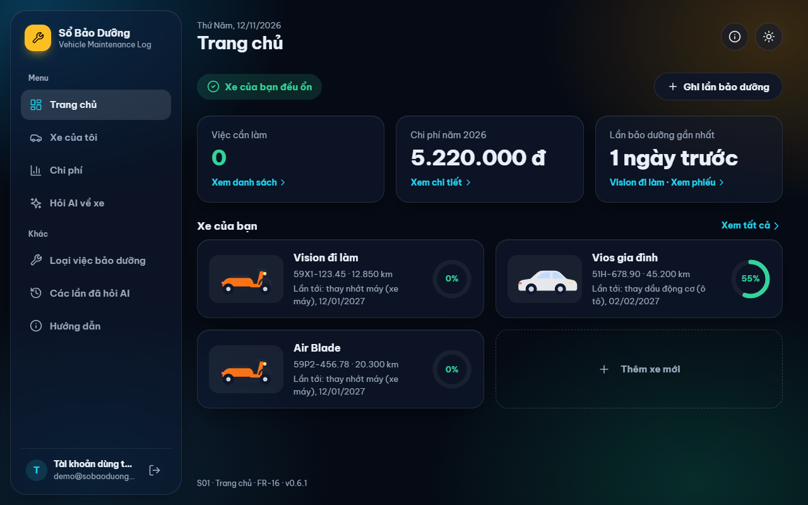
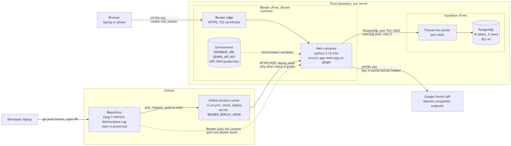

# Sổ Bảo Dưỡng (Vehicle Maintenance Log)

Ứng dụng web giúp chủ xe máy và ô tô lưu lịch sử bảo dưỡng, biết hạng mục nào sắp đến hạn (theo ngày hoặc số km), theo dõi chi phí, và hỏi AI khi xe có triệu chứng lạ.

[](https://github.com/Zang-1/Vehicle-Maintenance-Log/actions/workflows/ci-cd.yml)
&nbsp;**Trang live:** https://vehicle-maintenance-log.onrender.com



## Mục lục

- [Nhóm thực hiện](#nhóm-thực-hiện)
- [1. Giới thiệu](#1-giới-thiệu)
- [2. Tính năng](#2-tính-năng)
- [3. Dùng thử ngay](#3-dùng-thử-ngay)
- [4. Kiến trúc và công nghệ](#4-kiến-trúc-và-công-nghệ)
- [5. Chạy trên máy (local)](#5-chạy-trên-máy-local)
- [6. Chạy test](#6-chạy-test)
- [7. Trang và API](#7-trang-và-api)
- [8. Cơ sở dữ liệu](#8-cơ-sở-dữ-liệu)
- [9. CI/CD và triển khai](#9-cicd-và-triển-khai)
- [10. Bảo mật và secret](#10-bảo-mật-và-secret)
- [11. Tài liệu dự án](#11-tài-liệu-dự-án)
- [12. Quy trình đóng góp](#12-quy-trình-đóng-góp)

## Nhóm thực hiện

Đồ án cuối kỳ môn **72ITDS30103: Software Development Platforms**, Trường Đại học Văn Lang, học kỳ 1 năm học 2026-2027, lớp `261_72ITDS30103_01`, giảng viên Dr. Nguyen Tri Hai.

| Thành viên | MSSV | GitHub | Phụ trách |
|---|---|---|---|
| **Kiều Bảo Giang** (nhóm trưởng) | 2474802010095 | [@Zang-1](https://github.com/Zang-1) | Yêu cầu, thiết kế database, kế hoạch triển khai; khung FastAPI, connection pool, Supabase và Render; Hỏi AI; tài khoản; khung giao diện và Trang chủ |
| **Tăng Thoại Lâm** | 2474802010210 | [@noway165](https://github.com/noway165) | Use case, activity, kiến trúc; Xe; Lần bảo dưỡng; Nhắc lịch (API và tab trong trang xe); CI/CD và Deploy Hook |
| **Nguyễn Nam Khoa** | 2474802010194 | [@namkhoa306](https://github.com/namkhoa306) | Wireframe và thiết kế giao diện; Loại việc bảo dưỡng; Thống kê chi phí; màn hình tạo nhắc lịch; trang Thêm cho điện thoại; chọn xe khi hỏi AI; Dockerfile và Compose |

Phân công chi tiết (tài liệu, code, report, thuyết trình): [docs/PHAN-CONG.md](docs/PHAN-CONG.md).

## 1. Giới thiệu

Chủ xe thường quên lần thay nhớt gần nhất là khi nào, ở bao nhiêu km, và cả năm đã tốn bao nhiêu tiền cho xe. Sổ giấy hay ghi chú điện thoại thì dễ mất và không tự nhắc.

Sổ Bảo Dưỡng ghi lại từng lần bảo dưỡng (ngày, số km, gara, từng hạng mục và giá), tự tính lần tới cần làm gì và còn bao nhiêu ngày hoặc bao nhiêu km, và gom chi phí theo xe, theo loại việc, theo khoảng thời gian. Khi xe có hiện tượng lạ, người dùng mô tả bằng tiếng Việt và nhận gợi ý nguyên nhân kèm mức độ khẩn cấp từ AI.

Mỗi người dùng có tài khoản riêng và chỉ thấy dữ liệu của mình.

## 2. Tính năng

| Module | Tính năng | Trang |
|---|---|---|
| Tài khoản | Đăng ký, đăng nhập, đăng xuất. Nút "Dùng thử" vào tài khoản có sẵn dữ liệu mẫu. Mỗi người chỉ đọc và sửa được dữ liệu của mình | `/dang-nhap`, `/dang-ky` |
| M1 Trang chủ | Số việc cần làm, chi phí năm, lần bảo dưỡng gần nhất, từng xe kèm việc gấp nhất và phần trăm chu kỳ đã dùng | `/` |
| M2 Xe | Thêm, sửa, lưu trữ, xóa xe (xe đã có lịch sử thì chỉ lưu trữ được) | `/xe` |
| M3 Lần bảo dưỡng | Ghi một lần bảo dưỡng nhiều hạng mục, tự tính tổng tiền, tự nâng số km của xe. Xuất lịch sử ra CSV mở được bằng Excel | `/bao-duong/moi`, `/bao-duong/{id}` |
| M4 Loại việc bảo dưỡng | Danh mục mặc định dùng chung (chỉ đọc) và loại riêng của từng người, có số lần đã dùng | `/loai-dich-vu` |
| M5 Nhắc lịch | Chu kỳ theo km và/hoặc theo tháng cho từng xe; trạng thái Ổn / Sắp đến hạn / Quá hạn tính lại mỗi lần mở trang | tab Nhắc bảo dưỡng trong `/xe/{id}` |
| M6 Chi phí | Thống kê theo năm hoặc khoảng ngày, theo xe, theo loại việc | `/thong-ke` |
| M7 Hỏi AI về xe | Mô tả triệu chứng (có thể chọn xe để AI biết loại xe và số km), nhận tối đa ba câu gợi ý và mức khẩn cấp. Mọi lần hỏi đều được lưu, kể cả lần lỗi | `/chan-doan`, `/chan-doan/lich-su` |

Giao diện theo phong cách kính mờ, có chế độ sáng và tối, dùng được trên điện thoại (trang `/them` là menu cho màn hình nhỏ).

## 3. Dùng thử ngay

1. Mở https://vehicle-maintenance-log.onrender.com
2. Ở trang đăng nhập, bấm **Dùng thử** để vào tài khoản mẫu có 3 xe và lịch sử bảo dưỡng.

Ứng dụng chạy trên gói miễn phí của Render, tự ngủ sau 15 phút không có ai truy cập. Lần đầu mở sau khi ngủ có thể phải chờ khoảng một phút.

## 4. Kiến trúc và công nghệ



Trình duyệt chỉ nói chuyện với server của mình. Server (một container trên Render) đọc ghi database Supabase và gọi Gemini. Khóa API của Gemini và chuỗi kết nối database chỉ nằm trong biến môi trường của Render, trình duyệt không bao giờ thấy.

| Lớp | Công nghệ |
|---|---|
| Backend | Python 3.12, FastAPI, Uvicorn, Pydantic |
| Giao diện | Jinja2 (khung trang) + JavaScript thuần (`fetch`, dựng DOM bằng `textContent`) |
| Database | PostgreSQL 16 (local, Compose) / 17 (Supabase); psycopg 3 với connection pool |
| AI | Google Gemini `gemini-3.5-flash-lite` qua endpoint tương thích OpenAI, gọi bằng `httpx2` |
| Container | `Dockerfile` (`python:3.12-slim`), `compose.yml`; chạy bằng Podman hoặc Docker |
| Triển khai | Render Web Service (Free, Docker), Supabase (Free) |
| CI/CD | GitHub Actions: ruff, pytest, build image, gọi Render Deploy Hook |

Cấu trúc thư mục:

```
app/
  main.py            khởi tạo FastAPI, /health, /health/db, /api/info, xử lý lỗi chung
  db.py              connection pool duy nhất
  auth.py            băm mật khẩu (scrypt), phiên đăng nhập, CurrentUser
  ai.py              file duy nhất gọi Gemini: timeout, thử lại, báo lỗi
  schemas.py         model Pydantic cho mọi input và output
  routers/           mỗi module một file: vehicles, records, reminders, service_types, stats, diagnose, auth, pages
  templates/         khung HTML (Jinja2)
  static/            CSS và JavaScript của từng trang
db/
  schema.sql         tạo bảng, view, ràng buộc; chạy lại nhiều lần vẫn an toàn
  seed.sql           dữ liệu mẫu cho tài khoản Dùng thử
tests/               test chạy không cần database thật và không cần key AI
docs/                8 tài liệu thiết kế, report
Dockerfile, compose.yml, .env.example, chay-local.bat, dung-local.bat
```

## 5. Chạy trên máy (local)

Bộ local gồm hai container: `web` (ứng dụng) và `db` (PostgreSQL 16, đóng vai Supabase). Lần chạy đầu, database tự được tạo từ `db/schema.sql` và nạp dữ liệu mẫu từ `db/seed.sql`.

### 5.1 Cần cài

- **Git**
- **Podman 4+** có `podman compose` (Podman Desktop trên Windows), hoặc **Docker Desktop**. Hai file `Dockerfile` và `compose.yml` dùng định dạng chuẩn nên chạy được với cả hai.
- **Python 3.12**: chỉ cần khi muốn chạy test (mục 6).

### 5.2 Cách nhanh trên Windows

Bấm đúp **`chay-local.bat`**. Script sẽ:

1. bật Podman machine nếu đang tắt;
2. tạo file `.env` từ `.env.example` với mật khẩu database ngẫu nhiên, nếu chưa có;
3. build và chạy `web` + `db` ở chế độ nền;
4. chờ tới khi `/health` trả lời rồi mở http://localhost:3000.

Bấm đúp **`dung-local.bat`** để dừng. Dữ liệu vẫn được giữ cho lần sau.

### 5.3 Chạy bằng lệnh

Trên Windows dùng Git Bash; macOS và Linux dùng terminal bình thường.

```bash
git clone https://github.com/Zang-1/Vehicle-Maintenance-Log.git
cd Vehicle-Maintenance-Log
cp .env.example .env
```

Mở `.env`, điền `DB_PASSWORD` (chỉ chữ và số), các dòng khác để nguyên. Sau đó:

```bash
podman compose up --build      # hoặc: docker compose up --build
```

Chờ tới dòng `Uvicorn running on http://0.0.0.0:8000`, rồi mở:

- http://localhost:3000: giao diện (bấm **Dùng thử** để vào tài khoản mẫu)
- http://localhost:3000/health/db: phải trả về `{"db":"ok","vehicles":3}`
- http://localhost:3000/docs: tài liệu API

Ứng dụng chỉ mở trên `127.0.0.1`, máy khác trong mạng không truy cập được.

### 5.4 Biến môi trường

Tất cả nằm trong file `.env` (không bao giờ commit file này).

| Biến | Bắt buộc | Ý nghĩa |
|---|---|---|
| `DB_PASSWORD` | Có | Mật khẩu PostgreSQL local. Chỉ dùng chữ và số, vì nó được ghép vào chuỗi kết nối. Đặt một lần rồi giữ nguyên (xem 5.6) |
| `GEMINI_API_KEY` | Không | Key lấy từ Google AI Studio. Không có thì ứng dụng vẫn chạy bình thường, riêng Hỏi AI báo "tạm thời không khả dụng" |
| `APP_ENV` | Không | `development` (mặc định) hoặc `production`. Ở `production` cookie đăng nhập chỉ gửi qua HTTPS |
| `APP_NAME` | Không | Tên hiện ở `/api/info` |
| `DATABASE_URL` | Không (khi dùng Compose) | Compose tự ghép từ `DB_PASSWORD`. Chỉ điền khi chạy không qua Compose, ví dụ nối Supabase (5.7) |
| `AI_BASE_URL`, `AI_MODEL` | Không | Đổi nhà cung cấp hoặc model AI. Mặc định là Gemini, `gemini-3.5-flash-lite` |

### 5.5 Lệnh hay dùng

| Việc | Lệnh |
|---|---|
| Chạy nền | `podman compose up --build -d` |
| Xem trạng thái | `podman compose ps` |
| Xem log ứng dụng | `podman compose logs -f web` |
| Dừng, giữ dữ liệu | `podman compose down` |
| Xóa dữ liệu, tạo lại từ `schema.sql` + `seed.sql` | `podman compose down -v` rồi `podman compose up --build` |

Dùng Docker thì thay `podman` bằng `docker`.

### 5.6 Lỗi thường gặp

**`password authentication failed for user "app"`**
PostgreSQL lưu mật khẩu lúc tạo volume lần đầu. Nếu sau đó đổi `DB_PASSWORD` trong `.env` thì sẽ gặp lỗi này. Đặt lại mật khẩu cũ, hoặc chạy `podman compose down -v` để xóa dữ liệu và tạo lại.

**`failed to connect to the docker API at npipe:////./pipe/podman-machine-default`** (Windows)
Trên một số máy, `podman machine start` không tạo được cổng Docker API (lúc khởi động có in `win-sshproxy.exe failed to start`). Mở API của Podman qua TCP, chỉ trong máy mình, rồi trỏ compose vào đó:

```bash
podman machine ssh "nohup podman system service --time=0 tcp://127.0.0.1:23750 >/tmp/svc.log 2>&1 &"
export DOCKER_HOST=tcp://localhost:23750
podman compose up --build
```

`DOCKER_HOST` chỉ có hiệu lực trong cửa sổ terminal đó. `chay-local.bat` đã tự làm bước này.

**Cổng 3000 đã bị chiếm**
Có chương trình khác đang dùng cổng 3000. Tắt chương trình đó, hoặc sửa dòng `"127.0.0.1:3000:8000"` trong `compose.yml` thành cổng khác, ví dụ `"127.0.0.1:3001:8000"`.

**Hỏi AI luôn báo "tạm thời không khả dụng"**
Chưa có `GEMINI_API_KEY` trong `.env`, key sai, hoặc đã hết lượt miễn phí. Lý do cụ thể nằm trong log: `podman compose logs web`, tìm dòng `ai failed:`. Thêm hoặc sửa key xong thì chạy lại `podman compose up -d`.

**`/health/db` trả về `{"db":"error"}`**
Container `db` chưa sẵn sàng hoặc đã dừng. Kiểm tra bằng `podman compose ps`; `db` phải ở trạng thái `healthy`.

### 5.7 Chạy image nối thẳng Supabase (giống trên Render)

Dùng khi cần thử đúng cấu hình production. Tạo file `.env.cloud` chứa một dòng `DATABASE_URL=` là chuỗi kết nối transaction pooler (cổng 6543) của Supabase, rồi:

```bash
podman build -t vml:dev .
podman run --rm -p 3000:8000 --env-file .env.cloud vml:dev
```

`.env.cloud` đã nằm trong `.gitignore` và `.dockerignore`, không bao giờ vào repo hay image.

## 6. Chạy test

Test chạy giống hệt job `check` trên GitHub Actions và **không cần** database hay key AI: `tests/fakedb.py` thay connection pool, còn lời gọi Gemini được giả lập.

```bash
python -m venv .venv
source .venv/Scripts/activate        # macOS / Linux: source .venv/bin/activate
pip install -r requirements-dev.txt
ruff check .
pytest -q
```

Test phủ mọi route API, kiểm tra dữ liệu đầu vào, việc người này không đọc được dữ liệu của người khác, các quy tắc nghiệp vụ (ví dụ số km không bao giờ bị giảm), mọi kiểu lỗi của AI và trường hợp mất database.

## 7. Trang và API

Mọi trang và mọi `/api/*` (trừ đăng nhập, đăng ký) đều cần đăng nhập. Mở trang khi chưa đăng nhập sẽ chuyển tới `/dang-nhap` rồi quay lại trang cũ; gọi API khi chưa đăng nhập trả về 401 `NOT_SIGNED_IN`. Dữ liệu của người khác trả về 404, giống như không tồn tại.

**Trang giao diện**

| Đường dẫn | Màn hình |
|---|---|
| `/` | Trang chủ |
| `/xe`, `/xe/moi`, `/xe/{id}`, `/xe/{id}/sua` | Danh sách xe, thêm xe, chi tiết xe (tab Lịch sử và Nhắc bảo dưỡng), sửa xe |
| `/bao-duong/moi`, `/bao-duong/{id}`, `/bao-duong/{id}/sua` | Ghi lần bảo dưỡng, xem phiếu, sửa phiếu |
| `/xe/{id}/nhac-lich/moi`, `/nhac-lich/{id}/sua` | Tạo và sửa nhắc lịch |
| `/loai-dich-vu` | Loại việc bảo dưỡng |
| `/thong-ke` | Chi phí |
| `/chan-doan`, `/chan-doan/lich-su` | Hỏi AI về xe, các lần đã hỏi AI |
| `/them` | Menu cho điện thoại |
| `/dang-nhap`, `/dang-ky` | Đăng nhập, đăng ký |

**API chính** (đầy đủ tham số và ví dụ ở `/docs`)

| Nhóm | Endpoint |
|---|---|
| Tài khoản | `POST /api/auth/register`, `/login`, `/demo`, `/logout`; `GET /api/auth/me` |
| Xe | `GET`, `POST /api/vehicles`; `GET`, `PUT`, `DELETE /api/vehicles/{id}`; `PATCH /api/vehicles/{id}/archive` |
| Lần bảo dưỡng | `GET`, `POST /api/vehicles/{id}/records`; `GET`, `PUT`, `DELETE /api/records/{id}`; `GET /api/vehicles/{id}/records.csv` |
| Nhắc lịch | `GET`, `POST /api/vehicles/{id}/reminders`; `GET`, `PUT`, `DELETE /api/reminders/{id}`; `PATCH /api/reminders/{id}/active` |
| Loại việc | `GET`, `POST /api/service-types`; `GET`, `PUT`, `DELETE /api/service-types/{id}`; `PATCH /api/service-types/{id}/active` |
| Thống kê | `GET /api/stats/dashboard`; `GET /api/stats/costs?year=&vehicle_id=&from_date=&to_date=` |
| AI | `POST /diagnose` với `{"symptom_text": "...", "vehicle_id": 1}`; `GET /api/diagnoses` |
| Hệ thống | `GET /health` (không chạm database, dùng cho health check của Render); `GET /health/db`; `GET /api/info` (tên, phiên bản, môi trường) |

Khi AI lỗi (hết lượt, quá 15 giây, không có key), `POST /diagnose` trả về 503 `AI_UNAVAILABLE` với một câu thông báo dễ hiểu; lý do chi tiết chỉ ghi vào log. Khi database không kết nối được, mọi API trả về 503 `DB_UNAVAILABLE`.

## 8. Cơ sở dữ liệu

| Bảng / view | Nội dung |
|---|---|
| `users`, `sessions` | Tài khoản (mật khẩu chỉ lưu dạng băm scrypt) và phiên đăng nhập (chỉ lưu sha256 của token) |
| `vehicles` | Xe của từng người |
| `maintenance_records`, `maintenance_items` | Một lần bảo dưỡng và các hạng mục của nó; thành tiền là cột tự tính |
| `service_types` | Loại việc; `user_id` rỗng là loại mặc định dùng chung |
| `reminders` | Chu kỳ nhắc theo km và/hoặc tháng cho một xe và một loại việc |
| `diagnoses` | Mọi lần hỏi AI, kể cả lần lỗi kèm mã lỗi |
| `v_record_totals` | Tổng tiền từng lần bảo dưỡng |
| `v_reminder_status` | Lần tới đến hạn, còn bao nhiêu ngày và km, trạng thái Ổn / Sắp đến hạn / Quá hạn |

Trạng thái nhắc lịch được tính bằng view mỗi khi đọc, không dùng tác vụ chạy định kỳ, vì gói miễn phí của Render ngủ khi không có ai dùng.

- Sơ đồ ERD và từ điển dữ liệu: [docs/04-database/erd.md](docs/04-database/erd.md)
- Tạo và nâng cấp schema: [db/schema.sql](db/schema.sql). Dữ liệu mẫu: [db/seed.sql](db/seed.sql)

`schema.sql` chạy lại nhiều lần vẫn an toàn (`IF NOT EXISTS`). Khi đổi schema, chạy file này trong SQL Editor của Supabase **trước** khi merge code cần đến thay đổi đó, nếu không trang live sẽ lỗi 500.

## 9. CI/CD và triển khai

Workflow [`.github/workflows/ci-cd.yml`](.github/workflows/ci-cd.yml) có hai job:

| Job | Khi nào chạy | Làm gì |
|---|---|---|
| `check` | Mọi pull request và mọi lần push vào `main` | Cài thư viện, `compileall`, `ruff check .`, `pytest -q`, `docker build` |
| `deploy` | Chỉ khi push vào `main` và `check` đã xanh | Gọi Render Deploy Hook (lưu trong secret `RENDER_DEPLOY_HOOK`) |

Auto-Deploy của Render đã tắt, nên Deploy Hook là đường duy nhất để code lên production: commit làm `check` đỏ không bao giờ được deploy. Từ lúc merge tới lúc bản mới chạy trên trang live mất khoảng một phút.

Nhánh `main` được bảo vệ: chỉ nhận thay đổi qua pull request, cần một người khác duyệt, và job `check` phải xanh.

Kiểm tra bản đang chạy: mở `/api/info` để xem phiên bản, và đối chiếu mã commit trong trang Events của Render với commit mới nhất của `main`. Muốn đánh dấu một lần phát hành, tăng `APP_VERSION` trong `app/main.py` qua một pull request.

## 10. Bảo mật và secret

| Secret | Local | GitHub Actions | Render |
|---|---|---|---|
| Mật khẩu / chuỗi kết nối database | `.env` (`DB_PASSWORD`) | Không cần (test dùng giá trị giả) | Environment (`DATABASE_URL`) |
| `GEMINI_API_KEY` | `.env` (không bắt buộc) | Không cần (test giả lập AI) | Environment |
| `RENDER_DEPLOY_HOOK` | Không có | Repository secret | Không có |

Quy tắc của nhóm:

- Không commit `.env`, `.env.*` (trừ `.env.example`). Hai file này đã nằm trong `.gitignore` và `.dockerignore`.
- Không dán key, chuỗi kết nối hay URL Deploy Hook vào chat, issue, pull request hay ảnh chụp màn hình.
- Thêm biến môi trường mới thì thêm tên của nó vào `.env.example` trong cùng pull request.
- Nếu lộ secret: thu hồi và tạo mới ngay (Google AI Studio, Supabase, Render), cập nhật nơi lưu, rồi mới dọn dẹp. Xóa trong commit sau là không đủ vì secret vẫn còn trong lịch sử Git.

## 11. Tài liệu dự án

| # | Tài liệu | Người làm |
|---|---|---|
| 01 | [Requirements](docs/01-requirements/requirements.md) | Giang |
| 02 | [Use Case Diagram](docs/02-use-case/README.md) | Lâm |
| 03 | [Activity Diagram](docs/03-activity/README.md) | Lâm |
| 04 | [ERD và thiết kế database](docs/04-database/erd.md) | Giang |
| 05 | [Wireframe](docs/05-wireframe/README.md) | Khoa |
| 06 | [Thiết kế giao diện (Figma)](docs/06-ui-design/README.md) | Khoa |
| 07 | [Kiến trúc và Class Diagram](docs/07-architecture/README.md) | Lâm |
| 08 | [Kế hoạch triển khai](docs/08-implementation-plan/implementation-plan.md) | Giang |

Khác:

- [`ui-design.html`](ui-design.html): hệ thống thiết kế (màu, chữ, icon, component) và bản demo bấm được của giao diện mới; tải về rồi mở bằng trình duyệt.
- [`docs/report/`](docs/report/): report cuối kỳ.

## 12. Quy trình đóng góp

1. Cập nhật `main`: `git switch main && git pull`.
2. Tạo nhánh theo loại việc: `feature/...` (tính năng), `fix/...` (sửa lỗi), `docs/...` (tài liệu), `chore/...` (việc lặt vặt). Ví dụ: `git switch -c feature/xuat-pdf`.
3. Code, chạy `ruff check .` và `pytest -q` trên máy trước khi commit.
4. Commit với thông điệp nói rõ thay đổi, rồi `git push -u origin feature/xuat-pdf`.
5. Mở pull request vào `main`, nhờ một thành viên khác review.
6. Chờ job `check` xanh và được duyệt rồi merge. Merge xong, bản mới tự lên trang live sau khoảng một phút.

Đổi schema database thì chạy `db/schema.sql` trên Supabase trước khi merge (mục 8).
