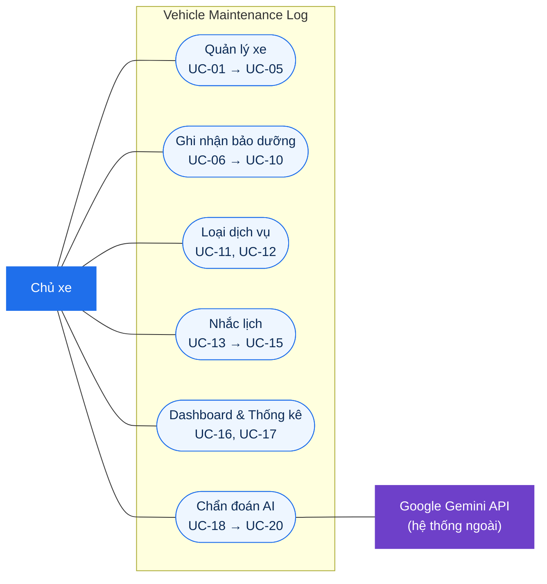
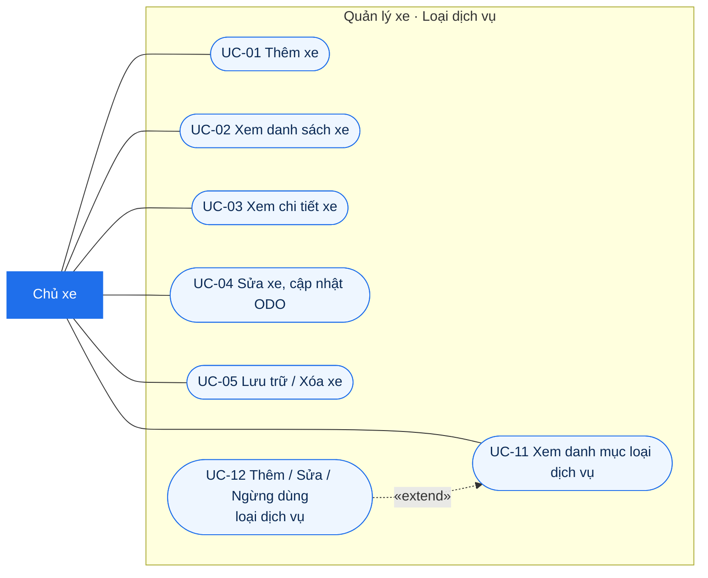
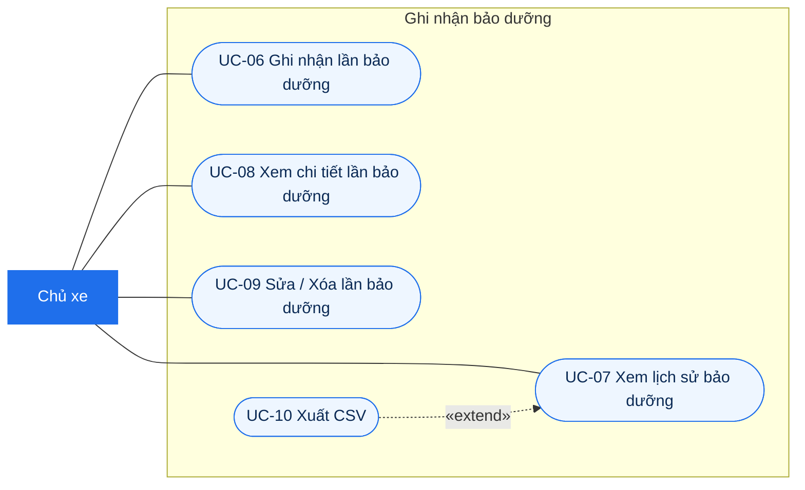
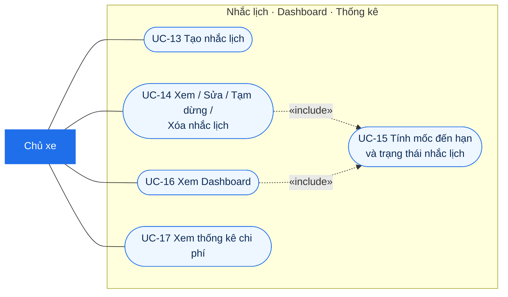
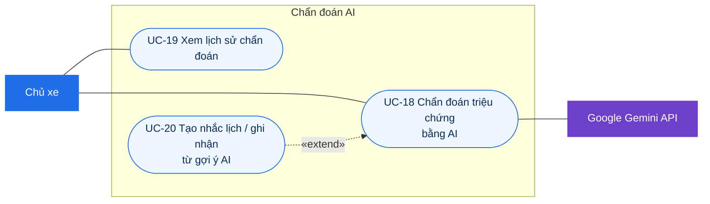

# 02 – Use Case Diagram

**Người phụ trách:** Tăng Thoại Lâm · **Phiên bản:** 2.0 · **Đầu vào:** [01 Requirements](../01-requirements/requirements.md) (v2.1)

Tài liệu gồm sơ đồ use case tổng quát, sơ đồ chi tiết theo từng nhóm chức năng và đặc tả các use case chính. Mỗi use case có mã `UC-xx` và ghi rõ `FR-xx`, `BR-xx` tương ứng trong tài liệu 01. Mã lỗi HTTP trong đặc tả khớp với danh sách API ở mục 4 tài liệu 08.

> Mermaid chưa có loại sơ đồ use case riêng nên sơ đồ được vẽ bằng `flowchart`. Quy ước ký hiệu:
> - Hình chữ nhật đậm màu = **tác nhân**; hình viên thuốc = **use case**; khung lớn = **ranh giới hệ thống**.
> - Đường liền = tác nhân tham gia use case. Tác nhân chính ở bên trái, hệ thống ngoài ở bên phải.
> - Mũi tên nét đứt `«include»` = use case gốc luôn dùng use case được trỏ tới.
> - Mũi tên nét đứt `«extend»` = use case mở rộng, chỉ xảy ra khi có điều kiện, trỏ về use case gốc.

## 1. Tác nhân

| Tác nhân | Loại | Tham gia |
|---|---|---|
| **Chủ xe** | Tác nhân chính (người) | Mọi use case. Bản demo **không có đăng nhập** (mục 1.4 tài liệu 01) nên không có tác nhân Khách hay Quản trị viên; ai mở URL cũng là Chủ xe và dùng chung một bộ dữ liệu |
| **Google Gemini API** | Tác nhân phụ (hệ thống ngoài) | Chỉ tham gia UC-18 Chẩn đoán triệu chứng bằng AI. Server gọi Gemini, trình duyệt không bao giờ gọi trực tiếp |

GitHub Actions, Render và Supabase là nền tảng triển khai, không phải tác nhân nghiệp vụ; chúng nằm ở sơ đồ triển khai trong [tài liệu 07](../07-architecture/README.md). Luồng CI/CD được vẽ bằng activity diagram ở [tài liệu 03](../03-activity/README.md#4-từ-commit-đến-production).

## 2. Danh sách use case

| Mã | Use case | FR | Ưu tiên | Màn hình |
|---|---|---|---|---|
| UC-01 | Thêm xe | FR-01 | Must | S03 |
| UC-02 | Xem danh sách xe | FR-02 | Must | S02 |
| UC-03 | Xem chi tiết xe | FR-03 | Must | S04 |
| UC-04 | Sửa xe, cập nhật ODO | FR-04 | Must | S03, S04 |
| UC-05 | Lưu trữ / Xóa xe | FR-05 | Should | S02 |
| UC-06 | Ghi nhận lần bảo dưỡng | FR-06 | Must | S05 |
| UC-07 | Xem lịch sử bảo dưỡng | FR-07 | Must | S04 (tab Lịch sử) |
| UC-08 | Xem chi tiết lần bảo dưỡng | FR-08 | Must | S06 |
| UC-09 | Sửa / Xóa lần bảo dưỡng | FR-09 | Must | S05, S06 |
| UC-10 | Xuất lịch sử ra CSV | FR-10 | Could | S04 |
| UC-11 | Xem danh mục loại dịch vụ | FR-11 | Must | S09 |
| UC-12 | Thêm / Sửa / Ngừng dùng loại dịch vụ | FR-12 | Should | S09 |
| UC-13 | Tạo nhắc lịch | FR-13 | Must | S07 |
| UC-14 | Xem / Sửa / Tạm dừng / Xóa nhắc lịch | FR-14 | Must | S04 (tab Nhắc lịch), S07 |
| UC-15 | Tính mốc đến hạn và trạng thái nhắc lịch | FR-15 | Must | – |
| UC-16 | Xem Dashboard | FR-16 | Must | S01 |
| UC-17 | Xem thống kê chi phí | FR-17 | Should | S08 |
| UC-18 | Chẩn đoán triệu chứng bằng AI | FR-18, FR-19, FR-20 | Must | S10 |
| UC-19 | Xem lịch sử chẩn đoán | FR-21 | Should | S11 |
| UC-20 | Tạo nhắc lịch / ghi nhận từ gợi ý AI | FR-22 | Could | S10 |

Đủ 22/22 chức năng FR-01 → FR-22. UC-18 gộp FR-18 → FR-20 vì gửi triệu chứng, nhận kết quả và xử lý lỗi là một lần tương tác duy nhất của người dùng; ba FR này lần lượt là luồng vào, luồng chính và các luồng ngoại lệ của UC-18.

## 3. Sơ đồ use case tổng quát

Sơ đồ mức gói: mỗi gói là một nhóm use case, chi tiết ở mục 4.

## 4. Sơ đồ chi tiết

### 4.1. Quản lý xe và Loại dịch vụ

### 4.2. Ghi nhận bảo dưỡng

### 4.3. Nhắc lịch, Dashboard và Thống kê

UC-15 không do người dùng bấm. Nó chạy mỗi khi có màn hình đọc nhắc lịch: view `v_reminder_status` tự tìm lần bảo dưỡng gần nhất cùng loại dịch vụ và tính mốc, nên ghi nhận/sửa/xóa lần bảo dưỡng (UC-06, UC-09) không phải cập nhật nhắc lịch.

### 4.4. Chẩn đoán AI

## 5. Đặc tả use case chính

**Quy ước chung cho mọi use case**
- Tác nhân chính là **Chủ xe**, trừ khi ghi khác.
- Tiền điều kiện chung: ứng dụng đang chạy và mở được trang. Không có bước đăng nhập.
- Dữ liệu gửi lên server được kiểm tra bằng Pydantic; sai kiểu, thiếu trường hoặc ngoài giới hạn thì server trả **422** và giao diện báo lỗi ngay dưới ô nhập sai.
- Bản ghi không tồn tại (xe, lần bảo dưỡng, nhắc lịch, loại dịch vụ) trả **404**.
- **Ngoại lệ chung E-DB:** mất kết nối database hoặc Supabase đang pause thì server trả lỗi, trang hiện thông báo "Không kết nối được cơ sở dữ liệu, vui lòng thử lại" qua `showError`, app không crash và tự chạy lại khi database có lại (NFR-05). Ngoại lệ này áp dụng cho mọi use case dưới đây nên không lặp lại.

### UC-01. Thêm xe

| Mục | Nội dung |
|---|---|
| Mô tả | Thêm một xe mới để bắt đầu theo dõi bảo dưỡng |
| FR / BR | FR-01 · BR-01 · TC-01 |
| API | `POST /api/vehicles` |
| Tiền điều kiện | – |
| Hậu điều kiện | Tạo một dòng `vehicles` với `is_archived = false`; xe xuất hiện ở danh sách xe |

**Luồng chính**
1. Chủ xe bấm "Thêm xe" ở màn hình danh sách xe (S02).
2. Hệ thống hiển thị form S03: tên gợi nhớ, loại xe, hãng, dòng xe, năm sản xuất, biển số, ODO hiện tại, ngày mua.
3. Chủ xe nhập thông tin (bắt buộc: tên, loại xe) và bấm "Lưu".
4. Hệ thống kiểm tra: tên 1–100 ký tự, loại xe ∈ {Xe máy, Ô tô, Khác}, năm sản xuất 1950–2100, ODO ≥ 0 (mặc định 0).
5. Hệ thống kiểm tra biển số chưa có ở xe nào khác (BR-01).
6. Hệ thống lưu xe và chuyển tới màn hình chi tiết xe (S04), gợi ý "Tạo nhắc lịch cho xe này".

**Luồng thay thế / ngoại lệ**
- 3a. Chủ xe để trống biển số (xe mới chưa có biển): hợp lệ, bỏ qua bước 5.
- 4a. Dữ liệu sai: 422, báo lỗi dưới ô nhập, giữ nguyên dữ liệu đã nhập, quay lại bước 3.
- 5a. Biển số đã tồn tại: **409**, báo "Biển số này đã có trong danh sách xe", quay lại bước 3 (TC-01).
- 3b. Chủ xe bấm "Hủy": không lưu, quay về S02.

### UC-04. Sửa xe, cập nhật ODO

| Mục | Nội dung |
|---|---|
| Mô tả | Sửa thông tin xe, trong đó có nhập số ODO mới để trạng thái nhắc lịch theo km được tính đúng |
| FR / BR | FR-04 · BR-01, BR-02 · TC-02 |
| API | `PUT /api/vehicles/{id}` |
| Tiền điều kiện | Xe tồn tại |
| Hậu điều kiện | Thông tin xe được cập nhật. Trạng thái nhắc lịch theo km được tính lại ở lần đọc tiếp theo (UC-15) |

**Luồng chính**
1. Ở màn hình chi tiết xe (S04), chủ xe bấm "Sửa" (hoặc "Cập nhật ODO").
2. Hệ thống hiển thị form S03 với dữ liệu hiện tại.
3. Chủ xe sửa thông tin, ví dụ nhập ODO mới, rồi bấm "Lưu".
4. Hệ thống kiểm tra dữ liệu như bước 4–5 của UC-01, bỏ qua chính xe đang sửa khi so biển số.
5. Hệ thống kiểm tra ODO mới ≥ ODO hiện tại (BR-02).
6. Hệ thống lưu và quay về S04; khối nhắc lịch hiển thị trạng thái mới (có thể chuyển sang "Sắp đến hạn" hoặc "Quá hạn").

**Luồng thay thế / ngoại lệ**
- 1a. Xe không tồn tại (đã bị xóa ở tab khác): 404, báo "Không tìm thấy xe", quay về S02.
- 4a. Dữ liệu sai hoặc trùng biển số: như 4a, 5a của UC-01.
- 5a. ODO mới nhỏ hơn ODO hiện tại: 422, báo "Số km không được nhỏ hơn số hiện tại (12.850 km)", ODO giữ nguyên (TC-02).

### UC-05. Lưu trữ / Xóa xe

| Mục | Nội dung |
|---|---|
| Mô tả | Ẩn xe đã bán nhưng giữ lịch sử, hoặc xóa hẳn xe nhập nhầm |
| FR / BR | FR-05 · BR-09 · NFR-09 · TC-03 |
| API | `PATCH /api/vehicles/{id}/archive` · `DELETE /api/vehicles/{id}` |
| Tiền điều kiện | Xe tồn tại |
| Hậu điều kiện | Lưu trữ: `is_archived = true`, xe không còn ở danh sách xe. Xóa: xe và các nhắc lịch của xe bị xóa (CASCADE), lịch sử chẩn đoán của xe giữ lại với `vehicle_id = NULL` |

**Luồng chính (Lưu trữ)**
1. Chủ xe chọn "Lưu trữ" trên thẻ xe ở S02.
2. Hệ thống hỏi xác nhận (NFR-09).
3. Chủ xe xác nhận.
4. Hệ thống đặt xe về trạng thái lưu trữ và bỏ xe khỏi danh sách.

**Luồng thay thế / ngoại lệ**
- 1a. Chủ xe chọn "Xóa": hệ thống hỏi xác nhận, rồi gửi yêu cầu xóa.
  - Xe chưa có lần bảo dưỡng nào: xóa hẳn, bỏ xe khỏi danh sách.
  - Xe đã có lịch sử: **409**, báo "Xe đã có lịch sử bảo dưỡng nên chỉ lưu trữ được" kèm nút "Lưu trữ" (BR-09, TC-03).
- 3a. Chủ xe bấm "Hủy" ở hộp thoại: không thay đổi gì.

### UC-06. Ghi nhận lần bảo dưỡng

| Mục | Nội dung |
|---|---|
| Mô tả | Ghi lại một lần mang xe đi bảo dưỡng/sửa chữa gồm một hoặc nhiều hạng mục và chi phí |
| FR / BR | FR-06, FR-15 · BR-02, BR-03, BR-04, BR-05, BR-07 · TC-04 → TC-08 |
| API | `POST /api/vehicles/{id}/records` |
| Tiền điều kiện | Có ít nhất một xe chưa lưu trữ; có ít nhất một loại dịch vụ đang dùng |
| Hậu điều kiện | Trong **một transaction**: tạo một dòng `maintenance_records`, các dòng `maintenance_items`, và nâng `vehicles.current_odometer` nếu ODO lúc làm lớn hơn. Nhắc lịch cùng loại dịch vụ tự có mốc mới ở lần đọc tiếp theo (UC-15) |

**Luồng chính**
1. Chủ xe bấm "Ghi nhận bảo dưỡng" (từ Dashboard hoặc tab Lịch sử của S04).
2. Hệ thống hiển thị form S05: xe (chọn sẵn nếu đi từ S04), ngày (mặc định hôm nay), ODO lúc làm (mặc định ODO hiện tại của xe), nơi làm, ghi chú, và một dòng hạng mục trống.
3. Chủ xe nhập thông tin chung.
4. Chủ xe thêm hạng mục: chọn loại dịch vụ (chỉ loại đang dùng, hợp với loại xe), mô tả, số lượng, đơn giá. Giao diện hiển thị thành tiền từng dòng và tổng tiền ngay khi nhập (BR-05).
5. Chủ xe bấm "Lưu".
6. Hệ thống kiểm tra: có ít nhất một hạng mục (BR-04), số lượng > 0, đơn giá ≥ 0, ODO ≥ 0.
7. Hệ thống kiểm tra ngày bảo dưỡng không ở tương lai (BR-03).
8. Hệ thống mở transaction, lưu lần bảo dưỡng, lưu các hạng mục (database tự tính `line_total`), nâng ODO xe nếu ODO lúc làm lớn hơn (BR-02), rồi commit.
9. Hệ thống chuyển tới chi tiết lần bảo dưỡng (S06) với tổng chi phí do server tính.

**Luồng thay thế / ngoại lệ**
- 4a. Chủ xe xóa một dòng hạng mục: tổng tiền được tính lại.
- 6a. Không có hạng mục: 422, báo "Cần ít nhất một hạng mục" (TC-04).
- 6b. Số lượng/đơn giá sai: 422, báo lỗi tại dòng hạng mục.
- 7a. Ngày ở tương lai: 422, báo lỗi tại ô ngày (TC-05).
- 8a. Đã có lần bảo dưỡng cùng xe + ngày + ODO (BR-04): rollback, **409**, báo "Lần bảo dưỡng này đã được ghi trước đó".
- 8b. ODO lúc làm nhỏ hơn ODO hiện tại (ghi bù lần bảo dưỡng cũ): hợp lệ, lưu bình thường, ODO xe giữ nguyên.
- 8c. Lỗi bất kỳ trong transaction: rollback toàn bộ, không có lần bảo dưỡng thiếu hạng mục; form giữ nguyên dữ liệu để chủ xe thử lại.

Ví dụ (TC-06, TC-07, TC-08): xe ODO 12.850, ghi nhận ngày 22/10/2026 ở 13.000 km với hạng mục thay nhớt 4 × 210.000 và 1 × 150.000 → tổng 990.000, ODO xe thành 13.000, nhắc lịch thay nhớt 1.500 km / 2 tháng có mốc mới 22/12/2026 hoặc 14.500 km.

### UC-09. Sửa / Xóa lần bảo dưỡng

| Mục | Nội dung |
|---|---|
| Mô tả | Sửa thông tin và hạng mục của lần bảo dưỡng đã ghi, hoặc xóa lần bảo dưỡng |
| FR / BR | FR-09 · BR-02 → BR-05 · NFR-09 |
| API | `PUT /api/records/{id}` · `DELETE /api/records/{id}` |
| Tiền điều kiện | Lần bảo dưỡng tồn tại |
| Hậu điều kiện | Dữ liệu được cập nhật hoặc xóa trong một transaction. Mốc nhắc lịch tự đúng theo lần làm gần nhất còn lại (UC-15) |

**Luồng chính (Sửa)**
1. Ở S06, chủ xe bấm "Sửa".
2. Hệ thống hiển thị form S05 với dữ liệu hiện tại.
3. Chủ xe sửa thông tin chung, thêm/sửa/xóa hạng mục, bấm "Lưu".
4. Hệ thống kiểm tra như bước 6–7 của UC-06.
5. Trong một transaction, hệ thống cập nhật lần bảo dưỡng, thay toàn bộ hạng mục bằng danh sách mới, nâng ODO xe nếu ODO mới lớn hơn (BR-02), rồi commit.
6. Hệ thống quay về S06 với dữ liệu mới.

**Luồng thay thế / ngoại lệ**
- 1a. Chủ xe bấm "Xóa": hệ thống hỏi xác nhận (NFR-09). Xác nhận thì xóa lần bảo dưỡng và các hạng mục (CASCADE), quay về tab Lịch sử của S04.
- 4a. Dữ liệu sai: như 6a, 6b, 7a của UC-06.
- 5a. Sửa thành trùng xe + ngày + ODO với lần khác: rollback, 409.
- Ghi chú: sửa hoặc xóa lần bảo dưỡng **không làm giảm** ODO của xe (BR-02).

### UC-12. Thêm / Sửa / Ngừng dùng loại dịch vụ

| Mục | Nội dung |
|---|---|
| Mô tả | Bổ sung loại dịch vụ chưa có trong dữ liệu mẫu, sửa chu kỳ mặc định, hoặc ẩn loại không dùng nữa |
| FR / BR | FR-12 · BR-09 |
| API | `POST /api/service-types` · `PUT /api/service-types/{id}` |
| Điểm mở rộng | Màn hình danh mục của UC-11 (S09) |
| Hậu điều kiện | Danh mục `service_types` được cập nhật; loại ngừng dùng không còn hiện trong danh sách chọn ở UC-06, UC-13 |

**Luồng chính (Thêm)**
1. Ở S09, chủ xe bấm "Thêm loại dịch vụ".
2. Chủ xe nhập tên, mô tả, áp dụng cho loại xe, chu kỳ mặc định km và/hoặc tháng, bấm "Lưu".
3. Hệ thống kiểm tra tên 1–100 ký tự và chưa tồn tại, chu kỳ (nếu có) > 0.
4. Hệ thống lưu và cập nhật danh mục.

**Luồng thay thế / ngoại lệ**
- 1a. Sửa: chọn một loại, sửa thông tin, lưu. Đổi chu kỳ mặc định chỉ ảnh hưởng nhắc lịch tạo sau đó, không đổi nhắc lịch đã có.
- 1b. Ngừng dùng / Dùng lại: đổi `is_active`. Ứng dụng **không có chức năng xóa** loại dịch vụ, vì loại đã dùng không được xóa (BR-09).
- 3a. Tên trùng: 409, báo lỗi tại ô tên.

### UC-13. Tạo nhắc lịch

| Mục | Nội dung |
|---|---|
| Mô tả | Đặt quy tắc "cứ X km hoặc Y tháng làm lại" cho một loại dịch vụ của một xe |
| FR / BR | FR-13 · BR-06, BR-07 · TC-10 |
| API | `POST /api/reminders` |
| Tiền điều kiện | Xe tồn tại, chưa lưu trữ |
| Hậu điều kiện | Tạo một dòng `reminders`. Mốc gốc lưu ở `start_date`, `start_odometer`; mốc đến hạn **không lưu** mà được tính khi đọc (UC-15) |

**Luồng chính**
1. Ở tab Nhắc lịch của S04, chủ xe bấm "Tạo nhắc lịch".
2. Hệ thống hiển thị form S07 với danh sách loại dịch vụ đang dùng, hợp với loại xe.
3. Chủ xe chọn loại dịch vụ.
4. Hệ thống điền sẵn chu kỳ km/tháng từ chu kỳ mặc định của loại dịch vụ, ngày bắt đầu = hôm nay, ODO bắt đầu = ODO hiện tại của xe, ngưỡng báo trước 7 ngày / 300 km.
5. Chủ xe chỉnh lại nếu cần và bấm "Lưu".
6. Hệ thống kiểm tra có ít nhất một chu kỳ, chu kỳ > 0, ngưỡng ≥ 0 (BR-06).
7. Hệ thống kiểm tra xe chưa có nhắc lịch cho loại dịch vụ này (BR-06).
8. Hệ thống lưu nhắc lịch và hiển thị danh sách nhắc lịch kèm trạng thái (UC-15).

**Luồng thay thế / ngoại lệ**
- 6a. Không nhập chu kỳ nào: 422, báo "Cần nhập chu kỳ theo km hoặc theo tháng".
- 7a. Đã có nhắc lịch cùng loại dịch vụ: **409**, báo trùng và gợi ý sửa nhắc lịch hiện có (TC-10).
- 8a. Xe đã từng làm loại dịch vụ này sau ngày bắt đầu: mốc gốc tự lấy theo lần làm đó (BR-07), không cần chủ xe nhập.

### UC-14. Xem / Sửa / Tạm dừng / Xóa nhắc lịch

| Mục | Nội dung |
|---|---|
| Mô tả | Xem các nhắc lịch kèm trạng thái và số ngày, số km còn lại; chỉnh hoặc tạm dừng nhắc lịch |
| FR / BR | FR-14 · BR-06, BR-08 · TC-09 |
| API | `GET /api/reminders?vehicle_id=&status=` · `PUT /api/reminders/{id}` · `DELETE /api/reminders/{id}` |
| Tiền điều kiện | – |
| Hậu điều kiện | Xem: không đổi dữ liệu. Sửa/Tạm dừng/Xóa: dòng `reminders` được cập nhật hoặc xóa |

**Luồng chính**
1. Chủ xe mở tab Nhắc lịch của S04 (hoặc bấm vào khối nhắc lịch trên Dashboard).
2. Hệ thống thực hiện **UC-15** để lấy mốc đến hạn và trạng thái của từng nhắc lịch.
3. Hệ thống hiển thị danh sách: loại dịch vụ, mốc ngày/km, còn bao nhiêu ngày/km, nhãn trạng thái màu (Quá hạn đỏ, Sắp đến hạn vàng, Còn hạn xanh), nhắc lịch tạm dừng hiển thị mờ.
4. Chủ xe lọc theo trạng thái nếu muốn.

**Luồng thay thế / ngoại lệ**
- 3a. Sửa: chủ xe chỉnh chu kỳ, ngưỡng báo trước, mốc bắt đầu rồi lưu; hệ thống kiểm tra như bước 6 của UC-13.
- 3b. Tạm dừng / Bật lại: đổi `is_active`. Nhắc lịch tạm dừng không được đếm ở Dashboard và danh sách xe.
- 3c. Xóa: hỏi xác nhận rồi xóa.
- 3d. Xe chưa có nhắc lịch nào: hiển thị "Chưa có nhắc lịch" và nút "Tạo nhắc lịch" (UC-13).

### UC-15. Tính mốc đến hạn và trạng thái nhắc lịch

| Mục | Nội dung |
|---|---|
| Tác nhân | Không có tác nhân trực tiếp; được include từ UC-14, UC-16 (và dùng khi đếm "nhắc lịch cần chú ý" ở UC-02) |
| Mô tả | Tính mốc đến hạn tiếp theo và trạng thái của nhắc lịch tại thời điểm đọc |
| FR / BR | FR-15 · BR-06, BR-07, BR-08 · TC-08, TC-09 |
| Cài đặt | View `v_reminder_status` (tài liệu 04, mục 5); không có tác vụ chạy ngầm |
| Hậu điều kiện | Không ghi gì vào database |

**Luồng chính**
1. Tìm lần bảo dưỡng **gần nhất** của xe có hạng mục thuộc loại dịch vụ của nhắc lịch (ngày lớn nhất, cùng ngày thì ODO lớn nhất).
2. Mốc gốc = ngày và ODO của lần đó nếu lần đó không trước `start_date`; ngược lại mốc gốc = `start_date`, `start_odometer` (BR-07).
3. Mốc đến hạn: ngày = mốc gốc + `interval_months` tháng; km = ODO gốc + `interval_km`.
4. Còn lại: số ngày = mốc ngày − hôm nay; số km = mốc km − ODO hiện tại của xe.
5. Trạng thái (BR-08): **Quá hạn** nếu đã tới mốc ngày hoặc mốc km; **Sắp đến hạn** nếu còn ≤ `notify_before_days` ngày hoặc ≤ `notify_before_km` km; còn lại **Còn hạn**. Có cả hai chu kỳ thì cái nào đến trước quyết định (BR-06).

**Luồng thay thế**
- 1a. Chưa có lần làm nào cùng loại: dùng `start_date`, `start_odometer` làm mốc gốc.
- 3a. Nhắc lịch chỉ có chu kỳ km (hoặc chỉ tháng): phần còn lại để trống và trạng thái chỉ xét theo chu kỳ có.

Ví dụ (TC-09): còn 200 km và 30 ngày, ngưỡng 300 km / 7 ngày → **Sắp đến hạn** vì điều kiện km đến trước.

### UC-16. Xem Dashboard

| Mục | Nội dung |
|---|---|
| Mô tả | Trang chủ cho biết ngay cần làm gì và đã tốn bao nhiêu |
| FR / BR | FR-16 · G-02 |
| API | `GET /api/stats/dashboard` |
| Hậu điều kiện | Không đổi dữ liệu |

**Luồng chính**
1. Chủ xe mở URL ứng dụng (S01).
2. Hệ thống đếm số xe đang dùng.
3. Hệ thống lấy các nhắc lịch đang bật có trạng thái Quá hạn hoặc Sắp đến hạn (UC-15), Quá hạn xếp trước.
4. Hệ thống tính chi phí tháng này và lấy 5 lần bảo dưỡng gần nhất.
5. Hệ thống hiển thị 4 khối trên và nút nhanh "Ghi nhận bảo dưỡng", "Chẩn đoán AI".

**Luồng thay thế / ngoại lệ**
- 2a. Chưa có xe nào: hiển thị lời chào và nút "Thêm xe đầu tiên".
- 3a. Không có nhắc lịch cần chú ý: hiển thị "Mọi hạng mục đều còn hạn".
- Lần mở đầu sau khi Render ngủ có thể chậm khoảng 1 phút (NFR-07); đây là hành vi của nền tảng, không phải lỗi.

### UC-17. Xem thống kê chi phí

| Mục | Nội dung |
|---|---|
| Mô tả | Xem chi phí theo tháng, theo xe hoặc theo loại dịch vụ trong khoảng thời gian chọn |
| FR / BR | FR-17 · BR-05 · G-03 · TC-11 |
| API | `GET /api/stats/costs?group_by=month\|vehicle\|service_type&from=&to=` |
| Hậu điều kiện | Không đổi dữ liệu |

**Luồng chính**
1. Chủ xe mở S08.
2. Hệ thống mặc định khoảng thời gian là năm hiện tại, nhóm theo tháng.
3. Hệ thống tổng hợp chi phí theo nhóm và hiển thị biểu đồ, bảng số liệu, tổng chi phí cả khoảng.
4. Chủ xe đổi khoảng ngày hoặc kiểu nhóm; hệ thống tính lại (quay lại bước 3).

**Luồng thay thế / ngoại lệ**
- 3a. Không có dữ liệu trong khoảng: hiển thị "Chưa có chi phí trong khoảng thời gian này".
- 4a. Ngày bắt đầu sau ngày kết thúc: 422, báo lỗi, không tính.
- Ghi chú: nhóm theo loại dịch vụ cộng theo **từng hạng mục** (`line_total`), không theo tổng lần bảo dưỡng, vì một lần có thể gồm nhiều loại dịch vụ.

Ví dụ (TC-11): dữ liệu `seed.sql`, năm 2026, theo tháng → 02: 1.960.000 · 03: 255.000 · 06: 135.000 · 07: 225.000 · 08: 1.305.000.

### UC-18. Chẩn đoán triệu chứng bằng AI

| Mục | Nội dung |
|---|---|
| Tác nhân | Chủ xe (chính) · Google Gemini API (phụ) |
| Mô tả | Chủ xe mô tả triệu chứng bằng lời và nhận gợi ý nguyên nhân, mức khẩn cấp, hạng mục nên kiểm tra |
| FR / BR | FR-18, FR-19, FR-20 · BR-10 · NFR-06 · TC-12 → TC-16 |
| API | `POST /diagnose` |
| Tiền điều kiện | – (không bắt buộc có xe) |
| Hậu điều kiện | Mọi lần đã gọi tới bước kiểm tra key đều tạo đúng **một** dòng `diagnoses`: `status = OK` kèm gợi ý, hoặc `status = FAILED` kèm `error_code`. Ô triệu chứng luôn giữ nguyên nội dung |

**Luồng chính**
1. Chủ xe mở S10.
2. Chủ xe nhập triệu chứng, ví dụ "Phanh trước kêu rít khi bóp mạnh", và có thể chọn một xe.
3. Chủ xe bấm "Chẩn đoán". Nút bị khóa và hiện trạng thái "Đang chẩn đoán…" để tránh bấm liên tục.
4. Hệ thống kiểm tra triệu chứng dài 10–1.000 ký tự và xe (nếu chọn) tồn tại.
5. Hệ thống kiểm tra đã cấu hình `GEMINI_API_KEY`.
6. Hệ thống tạo prompt gồm triệu chứng, loại xe, hãng, dòng xe, ODO (nếu chọn xe) và danh sách tên loại dịch vụ đang dùng; yêu cầu trả về JSON `{suggestion, urgency_level, service_type}`.
7. Hệ thống gửi prompt tới **Google Gemini API** với thời gian chờ tối đa 20 giây.
8. Gemini trả về kết quả.
9. Hệ thống kiểm tra kết quả đúng định dạng JSON và `urgency_level` ∈ {LOW, MEDIUM, HIGH}; đối chiếu `service_type` với danh mục để lấy `suggested_service_type_id` (không khớp thì để trống).
10. Hệ thống lưu một dòng `diagnoses` với `status = OK`.
11. Hệ thống trả **200**; trang hiển thị gợi ý nguyên nhân, nhãn mức khẩn cấp có màu, hạng mục nên kiểm tra và câu lưu ý "Kết quả chỉ mang tính tham khảo, hãy mang xe tới thợ để kiểm tra". Nút "Chẩn đoán" mở lại.

**Luồng thay thế / ngoại lệ** (khớp bảng BR-10 tài liệu 01)

| Mã | Tại bước | Tình huống | Server trả | Người dùng thấy | Lưu `diagnoses` |
|---|---|---|---|---|---|
| E1 | 4 | Triệu chứng < 10 hoặc > 1.000 ký tự | 422 | Lỗi ngay dưới ô nhập; **không gọi AI** | Không lưu |
| E2 | 4 | Xe đã chọn không tồn tại | 404 | "Không tìm thấy xe", chọn lại xe | Không lưu |
| E3 | 5 | Chưa cấu hình `GEMINI_API_KEY` | 503 | "Tính năng chẩn đoán AI tạm thời không khả dụng." | FAILED · `NO_KEY` |
| E4 | 8 | Gemini trả 429 (hết lượt free tier) | 429 | "Đã hết lượt chẩn đoán miễn phí, vui lòng thử lại sau ít phút." Server **không tự gọi lại** | FAILED · `RATE_LIMITED` |
| E5 | 7 | Quá 20 giây chưa có phản hồi | 504 | "AI phản hồi quá lâu, vui lòng thử lại." | FAILED · `TIMEOUT` |
| E6 | 8, 9 | Gemini lỗi 5xx, lỗi mạng, hoặc trả về sai định dạng JSON | 502 | "Không nhận được kết quả từ AI, vui lòng thử lại." | FAILED · `UPSTREAM_ERROR` |

Với mọi ngoại lệ E1 → E6:
- Thông báo hiện ngay trên S10 qua vùng thông báo lỗi chung; ô triệu chứng và xe đã chọn **giữ nguyên**; nút "Chẩn đoán" mở lại; các trang khác của ứng dụng vẫn dùng bình thường (G-04).
- Trình duyệt chỉ nhận mã lỗi và câu thông báo. Chi tiết kỹ thuật (mã HTTP gốc của Gemini, nội dung lỗi) chỉ ghi vào log server, **không bao giờ ghi key** (BR-10, NFR-01).
- 11a. Chủ xe bấm "Tạo nhắc lịch" hoặc "Ghi nhận bảo dưỡng" dưới kết quả: chuyển sang UC-20 (extend).

### UC-19. Xem lịch sử chẩn đoán

| Mục | Nội dung |
|---|---|
| Mô tả | Xem lại các lần đã hỏi AI, gồm cả lần lỗi |
| FR / BR | FR-21 |
| API | `GET /api/diagnoses` |
| Hậu điều kiện | Không đổi dữ liệu |

**Luồng chính**
1. Chủ xe mở S11.
2. Hệ thống lấy 20 lần chẩn đoán gần nhất, mới nhất trước.
3. Hệ thống hiển thị thời gian, xe (nếu có), triệu chứng, và kết quả: gợi ý + mức khẩn cấp với lần thành công; nhãn lỗi dễ hiểu (ví dụ "Hết lượt miễn phí") với lần `FAILED`.

**Luồng thay thế**
- 2a. Chưa có lần chẩn đoán nào: hiển thị "Chưa có lần chẩn đoán nào" và nút sang S10.
- 3a. Xe của một lần chẩn đoán đã bị xóa: cột xe để trống, vẫn giữ lần chẩn đoán.

### UC-20. Tạo nhắc lịch / ghi nhận từ gợi ý AI

| Mục | Nội dung |
|---|---|
| Mô tả | Từ kết quả chẩn đoán, đi nhanh sang tạo nhắc lịch hoặc ghi nhận bảo dưỡng cho hạng mục được gợi ý |
| FR / BR | FR-22 |
| Điểm mở rộng | Bước 11 của UC-18, chỉ khi kết quả có `suggested_service_type_id` |
| Hậu điều kiện | Như UC-13 hoặc UC-06 |

**Luồng chính**
1. Dưới kết quả chẩn đoán, chủ xe bấm "Tạo nhắc lịch" (hoặc "Ghi nhận bảo dưỡng").
2. Hệ thống mở form S07 (hoặc S05) với xe và loại dịch vụ được điền sẵn từ lần chẩn đoán.
3. Tiếp tục từ bước 4 của UC-13 (hoặc bước 3 của UC-06).

**Luồng thay thế**
- 1a. Chưa chọn xe khi chẩn đoán: form yêu cầu chọn xe trước khi lưu.
- 1b. Kết quả không gợi ý được loại dịch vụ nào có trong danh mục: không hiện hai nút này.

## 6. Ma trận truy vết

| FR | Use case | FR | Use case | FR | Use case |
|---|---|---|---|---|---|
| FR-01 | UC-01 | FR-09 | UC-09 | FR-17 | UC-17 |
| FR-02 | UC-02 | FR-10 | UC-10 | FR-18 | UC-18 (bước 1–7) |
| FR-03 | UC-03 | FR-11 | UC-11 | FR-19 | UC-18 (bước 8–11) |
| FR-04 | UC-04 | FR-12 | UC-12 | FR-20 | UC-18 (E3 → E6) |
| FR-05 | UC-05 | FR-13 | UC-13 | FR-21 | UC-19 |
| FR-06 | UC-06 | FR-14 | UC-14 | FR-22 | UC-20 |
| FR-07 | UC-07 | FR-15 | UC-15 | | |
| FR-08 | UC-08 | FR-16 | UC-16 | | |

## 7. Ghi chú gửi nhóm

Tài liệu 01 chưa nói rõ các điểm dưới đây nên mình đã tự chọn cách xử lý. Mọi người góp ý trong PR:

1. **Ghi bù lần bảo dưỡng cũ** (UC-06, 8b): cho phép ODO lúc làm nhỏ hơn ODO hiện tại của xe, vì chủ xe hay nhập lại lịch sử cũ; khi đó ODO xe giữ nguyên.
2. **Chọn xe không tồn tại khi chẩn đoán** (UC-18, E2): trả 404 và không lưu `diagnoses`, giống E1, vì chưa tới bước gọi AI.
3. **Gemini trả `service_type` không có trong danh mục** (UC-18, bước 9): vẫn coi là thành công, chỉ để trống `suggested_service_type_id`, nên UC-20 không hiện nút.
4. **Không có chức năng xóa loại dịch vụ** (UC-12): danh sách API ở tài liệu 08 cũng không có `DELETE /api/service-types/{id}`, nên chỉ có ngừng dùng.
