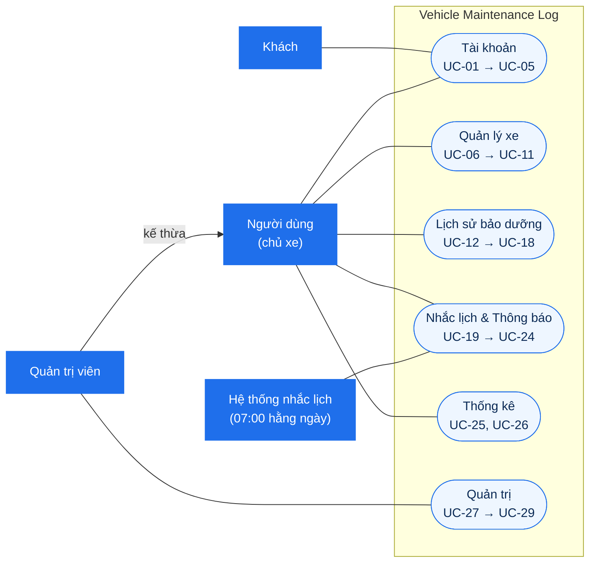
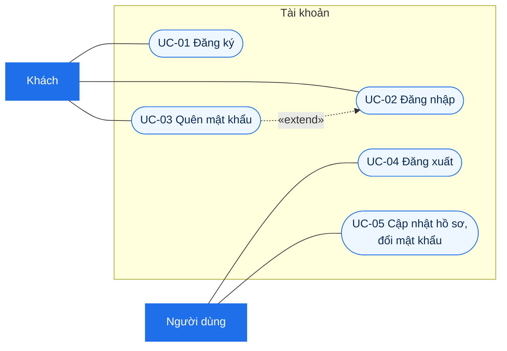
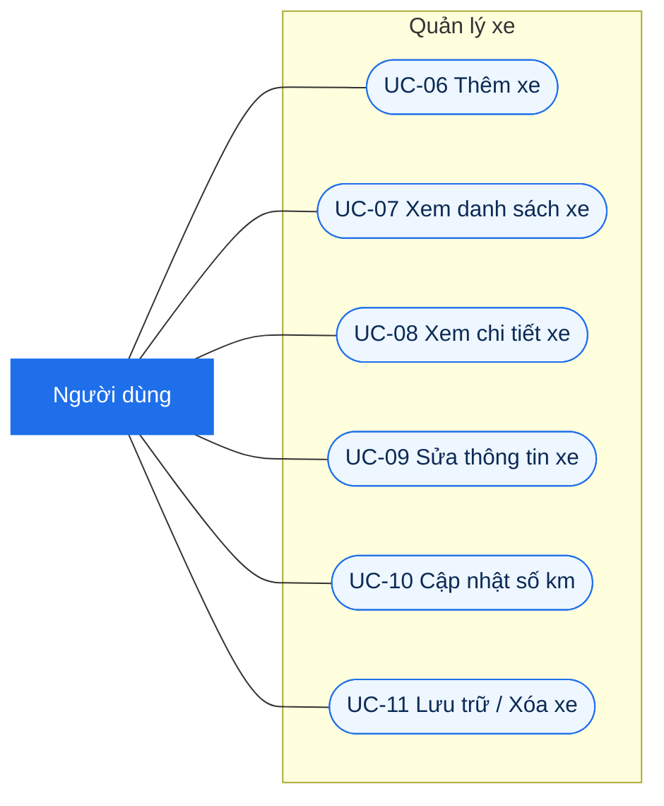
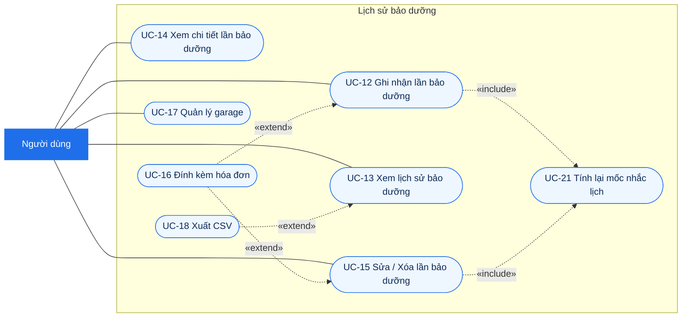
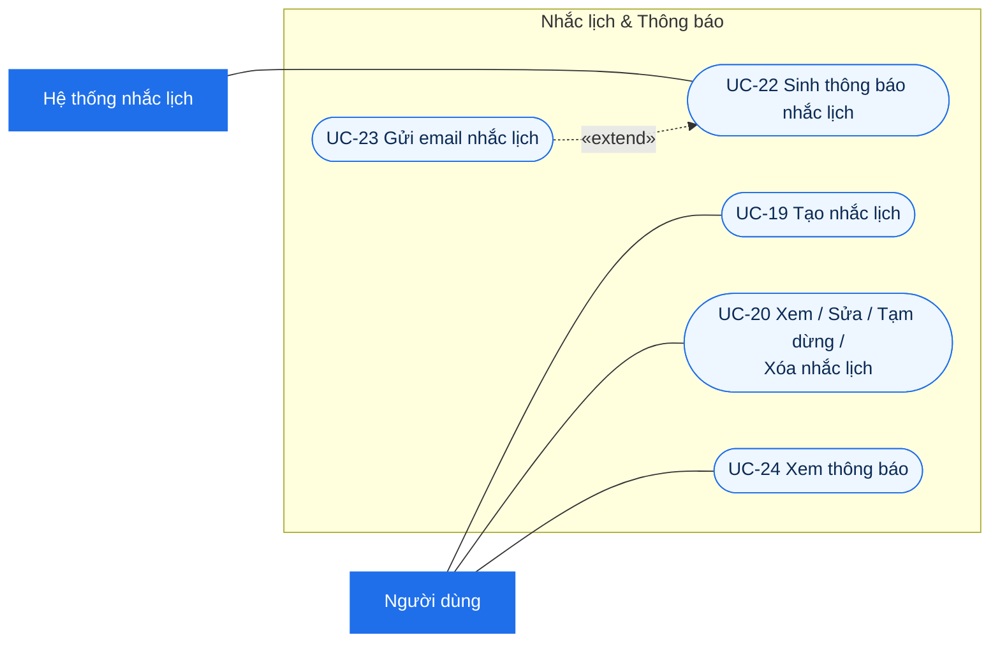
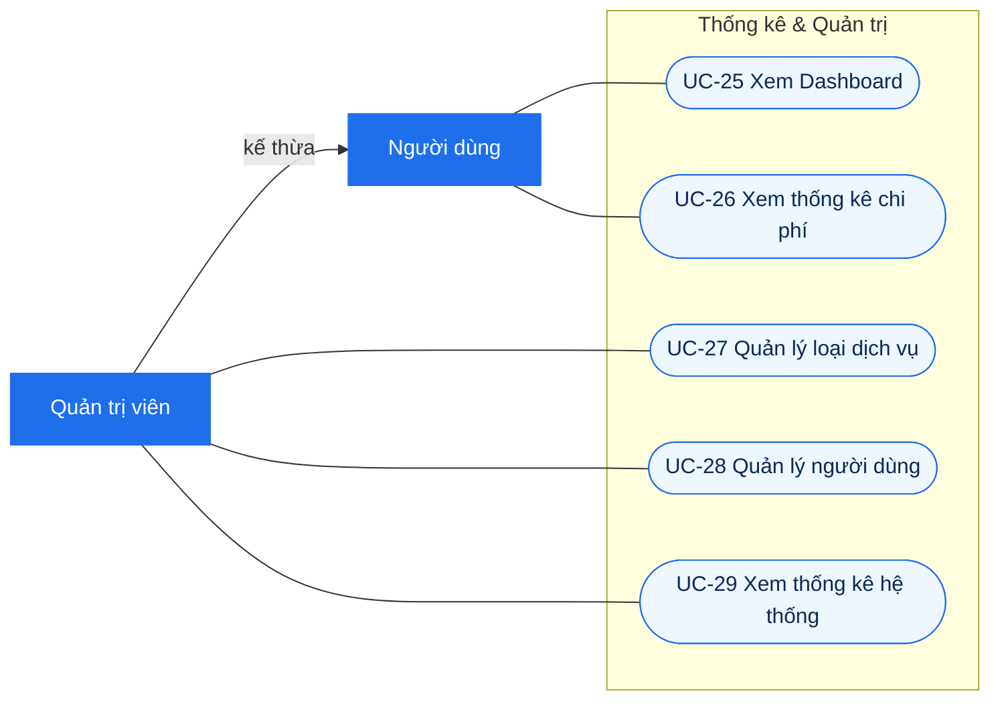

# 02 – Use Case Diagram

**Người phụ trách:** Lâm · **Phiên bản:** 1.0 · **Đầu vào:** [01 Requirements](../01-requirements/requirements.md)

Tài liệu gồm sơ đồ use case tổng quát, sơ đồ phân rã theo từng nhóm chức năng và đặc tả các use case chính. Mỗi use case có mã `UC-xx` và ghi rõ `FR-xx` tương ứng trong tài liệu 01.

> Mermaid chưa có loại sơ đồ use case riêng nên sơ đồ được vẽ bằng `flowchart`. Quy ước ký hiệu:
> - Hình chữ nhật đậm màu = **tác nhân**; hình viên thuốc = **use case**; khung lớn = **ranh giới hệ thống**.
> - Mũi tên liền = tác nhân tham gia use case.
> - Mũi tên nét đứt `«include»` = use case gốc luôn gọi use case được trỏ tới.
> - Mũi tên nét đứt `«extend»` = use case mở rộng, chỉ xảy ra khi có điều kiện, trỏ về use case gốc.
> - Mũi tên ghi `kế thừa` = tổng quát hóa giữa hai tác nhân (trong UML vẽ bằng mũi tên tam giác rỗng).

## 1. Tác nhân

| Tác nhân | Mô tả | Ghi chú |
|---|---|---|
| **Khách** | Người chưa đăng nhập | Sau khi đăng nhập trở thành Người dùng hoặc Quản trị viên |
| **Người dùng** (chủ xe) | Người đã có tài khoản, vai trò `USER` | Tác nhân chính |
| **Quản trị viên** | Tài khoản có vai trò `ADMIN` | **Kế thừa** Người dùng: cùng bảng `users`, làm được mọi việc của Người dùng, cộng thêm các chức năng quản trị |
| **Hệ thống nhắc lịch** | Tiến trình định kỳ chạy lúc 07:00 mỗi ngày | Tác nhân thời gian, không phải con người |

## 2. Danh sách use case

| Mã | Use case | Tác nhân chính | FR | Ưu tiên | Màn hình |
|---|---|---|---|---|---|
| UC-01 | Đăng ký | Khách | FR-01 | Must | S02 |
| UC-02 | Đăng nhập | Khách | FR-02 | Must | S02 |
| UC-03 | Quên mật khẩu | Khách | FR-03 | Could | S02 |
| UC-04 | Đăng xuất | Người dùng | FR-02 | Must | Mọi màn hình |
| UC-05 | Cập nhật hồ sơ, đổi mật khẩu | Người dùng | FR-04 | Should | S13 |
| UC-06 | Thêm xe | Người dùng | FR-05 | Must | S05 |
| UC-07 | Xem danh sách xe | Người dùng | FR-06 | Must | S04 |
| UC-08 | Xem chi tiết xe | Người dùng | FR-07 | Must | S06 |
| UC-09 | Sửa thông tin xe | Người dùng | FR-08 | Must | S05 |
| UC-10 | Cập nhật số km (ODO) | Người dùng | FR-09 | Must | S06 |
| UC-11 | Lưu trữ / Xóa xe | Người dùng | FR-10 | Should | S04 |
| UC-12 | Ghi nhận lần bảo dưỡng | Người dùng | FR-11 | Must | S07 |
| UC-13 | Xem lịch sử bảo dưỡng | Người dùng | FR-12 | Must | S06 |
| UC-14 | Xem chi tiết lần bảo dưỡng | Người dùng | FR-13 | Must | S08 |
| UC-15 | Sửa / Xóa lần bảo dưỡng | Người dùng | FR-14 | Must | S07, S08 |
| UC-16 | Đính kèm hóa đơn | Người dùng | FR-15 | Should | S07 |
| UC-17 | Quản lý garage | Người dùng | FR-16 | Should | S12 |
| UC-18 | Xuất lịch sử ra CSV | Người dùng | FR-17 | Could | S06 |
| UC-19 | Tạo nhắc lịch | Người dùng | FR-18 | Must | S09 |
| UC-20 | Xem / Sửa / Tạm dừng / Xóa nhắc lịch | Người dùng | FR-19 | Must | S06, S09 |
| UC-21 | Tính lại mốc nhắc lịch | (được gọi từ UC-12, UC-15) | FR-20 | Must | – |
| UC-22 | Sinh thông báo nhắc lịch | Hệ thống nhắc lịch | FR-21 | Must | – |
| UC-23 | Gửi email nhắc lịch | Hệ thống nhắc lịch | FR-23 | Could | – |
| UC-24 | Xem thông báo | Người dùng | FR-22 | Must | S10 |
| UC-25 | Xem Dashboard | Người dùng | FR-24 | Must | S03 |
| UC-26 | Xem thống kê chi phí | Người dùng | FR-25 | Should | S11 |
| UC-27 | Quản lý loại dịch vụ | Quản trị viên | FR-26 | Must | S14 |
| UC-28 | Quản lý người dùng | Quản trị viên | FR-27 | Should | S15 |
| UC-29 | Xem thống kê hệ thống | Quản trị viên | FR-28 | Could | S15 |

Đủ 28/28 chức năng FR-01 → FR-28 của tài liệu 01 (FR-02 tách thành UC-02 Đăng nhập và UC-04 Đăng xuất).

## 3. Sơ đồ use case tổng quát

Sơ đồ mức gói: mỗi gói là một nhóm use case, chi tiết ở mục 4.

## 4. Sơ đồ phân rã

### 4.1. Tài khoản

### 4.2. Quản lý xe

### 4.3. Lịch sử bảo dưỡng

### 4.4. Nhắc lịch và thông báo

### 4.5. Thống kê và Quản trị

## 5. Đặc tả use case chính

Các use case dưới đây là luồng cốt lõi của bản demo (mức Must) hoặc có nhiều quy tắc nghiệp vụ. Những use case còn lại chủ yếu là xem/sửa đơn giản, luồng giống mẫu ở UC-09.

Tiền điều kiện chung cho mọi use case của Người dùng và Quản trị viên: **đã đăng nhập và tài khoản đang hoạt động**. Mọi thao tác trên xe, lần bảo dưỡng, nhắc lịch đều kiểm tra dữ liệu đó thuộc người đang đăng nhập (NFR-02); nếu không, hệ thống trả lỗi "Không tìm thấy" và không lộ dữ liệu.

### UC-01. Đăng ký

| Mục | Nội dung |
|---|---|
| Tác nhân | Khách |
| Mô tả | Khách tạo tài khoản mới để sử dụng hệ thống |
| FR / BR | FR-01 · BR-01 · NFR-01, NFR-06 |
| Tiền điều kiện | Chưa đăng nhập |
| Hậu điều kiện | Tạo bản ghi `users` với `role = USER`, `is_active = TRUE`, mật khẩu đã băm bcrypt. Khách được chuyển tới màn hình đăng nhập |

**Luồng chính**
1. Khách chọn "Đăng ký".
2. Hệ thống hiển thị form: họ tên, email, mật khẩu, nhập lại mật khẩu.
3. Khách nhập thông tin và bấm "Đăng ký".
4. Hệ thống kiểm tra dữ liệu hợp lệ.
5. Hệ thống kiểm tra email chưa được sử dụng (BR-01).
6. Hệ thống băm mật khẩu, lưu tài khoản.
7. Hệ thống báo "Đăng ký thành công" và chuyển tới màn hình đăng nhập.

**Luồng thay thế / ngoại lệ**
- 4a. Thiếu trường bắt buộc, email sai định dạng, mật khẩu ngắn hơn 8 ký tự hoặc hai mật khẩu không khớp: báo lỗi ngay dưới ô nhập sai (NFR-06), quay lại bước 3.
- 5a. Email đã tồn tại: báo "Email đã được sử dụng", quay lại bước 3 (TC-01).

### UC-02. Đăng nhập

| Mục | Nội dung |
|---|---|
| Tác nhân | Khách (sau đó là Người dùng hoặc Quản trị viên) |
| Mô tả | Xác thực bằng email và mật khẩu để vào hệ thống |
| FR / BR | FR-02 · BR-13 · NFR-02 |
| Tiền điều kiện | Đã có tài khoản |
| Hậu điều kiện | Hệ thống cấp JWT; giao diện lưu token và chuyển tới Dashboard (vai trò USER) hoặc trang quản trị (vai trò ADMIN) |

**Luồng chính**
1. Khách nhập email, mật khẩu và bấm "Đăng nhập".
2. Hệ thống tìm tài khoản theo email.
3. Hệ thống so khớp mật khẩu với `password_hash`.
4. Hệ thống kiểm tra tài khoản đang hoạt động (BR-13).
5. Hệ thống tạo JWT chứa `userId`, `role` và trả về.
6. Giao diện chuyển tới màn hình theo vai trò.

**Luồng thay thế / ngoại lệ**
- 2a, 3a. Không có email hoặc sai mật khẩu: báo chung "Email hoặc mật khẩu không đúng" (không tiết lộ email có tồn tại hay không), quay lại bước 1.
- 4a. Tài khoản bị khóa: báo "Tài khoản đã bị khóa", không cấp token (TC-02).
- 1a. Khách chọn "Quên mật khẩu": chuyển sang UC-03 (extend).

### UC-06. Thêm xe

| Mục | Nội dung |
|---|---|
| Tác nhân | Người dùng |
| Mô tả | Thêm một xe mới vào danh sách xe của mình |
| FR / BR | FR-05 · BR-02, BR-03 |
| Tiền điều kiện | Đã đăng nhập |
| Hậu điều kiện | Tạo bản ghi `vehicles` thuộc người dùng, `is_archived = FALSE`. Xe xuất hiện trong danh sách xe |

**Luồng chính**
1. Người dùng chọn "Thêm xe" ở màn hình danh sách xe.
2. Hệ thống hiển thị form: tên gợi nhớ, loại xe, hãng, dòng xe, năm sản xuất, biển số, số khung, ODO hiện tại, ngày mua, ảnh xe.
3. Người dùng nhập thông tin (bắt buộc: tên, loại xe, ODO) và bấm "Lưu".
4. Hệ thống kiểm tra dữ liệu: năm sản xuất 1950–2100, ODO ≥ 0, ngày mua không ở tương lai.
5. Hệ thống kiểm tra biển số không trùng với xe khác của chính người dùng (BR-02).
6. Hệ thống lưu ảnh (nếu có) và lưu xe.
7. Hệ thống chuyển tới màn hình chi tiết xe vừa tạo và gợi ý "Tạo nhắc lịch cho xe này".

**Luồng thay thế / ngoại lệ**
- 4a. Dữ liệu không hợp lệ: báo lỗi tại ô nhập, quay lại bước 3.
- 5a. Trùng biển số: báo "Bạn đã có xe với biển số này", quay lại bước 3 (TC-04).
- 3a. Người dùng bấm "Hủy": không lưu, quay về danh sách xe.

### UC-09. Sửa thông tin xe

| Mục | Nội dung |
|---|---|
| Tác nhân | Người dùng |
| Mô tả | Sửa các thông tin đã nhập ở UC-06 |
| FR / BR | FR-08 · BR-02, BR-03 |
| Tiền điều kiện | Xe thuộc người dùng |
| Hậu điều kiện | Thông tin xe được cập nhật |

**Luồng chính**
1. Ở màn hình chi tiết xe, người dùng bấm "Sửa".
2. Hệ thống hiển thị form với dữ liệu hiện tại.
3. Người dùng sửa và bấm "Lưu".
4. Hệ thống kiểm tra dữ liệu như bước 4–5 của UC-06.
5. Hệ thống lưu thay đổi và quay về màn hình chi tiết xe.

**Luồng thay thế / ngoại lệ**
- 4a. ODO mới nhỏ hơn ODO hiện tại: báo lỗi (BR-03). Muốn tăng ODO, người dùng có thể sửa ở đây hoặc dùng UC-10.
- 4b. Dữ liệu sai hoặc trùng biển số: như 4a, 5a của UC-06.

### UC-10. Cập nhật số km (ODO)

| Mục | Nội dung |
|---|---|
| Tác nhân | Người dùng |
| Mô tả | Nhập nhanh số ODO mới cho xe để hệ thống tính đúng nhắc lịch theo km |
| FR / BR | FR-09 · BR-03, BR-09 |
| Tiền điều kiện | Xe thuộc người dùng, chưa lưu trữ |
| Hậu điều kiện | `vehicles.current_odometer` được cập nhật; trạng thái các nhắc lịch theo km của xe được tính lại khi hiển thị |

**Luồng chính**
1. Ở màn hình chi tiết xe, người dùng bấm "Cập nhật km".
2. Hệ thống hiển thị ô nhập kèm ODO hiện tại.
3. Người dùng nhập ODO mới và xác nhận.
4. Hệ thống kiểm tra ODO mới ≥ ODO hiện tại (BR-03).
5. Hệ thống lưu ODO mới.
6. Hệ thống hiển thị lại thông tin xe và trạng thái nhắc lịch (có thể chuyển sang "Sắp đến hạn" hoặc "Quá hạn").

**Luồng thay thế / ngoại lệ**
- 4a. ODO mới nhỏ hơn ODO hiện tại: báo "Số km không được nhỏ hơn số hiện tại (x km)", ODO giữ nguyên (TC-05).

### UC-11. Lưu trữ / Xóa xe

| Mục | Nội dung |
|---|---|
| Tác nhân | Người dùng |
| Mô tả | Ẩn xe đã bán khỏi danh sách nhưng giữ lịch sử, hoặc xóa hẳn xe nhập nhầm |
| FR / BR | FR-10 · BR-12 · NFR-07 |
| Tiền điều kiện | Xe thuộc người dùng |
| Hậu điều kiện | Lưu trữ: `is_archived = TRUE`, các nhắc lịch của xe không còn sinh thông báo. Xóa: xe và các nhắc lịch của xe bị xóa |

**Luồng chính (Lưu trữ)**
1. Người dùng chọn "Lưu trữ" trên thẻ xe.
2. Hệ thống hỏi xác nhận (NFR-07).
3. Người dùng xác nhận.
4. Hệ thống đặt xe về trạng thái lưu trữ và ẩn khỏi danh sách.

**Luồng thay thế / ngoại lệ**
- 1a. Người dùng chọn "Xóa": hệ thống kiểm tra xe đã có lần bảo dưỡng chưa.
  - Chưa có: hỏi xác nhận, xóa hẳn xe.
  - Đã có: báo "Xe đã có lịch sử bảo dưỡng, chỉ có thể lưu trữ" và gợi ý nút "Lưu trữ" (BR-12, TC-14).
- 1b. Người dùng xem danh sách "Xe đã lưu trữ" và chọn "Khôi phục": hệ thống đặt `is_archived = FALSE`.
- 3a. Người dùng hủy: không thay đổi gì.

### UC-12. Ghi nhận lần bảo dưỡng

| Mục | Nội dung |
|---|---|
| Tác nhân | Người dùng |
| Mô tả | Ghi lại một lần mang xe đi bảo dưỡng/sửa chữa, gồm một hoặc nhiều hạng mục và chi phí |
| FR / BR | FR-11, FR-15, FR-16, FR-20 · BR-03, BR-04, BR-05, BR-06, BR-08 |
| Tiền điều kiện | Người dùng có ít nhất một xe chưa lưu trữ |
| Hậu điều kiện | Tạo `maintenance_records` và các `maintenance_items` (và `attachments` nếu có) trong **một giao dịch**. ODO xe được nâng lên nếu cần. Các nhắc lịch trùng loại dịch vụ được tính lại mốc (UC-21) |

**Luồng chính**
1. Người dùng chọn "Ghi nhận bảo dưỡng" (từ Dashboard hoặc chi tiết xe).
2. Hệ thống hiển thị form: xe (chọn sẵn nếu đi từ chi tiết xe), ngày (mặc định hôm nay), ODO lúc làm (mặc định ODO hiện tại), garage, ghi chú, và một dòng hạng mục trống.
3. Người dùng nhập thông tin chung, chọn garage từ danh sách garage của mình.
4. Người dùng thêm các hạng mục: chọn loại dịch vụ (lọc theo loại xe, chỉ loại đang dùng), mô tả, số lượng, đơn giá. Hệ thống tự tính thành tiền từng dòng và tổng tiền (BR-06).
5. Người dùng bấm "Lưu".
6. Hệ thống kiểm tra: ngày không ở tương lai (BR-04), ODO ≥ 0, có ít nhất một hạng mục (BR-05), số lượng > 0, đơn giá ≥ 0.
7. Hệ thống lưu lần bảo dưỡng và các hạng mục.
8. Nếu ODO lúc làm lớn hơn ODO hiện tại của xe, hệ thống cập nhật ODO xe (BR-03).
9. Hệ thống thực hiện **UC-21 Tính lại mốc nhắc lịch** (include).
10. Hệ thống báo thành công và chuyển tới màn hình chi tiết lần bảo dưỡng.

**Luồng thay thế / ngoại lệ**
- 3a. Garage chưa có trong danh sách: người dùng chọn "Thêm garage mới" ngay trong form (UC-17), garage mới được chọn sẵn.
- 4a. Người dùng xóa một dòng hạng mục: tổng tiền được tính lại.
- 5a. Người dùng đính kèm ảnh/PDF hóa đơn trước khi lưu: thực hiện UC-16 (extend).
- 6a. Ngày ở tương lai: báo lỗi tại ô ngày (TC-07).
- 6b. Không có hạng mục: báo "Cần ít nhất một hạng mục" (TC-06).
- 6c. ODO lúc làm nhỏ hơn ODO hiện tại: **cho phép** (ghi bù lần bảo dưỡng cũ), không thay đổi ODO xe.
- 7a. Lỗi khi lưu: hủy toàn bộ giao dịch, không có dữ liệu nào được ghi một nửa, báo lỗi để người dùng thử lại.

### UC-15. Sửa / Xóa lần bảo dưỡng

| Mục | Nội dung |
|---|---|
| Tác nhân | Người dùng |
| Mô tả | Sửa thông tin, hạng mục của lần bảo dưỡng đã ghi, hoặc xóa lần bảo dưỡng |
| FR / BR | FR-14 · BR-03 → BR-06, BR-08 · NFR-07 |
| Tiền điều kiện | Lần bảo dưỡng thuộc xe của người dùng |
| Hậu điều kiện | Dữ liệu được cập nhật/xóa; nhắc lịch liên quan được tính lại (UC-21) |

**Luồng chính (Sửa)**
1. Ở màn hình chi tiết lần bảo dưỡng, người dùng bấm "Sửa".
2. Hệ thống hiển thị form như UC-12 với dữ liệu hiện tại.
3. Người dùng sửa thông tin chung, thêm/sửa/xóa hạng mục, bấm "Lưu".
4. Hệ thống kiểm tra như bước 6 của UC-12.
5. Hệ thống cập nhật lần bảo dưỡng và thay toàn bộ danh sách hạng mục trong một giao dịch.
6. Hệ thống thực hiện UC-21 cho cả loại dịch vụ cũ và mới của lần bảo dưỡng.

**Luồng thay thế / ngoại lệ**
- 1a. Người dùng bấm "Xóa": hệ thống hỏi xác nhận (NFR-07). Xác nhận thì xóa lần bảo dưỡng, các hạng mục và file hóa đơn, sau đó thực hiện UC-21 cho các loại dịch vụ của lần bị xóa.
- 3a. Thêm/xóa file hóa đơn: UC-16 (extend).
- 4a. Dữ liệu sai: như 6a, 6b của UC-12.
- Ghi chú: sửa hoặc xóa lần bảo dưỡng **không làm giảm** ODO của xe (BR-03).

### UC-16. Đính kèm hóa đơn

| Mục | Nội dung |
|---|---|
| Tác nhân | Người dùng |
| Mô tả | Tải ảnh hoặc PDF hóa đơn cho lần bảo dưỡng |
| FR / BR | FR-15 · NFR-08 |
| Điểm mở rộng | Bước 5 của UC-12, bước 3 của UC-15 |
| Hậu điều kiện | File được lưu ở thư mục `uploads/` trên server, tạo bản ghi `attachments` |

**Luồng chính**
1. Người dùng bấm "Đính kèm hóa đơn" và chọn một hoặc nhiều file.
2. Hệ thống kiểm tra định dạng JPG/PNG/PDF và dung lượng ≤ 5 MB mỗi file.
3. Hệ thống lưu file và hiển thị ảnh thu nhỏ/tên file.

**Luồng thay thế / ngoại lệ**
- 2a. Sai định dạng hoặc quá 5 MB: báo lỗi, bỏ qua file đó (TC-15).
- 3a. Người dùng bấm xóa một file đã đính kèm: hệ thống xóa bản ghi và file vật lý.

### UC-19. Tạo nhắc lịch

| Mục | Nội dung |
|---|---|
| Tác nhân | Người dùng |
| Mô tả | Đặt quy tắc nhắc cho một loại dịch vụ của một xe: cứ X km và/hoặc Y tháng thì làm lại |
| FR / BR | FR-18 · BR-07, BR-08, BR-09, BR-11 |
| Tiền điều kiện | Xe thuộc người dùng, chưa lưu trữ |
| Hậu điều kiện | Tạo bản ghi `reminders` với `next_due_date`, `next_due_odometer` đã tính, `last_notified_level = NONE` |

**Luồng chính**
1. Ở tab "Nhắc lịch" của chi tiết xe, người dùng bấm "Tạo nhắc lịch".
2. Hệ thống hiển thị form với danh sách loại dịch vụ phù hợp loại xe, bỏ những loại xe này đã có nhắc lịch.
3. Người dùng chọn loại dịch vụ.
4. Hệ thống điền sẵn chu kỳ km/tháng từ chu kỳ mặc định của loại dịch vụ; điền sẵn mốc gốc = ngày và ODO của lần làm gần nhất loại dịch vụ này (nếu có), nếu chưa có thì là hôm nay và ODO hiện tại (BR-08); ngưỡng báo trước mặc định 7 ngày / 300 km.
5. Người dùng chỉnh lại nếu cần và bấm "Lưu".
6. Hệ thống kiểm tra có ít nhất một chu kỳ (BR-07), chu kỳ > 0, ngưỡng ≥ 0.
7. Hệ thống kiểm tra xe chưa có nhắc lịch cho loại dịch vụ này (BR-11).
8. Hệ thống tính mốc đến hạn: ngày = mốc gốc + số tháng, km = ODO gốc + số km (BR-08).
9. Hệ thống lưu nhắc lịch và hiển thị trong danh sách kèm trạng thái (BR-09).

**Luồng thay thế / ngoại lệ**
- 6a. Không nhập chu kỳ nào: báo "Cần nhập chu kỳ theo km hoặc theo tháng".
- 7a. Đã có nhắc lịch cùng loại dịch vụ: báo trùng, gợi ý sửa nhắc lịch hiện có (TC-13).
- 9a. Mốc vừa tính đã qua hoặc sắp tới: nhắc lịch hiển thị ngay trạng thái "Quá hạn"/"Sắp đến hạn"; thông báo sẽ được sinh ở lần chạy kế tiếp của UC-22.

### UC-21. Tính lại mốc nhắc lịch

| Mục | Nội dung |
|---|---|
| Tác nhân | Không có tác nhân trực tiếp (được include từ UC-12, UC-15) |
| Mô tả | Cập nhật mốc đến hạn của các nhắc lịch khi lịch sử bảo dưỡng thay đổi |
| FR / BR | FR-20 · BR-08, BR-10 |
| Đầu vào | Xe và danh sách loại dịch vụ có trong lần bảo dưỡng vừa thêm/sửa/xóa |
| Hậu điều kiện | `last_service_date`, `last_service_odometer`, `next_due_date`, `next_due_odometer` đúng theo lần làm gần nhất; `last_notified_level` về `NONE` nếu mốc thay đổi |

**Luồng chính**
1. Với mỗi loại dịch vụ đầu vào, hệ thống tìm nhắc lịch của xe cho loại dịch vụ đó.
2. Nếu không có nhắc lịch: bỏ qua loại dịch vụ này.
3. Hệ thống tìm lần bảo dưỡng **gần nhất** (ngày lớn nhất, cùng ngày thì ODO lớn nhất) của xe có hạng mục thuộc loại dịch vụ đó.
4. Hệ thống đặt mốc gốc = ngày và ODO của lần đó, tính lại mốc đến hạn = mốc gốc + chu kỳ.
5. Nếu mốc thay đổi, hệ thống đặt `last_notified_level = NONE` để chu kỳ mới được thông báo lại (BR-10).

**Luồng thay thế / ngoại lệ**
- 3a. Không còn lần bảo dưỡng nào cho loại dịch vụ (ví dụ vừa xóa lần duy nhất): giữ nguyên mốc gốc hiện có của nhắc lịch.
- Ví dụ (TC-10): nhắc thay nhớt 1.500 km / 2 tháng, ghi nhận thay nhớt ngày 2026-10-22 ở 13.000 km → mốc mới 2026-12-22 hoặc 14.500 km.

### UC-22. Sinh thông báo nhắc lịch

| Mục | Nội dung |
|---|---|
| Tác nhân | Hệ thống nhắc lịch |
| Mô tả | Mỗi ngày quét các nhắc lịch, tạo thông báo cho nhắc lịch sắp đến hạn hoặc quá hạn |
| FR / BR | FR-21 · BR-07, BR-09, BR-10 |
| Tiền điều kiện | Đến giờ chạy (07:00) |
| Hậu điều kiện | Mỗi nhắc lịch đổi trạng thái sinh đúng một thông báo cho trạng thái mới; `last_notified_level` được cập nhật |

**Luồng chính**
1. Đến 07:00, tiến trình nhắc lịch khởi chạy.
2. Hệ thống lấy các nhắc lịch đang hoạt động của xe chưa lưu trữ, thuộc tài khoản đang hoạt động, kèm trạng thái tính theo BR-09 (view `v_reminder_status`).
3. Với mỗi nhắc lịch có trạng thái "Quá hạn" và `last_notified_level` khác `OVERDUE`: tạo thông báo loại `OVERDUE`, đặt `last_notified_level = OVERDUE`.
4. Với mỗi nhắc lịch có trạng thái "Sắp đến hạn" và `last_notified_level = NONE`: tạo thông báo loại `DUE_SOON`, đặt `last_notified_level = DUE_SOON`.
5. Nếu chủ xe bật nhận email: thực hiện UC-23 (extend).
6. Hệ thống ghi log số thông báo đã tạo.

**Luồng thay thế / ngoại lệ**
- 3a, 4a. Nhắc lịch đã được thông báo ở mức tương ứng: bỏ qua, không tạo thông báo trùng (BR-10, TC-12).
- 2a. Lỗi khi xử lý một nhắc lịch: ghi log, tiếp tục các nhắc lịch còn lại. Mỗi nhắc lịch xử lý trong giao dịch riêng (tạo thông báo + cập nhật mức) để không bị thông báo trùng khi chạy lại.

### UC-24. Xem thông báo

| Mục | Nội dung |
|---|---|
| Tác nhân | Người dùng |
| Mô tả | Xem số thông báo chưa đọc trên biểu tượng chuông, xem danh sách và đánh dấu đã đọc |
| FR / BR | FR-22 |
| Tiền điều kiện | Đã đăng nhập |
| Hậu điều kiện | Thông báo được chọn có `is_read = TRUE`, `read_at` = thời điểm đọc |

**Luồng chính**
1. Ở mọi màn hình, hệ thống hiển thị biểu tượng chuông kèm số thông báo chưa đọc.
2. Người dùng bấm vào chuông.
3. Hệ thống hiển thị danh sách thông báo, mới nhất trước, thông báo chưa đọc được tô đậm.
4. Người dùng bấm một thông báo.
5. Hệ thống đánh dấu đã đọc và mở màn hình chi tiết xe, tab "Nhắc lịch".

**Luồng thay thế / ngoại lệ**
- 4a. Người dùng bấm "Đánh dấu tất cả đã đọc": mọi thông báo chưa đọc được đánh dấu.
- 5a. Nhắc lịch gốc đã bị xóa (`reminder_id` rỗng): chỉ đánh dấu đã đọc, không chuyển màn hình.

### UC-26. Xem thống kê chi phí

| Mục | Nội dung |
|---|---|
| Tác nhân | Người dùng |
| Mô tả | Xem biểu đồ chi phí bảo dưỡng theo tháng, theo xe hoặc theo loại dịch vụ |
| FR / BR | FR-25 · BR-06 · G-03 |
| Tiền điều kiện | Đã đăng nhập |
| Hậu điều kiện | Không thay đổi dữ liệu |

**Luồng chính**
1. Người dùng mở màn hình "Thống kê chi phí".
2. Hệ thống mặc định khoảng thời gian là năm hiện tại, nhóm theo tháng, tất cả xe.
3. Hệ thống tính tổng chi phí theo nhóm từ các lần bảo dưỡng của người dùng (view `v_record_totals`).
4. Hệ thống hiển thị biểu đồ, bảng số liệu và tổng chi phí của khoảng thời gian.
5. Người dùng đổi khoảng thời gian, kiểu nhóm (tháng / xe / loại dịch vụ) hoặc lọc một xe.
6. Hệ thống tính lại và hiển thị (quay lại bước 3).

**Luồng thay thế / ngoại lệ**
- 3a. Không có dữ liệu trong khoảng đã chọn: hiển thị "Chưa có chi phí trong khoảng thời gian này" và nút "Ghi nhận bảo dưỡng".
- 5a. Ngày bắt đầu sau ngày kết thúc: báo lỗi, không tính.
- Ví dụ (TC-18): user 2 năm 2026 theo tháng → 02: 1.960.000 · 03: 255.000 · 06: 135.000 · 08: 1.305.000.

### UC-27. Quản lý loại dịch vụ

| Mục | Nội dung |
|---|---|
| Tác nhân | Quản trị viên |
| Mô tả | Thêm, sửa, ngừng dùng loại dịch vụ chuẩn và chu kỳ mặc định |
| FR / BR | FR-26 · BR-14 · NFR-02 |
| Tiền điều kiện | Đăng nhập với vai trò ADMIN |
| Hậu điều kiện | Danh mục `service_types` được cập nhật; loại ngừng dùng không còn hiện trong danh sách chọn của người dùng |

**Luồng chính (Thêm)**
1. Quản trị viên mở "Quản trị › Loại dịch vụ".
2. Hệ thống hiển thị danh sách loại dịch vụ, có ô tìm kiếm và lọc theo loại xe.
3. Quản trị viên bấm "Thêm", nhập tên, mô tả, áp dụng cho loại xe, chu kỳ mặc định km/tháng, bấm "Lưu".
4. Hệ thống kiểm tra tên không trùng, chu kỳ (nếu có) > 0.
5. Hệ thống lưu và cập nhật danh sách.

**Luồng thay thế / ngoại lệ**
- 3a. Sửa: chọn một loại, sửa thông tin, lưu. Đổi chu kỳ mặc định không ảnh hưởng nhắc lịch đã tạo.
- 3b. Ngừng dùng / dùng lại: đổi `is_active`. Loại đã được dùng trong hạng mục hoặc nhắc lịch thì **không có nút xóa**, chỉ ngừng dùng (BR-14, TC-16).
- 4a. Tên trùng: báo lỗi.
- Người dùng thường gọi API quản trị: trả lỗi 403 (TC-17).

### UC-28. Quản lý người dùng

| Mục | Nội dung |
|---|---|
| Tác nhân | Quản trị viên |
| Mô tả | Xem, tìm kiếm, khóa/mở khóa tài khoản người dùng |
| FR / BR | FR-27 · BR-13 |
| Tiền điều kiện | Đăng nhập với vai trò ADMIN |
| Hậu điều kiện | `users.is_active` được cập nhật; tài khoản bị khóa không đăng nhập được, dữ liệu vẫn giữ |

**Luồng chính**
1. Quản trị viên mở "Quản trị › Người dùng".
2. Hệ thống hiển thị danh sách người dùng (họ tên, email, số xe, ngày tạo, trạng thái), có phân trang.
3. Quản trị viên tìm theo tên hoặc email.
4. Quản trị viên bấm "Khóa" trên một tài khoản, xác nhận.
5. Hệ thống đặt `is_active = FALSE`.

**Luồng thay thế / ngoại lệ**
- 4a. Bấm "Mở khóa" trên tài khoản đang bị khóa: đặt `is_active = TRUE`.
- 4b. Quản trị viên tự khóa tài khoản của chính mình: không cho phép.

## 6. Ma trận truy vết FR → Use case

| FR | Use case | FR | Use case | FR | Use case | FR | Use case |
|---|---|---|---|---|---|---|---|
| FR-01 | UC-01 | FR-08 | UC-09 | FR-15 | UC-16 | FR-22 | UC-24 |
| FR-02 | UC-02, UC-04 | FR-09 | UC-10 | FR-16 | UC-17 | FR-23 | UC-23 |
| FR-03 | UC-03 | FR-10 | UC-11 | FR-17 | UC-18 | FR-24 | UC-25 |
| FR-04 | UC-05 | FR-11 | UC-12 | FR-18 | UC-19 | FR-25 | UC-26 |
| FR-05 | UC-06 | FR-12 | UC-13 | FR-19 | UC-20 | FR-26 | UC-27 |
| FR-06 | UC-07 | FR-13 | UC-14 | FR-20 | UC-21 | FR-27 | UC-28 |
| FR-07 | UC-08 | FR-14 | UC-15 | FR-21 | UC-22 | FR-28 | UC-29 |

## 7. Ghi chú gửi nhóm

Các điểm tài liệu 01 chưa nói rõ, mình đã chọn cách xử lý như sau. Mọi người xem và góp ý trong Pull Request:

1. **Quản trị viên kế thừa Người dùng**: tài khoản ADMIN vẫn có thể có xe, ghi bảo dưỡng như người dùng thường (cùng bảng `users`).
2. **Ghi bù lần bảo dưỡng cũ** (UC-12, 6c): cho phép ODO lúc làm nhỏ hơn ODO hiện tại của xe, vì người dùng hay nhập lại lịch sử cũ; khi đó ODO xe không đổi.
3. **Xe đã lưu trữ, tài khoản bị khóa** không sinh thông báo nhắc lịch (UC-22, bước 2).
4. **Tính lại mốc khi sửa/xóa lần bảo dưỡng** (UC-21): mốc luôn lấy theo lần làm gần nhất còn lại, không chỉ khi thêm mới. Hợp đồng `reminderService.onMaintenanceSaved` ở tài liệu 08 cần thêm trường hợp xóa, chi tiết ở [tài liệu 07](../07-architecture/README.md#7-ghi-chú-cho-tài-liệu-08).
5. **Khóa tài khoản chính mình**: quản trị viên không được tự khóa tài khoản của mình (UC-28, 4b), tránh mất quyền quản trị.
