# 03 – Activity Diagram

**Người phụ trách:** Tăng Thoại Lâm · **Phiên bản:** 2.0 · **Đầu vào:** [01 Requirements](../01-requirements/requirements.md), [02 Use Case](../02-use-case/), [04 Database](../04-database/erd.md)

Activity diagram có swimlane cho 4 luồng chính. Các bước kiểm tra, mã lỗi và câu SQL khớp với đặc tả use case ở tài liệu 02, truy vấn mẫu ở `sample-queries.sql` (tài liệu 04) và danh sách API ở tài liệu 08.

> Mermaid chưa có loại activity diagram riêng nên sơ đồ được vẽ bằng `flowchart`. Quy ước ký hiệu:
> - Chấm tròn đặc = **bắt đầu**; vòng tròn đôi = **kết thúc**.
> - Hình chữ nhật bo góc = **hành động**; hình thoi = **rẽ nhánh theo điều kiện**.
> - Mỗi khung lớn = một **làn** (swimlane): ai hoặc thành phần nào thực hiện hành động trong khung đó.
> - Ô màu cam = mở/đóng transaction database; ô màu đỏ nhạt = nhánh lỗi.

| # | Luồng | Làn | Use case | FR |
|---|---|---|---|---|
| 1 | [Ghi nhận lần bảo dưỡng](#1-ghi-nhận-lần-bảo-dưỡng) | Chủ xe · Server · Database | UC-06 | FR-06, FR-15 |
| 2 | [Tạo nhắc lịch và tính trạng thái](#2-tạo-nhắc-lịch-và-tính-trạng-thái) | Chủ xe · Server · Database | UC-13, UC-15 | FR-13 → FR-15 |
| 3 | [Chẩn đoán AI](#3-chẩn-đoán-ai) | Chủ xe · Server · Gemini · Database | UC-18 | FR-18 → FR-21 |
| 4 | [Từ commit đến production](#4-từ-commit-đến-production) | Lập trình viên · Người review · GitHub · GitHub Actions · Render | – | PR-04, PR-08 |

Làn **Server** là ứng dụng FastAPI (router + Pydantic). Làn **Database** là PostgreSQL (Compose khi chạy local, Supabase trên cloud).

## 1. Ghi nhận lần bảo dưỡng

UC-06 · FR-06, FR-15 · BR-02, BR-03, BR-04, BR-05 · TC-04 → TC-08

```mermaid
flowchart TB
    subgraph U["Chủ xe (trình duyệt)"]
        S((" "))
        A1("Mở form Ghi nhận bảo dưỡng (S05)")
        A2("Chọn xe, nhập ngày, ODO lúc làm,<br/>nơi làm, ghi chú")
        A3("Thêm hạng mục: loại dịch vụ,<br/>mô tả, số lượng, đơn giá")
        A4("Trình duyệt hiện thành tiền<br/>và tổng tạm tính")
        A5{"Thêm hạng mục khác?"}
        A6("Bấm Lưu: fetch POST<br/>/api/vehicles/{id}/records")
        A7("Hiện lỗi dưới ô nhập,<br/>giữ nguyên dữ liệu đã nhập")
        A8("Chuyển tới chi tiết<br/>lần bảo dưỡng (S06)")
        E(((" ")))
    end
    subgraph H["Server (FastAPI)"]
        B1("Trả trang S05 kèm danh sách xe<br/>và loại dịch vụ đang dùng")
        B2{"Pydantic hợp lệ?<br/>≥ 1 hạng mục, số lượng > 0,<br/>đơn giá ≥ 0, ODO ≥ 0"}
        B3{"Ngày không ở<br/>tương lai? (BR-03)"}
        B4("Trả 422 + lỗi từng trường")
        B5{"Xe tồn tại?"}
        B6("Trả 404")
        B7("Trả 409: lần bảo dưỡng<br/>đã được ghi trước đó")
        B8("Trả 201: record_id, total_cost")
    end
    subgraph D["Database (PostgreSQL)"]
        D0("SELECT vehicles chưa lưu trữ,<br/>service_types is_active")
        T1("BEGIN")
        D1("INSERT maintenance_records<br/>RETURNING id")
        D2{"Trùng xe + ngày + ODO?<br/>(UNIQUE, BR-04)"}
        D3("ROLLBACK")
        D4("INSERT các maintenance_items<br/>line_total tự tính (BR-05)")
        D5("UPDATE vehicles SET current_odometer<br/>WHERE current_odometer nhỏ hơn ODO mới<br/>(BR-02)")
        T2("COMMIT")
    end

    S --> A1 --> D0 --> B1 --> A2 --> A3 --> A4 --> A5
    A5 -- Có --> A3
    A5 -- Không --> A6 --> B2
    B2 -- Không --> B4
    B2 -- Có --> B3
    B3 -- Không --> B4
    B4 --> A7 --> A6
    B3 -- Có --> B5
    B5 -- Không --> B6 --> A7
    B5 -- Có --> T1 --> D1 --> D2
    D2 -- Có --> D3 --> B7 --> A7
    D2 -- Không --> D4 --> D5 --> T2 --> B8 --> A8 --> E

    classDef start fill:#000,stroke:#000
    classDef tx fill:#fff4e5,stroke:#d97706,color:#7c2d12
    classDef err fill:#fdecec,stroke:#d1242f,color:#82071e
    class S,E start
    class T1,T2,D3 tx
    class B4,B6,B7,A7 err
```

Ghi chú:
- Ba câu lệnh `INSERT maintenance_records`, `INSERT maintenance_items`, `UPDATE vehicles` chạy trong **một transaction** (`with conn.transaction():`). Lỗi ở bất kỳ câu nào thì rollback hết, không bao giờ có lần bảo dưỡng thiếu hạng mục.
- **Nhắc lịch không có bước cập nhật.** Lần đọc nhắc lịch tiếp theo, view `v_reminder_status` tự lấy lần bảo dưỡng vừa ghi làm mốc gốc (luồng 2b), nên FR-15 được đáp ứng mà luồng này không phải làm gì thêm.
- ODO lúc làm nhỏ hơn ODO xe (ghi bù lần cũ) vẫn hợp lệ: câu `UPDATE` không đổi dòng nào, ODO xe giữ nguyên.

## 2. Tạo nhắc lịch và tính trạng thái

### 2a. Tạo nhắc lịch

UC-13 · FR-13 · BR-06, BR-07 · TC-10

```mermaid
flowchart TB
    subgraph U["Chủ xe (trình duyệt)"]
        S((" "))
        A1("Mở tab Nhắc lịch của xe,<br/>bấm Tạo nhắc lịch")
        A2("Chọn loại dịch vụ")
        A3("Chỉnh chu kỳ, ngày/ODO bắt đầu,<br/>ngưỡng báo trước")
        A4("Bấm Lưu: fetch POST /api/reminders")
        A5("Sửa lại theo thông báo lỗi")
        A6("Thấy nhắc lịch mới<br/>kèm trạng thái")
        E(((" ")))
    end
    subgraph H["Server (FastAPI)"]
        B1("Trả form S07")
        B2("Điền sẵn: chu kỳ mặc định của loại dịch vụ,<br/>ngày bắt đầu = hôm nay, ODO bắt đầu = ODO xe,<br/>ngưỡng 7 ngày / 300 km")
        B3{"Có ít nhất một chu kỳ?<br/>chu kỳ > 0, ngưỡng ≥ 0?<br/>(BR-06)"}
        B4("Trả 422")
        B5("Trả 409: xe đã có nhắc lịch<br/>cho loại dịch vụ này")
        B6("Trả 201, đọc lại danh sách<br/>nhắc lịch kèm trạng thái (2b)")
    end
    subgraph D["Database (PostgreSQL)"]
        D1("SELECT service_types<br/>is_active, hợp loại xe")
        D2("INSERT reminders")
        D3{"Trùng xe + loại dịch vụ?<br/>(UNIQUE, BR-06)"}
    end

    S --> A1 --> D1 --> B1 --> A2 --> B2 --> A3 --> A4 --> B3
    B3 -- Không --> B4 --> A5 --> A4
    B3 -- Có --> D2 --> D3
    D3 -- Có --> B5 --> A5
    D3 -- Không --> B6 --> A6 --> E

    classDef start fill:#000,stroke:#000
    classDef err fill:#fdecec,stroke:#d1242f,color:#82071e
    class S,E start
    class B4,B5,A5 err
```

### 2b. Tính mốc đến hạn và trạng thái khi đọc

UC-15 · FR-14, FR-15 · BR-06, BR-07, BR-08 · TC-08, TC-09

Không có tác vụ chạy ngầm: mỗi lần một màn hình cần nhắc lịch (Dashboard, danh sách xe, tab Nhắc lịch), server đọc view `v_reminder_status` và database tính các bước dưới đây ngay lúc đọc. Render free sleep sau ~15 phút nên cron trong container không chạy được (tài liệu 01, mục 1.4).

```mermaid
flowchart TB
    subgraph U["Chủ xe (trình duyệt)"]
        S((" "))
        A1("Mở Dashboard, danh sách xe<br/>hoặc tab Nhắc lịch")
        A2("Thấy nhãn: Quá hạn đỏ ·<br/>Sắp đến hạn vàng · Còn hạn xanh,<br/>kèm số ngày / số km còn lại")
        E(((" ")))
    end
    subgraph H["Server (FastAPI)"]
        B1("GET /api/reminders hoặc<br/>/api/stats/dashboard:<br/>SELECT ... FROM v_reminder_status")
        B2("Trả JSON; nhắc lịch tạm dừng<br/>không tính vào số cần chú ý")
    end
    subgraph D["Database: view v_reminder_status"]
        D1("Với mỗi nhắc lịch: tìm lần bảo dưỡng<br/>gần nhất của xe có hạng mục<br/>cùng loại dịch vụ")
        D2{"Có lần làm từ<br/>start_date trở đi?"}
        D3("Mốc gốc = ngày, ODO<br/>của lần làm đó")
        D4("Mốc gốc = start_date,<br/>start_odometer")
        D5("next_due_date = mốc gốc + interval_months<br/>next_due_odometer = ODO gốc + interval_km")
        D6("days_left = next_due_date − hôm nay<br/>km_left = next_due_odometer − ODO xe")
        D7{"days_left ≤ 0<br/>hoặc km_left ≤ 0?"}
        D8("status = OVERDUE")
        D9{"days_left ≤ notify_before_days<br/>hoặc km_left ≤ notify_before_km?"}
        D10("status = DUE_SOON")
        D11("status = OK")
    end

    S --> A1 --> B1 --> D1 --> D2
    D2 -- Có --> D3 --> D5
    D2 -- Không --> D4 --> D5
    D5 --> D6 --> D7
    D7 -- Có --> D8 --> B2
    D7 -- Không --> D9
    D9 -- Có --> D10 --> B2
    D9 -- Không --> D11 --> B2
    B2 --> A2 --> E

    classDef start fill:#000,stroke:#000
    class S,E start
```

Ghi chú:
- "Hoặc" ở hai hình thoi thể hiện BR-06: có cả chu kỳ km và chu kỳ tháng thì cái nào đến trước quyết định trạng thái.
- Nhắc lịch chỉ có một chu kỳ: phần còn lại của chu kỳ kia là `NULL`, phép so sánh với `NULL` không đúng, nên trạng thái chỉ xét theo chu kỳ có.
- Ví dụ TC-09: còn 200 km và 30 ngày, ngưỡng 300 km / 7 ngày → hình thoi thứ hai đúng nhờ điều kiện km → **DUE_SOON**.

## 3. Chẩn đoán AI

UC-18, UC-19 · FR-18 → FR-21 · BR-10 · NFR-06 · TC-12 → TC-16

```mermaid
flowchart TB
    subgraph U["Chủ xe (trình duyệt)"]
        S((" "))
        A1("Mở trang Chẩn đoán AI (S10)")
        A2("Nhập triệu chứng,<br/>có thể chọn xe")
        A3("Bấm Chẩn đoán: fetch POST /diagnose;<br/>khóa nút, hiện Đang chẩn đoán")
        A4("Hiện gợi ý nguyên nhân, mức khẩn cấp,<br/>hạng mục nên kiểm tra,<br/>câu lưu ý chỉ mang tính tham khảo")
        A5("Hiện thông báo lỗi thân thiện;<br/>ô triệu chứng giữ nguyên; mở lại nút")
        E1(((" ")))
        E2(((" ")))
    end
    subgraph H["Server (FastAPI + AiService)"]
        B1{"Triệu chứng 10–1.000 ký tự<br/>và xe (nếu chọn) tồn tại?"}
        B2("Trả 422 / 404:<br/>không gọi AI, không lưu")
        B3{"Có GEMINI_API_KEY?"}
        B4("Tạo prompt: triệu chứng + loại xe,<br/>hãng, dòng xe, ODO + tên các<br/>loại dịch vụ đang dùng")
        B5("Gọi Gemini qua HTTPS,<br/>timeout 20 giây")
        B6{"Có phản hồi<br/>trong 20 giây?"}
        B7{"Mã HTTP<br/>Gemini trả về?"}
        B8{"JSON hợp lệ?<br/>suggestion, urgency_level<br/>LOW / MEDIUM / HIGH"}
        B9("Đối chiếu service_type với danh mục<br/>→ suggested_service_type_id")
        B10("Trả 200 + kết quả")
        X1("NO_KEY → 503")
        X2("RATE_LIMITED → 429<br/>không tự gọi lại")
        X3("TIMEOUT → 504")
        X4("UPSTREAM_ERROR → 502")
        B11("Ghi log chi tiết lỗi<br/>(không bao giờ ghi key)")
        B12("Trả mã lỗi + câu thông báo<br/>theo bảng BR-10")
    end
    subgraph G["Google Gemini API"]
        G1("Nhận prompt, sinh kết quả<br/>hoặc trả lỗi")
    end
    subgraph D["Database (PostgreSQL)"]
        D1("SELECT xe, tên service_types<br/>đang dùng")
        D2("INSERT diagnoses<br/>status = OK")
        D3("INSERT diagnoses<br/>status = FAILED, error_code")
    end

    S --> A1 --> A2 --> A3 --> B1
    B1 -- Không --> B2 --> A5
    B1 -- Có --> B3
    B3 -- Không --> X1
    B3 -- Có --> D1 --> B4 --> B5 --> G1 --> B6
    B6 -- Không --> X3
    B6 -- Có --> B7
    B7 -- 429 --> X2
    B7 -- "5xx / lỗi mạng" --> X4
    B7 -- 200 --> B8
    B8 -- Không --> X4
    B8 -- Có --> B9 --> D2 --> B10 --> A4 --> E1
    X1 --> B11
    X2 --> B11
    X3 --> B11
    X4 --> B11
    B11 --> D3 --> B12 --> A5 --> E2

    classDef start fill:#000,stroke:#000
    classDef err fill:#fdecec,stroke:#d1242f,color:#82071e
    class S,E1,E2 start
    class B2,X1,X2,X3,X4,B11,B12,A5 err
```

Ghi chú:
- **Nhánh lưu `diagnoses` cả khi lỗi:** bốn lỗi NO_KEY, RATE_LIMITED, TIMEOUT, UPSTREAM_ERROR đều đi qua `INSERT diagnoses status = FAILED`, đúng ràng buộc CHECK ở tài liệu 04 (`FAILED` thì phải có `error_code`). Số dòng `RATE_LIMITED` là số liệu thật cho mục "AI API integration" của report.
- Lỗi 422/404 không lưu vì chưa tới bước gọi AI, và `symptom_text` quá ngắn/dài sẽ vi phạm CHECK 10–1.000 ký tự của bảng.
- Thiếu key **không** làm app dừng: chỉ `/diagnose` trả 503, các trang khác vẫn chạy (TC-14).
- Gặp 429 thì trả lỗi ngay, không thử lại trong server, để không đốt thêm lượt free tier (NFR-06).
- Sau khi có kết quả thành công, chủ xe có thể bấm "Tạo nhắc lịch" hoặc "Ghi nhận bảo dưỡng" (UC-20, FR-22) để sang luồng 2a hoặc luồng 1 với loại dịch vụ đã điền sẵn.

## 4. Từ commit đến production

PR-04, PR-08 · workflow `.github/workflows/ci-cd.yml` (module P1) · PT-03, PT-04

```mermaid
flowchart TB
    subgraph DEV["Lập trình viên"]
        S((" "))
        V1("Tạo nhánh từ main,<br/>code, commit")
        V2("git push nhánh,<br/>mở Pull Request vào main")
        V3("Đọc log Actions,<br/>sửa, push thêm commit")
        V4("Merge PR, xóa nhánh")
        V5("Xem log Render,<br/>sửa qua PR mới")
        V6("Đối chiếu commit hash trên<br/>Render Events, mở URL live")
        E1(((" ")))
        E2(((" ")))
    end
    subgraph REV["Người review"]
        R1("Đọc diff, nhận xét")
        R2{"Approve?"}
    end
    subgraph GH["GitHub"]
        G1("Sự kiện pull_request:<br/>kích hoạt workflow")
        G2("Check đỏ: branch protection<br/>khóa nút Merge")
        G3("Check xanh: chờ review")
        G4("Commit mới trên main;<br/>sự kiện push: kích hoạt workflow")
    end
    subgraph GA["GitHub Actions"]
        C1("Job check: checkout,<br/>setup Python 3.12, cài requirements")
        C2("python -m compileall · ruff check .")
        C3("pytest: DATABASE_URL giả,<br/>mock Gemini, không cần secret")
        C4("docker build .")
        C5{"check xanh?"}
        C6("Job check chạy lại trên main")
        C7{"check xanh?"}
        C8("Job deploy không chạy;<br/>bản đang live giữ nguyên")
        C9("Job deploy (needs: check,<br/>chỉ khi push vào main):<br/>curl POST RENDER_DEPLOY_HOOK")
    end
    subgraph RD["Render"]
        P1("Kéo commit mới nhất của main")
        P2("Build image từ Dockerfile")
        P3{"Build xong và<br/>/health trả 200?"}
        P4("Deploy failed;<br/>bản cũ vẫn phục vụ")
        P5("Chạy container mới,<br/>chuyển traffic HTTPS sang")
    end

    S --> V1 --> V2 --> G1 --> C1 --> C2 --> C3 --> C4 --> C5
    C5 -- Không --> G2 --> V3 --> G1
    C5 -- Có --> G3 --> R1 --> R2
    R2 -- "Yêu cầu sửa" --> V3
    R2 -- Có --> V4 --> G4 --> C6 --> C7
    C7 -- Không --> C8 --> V5
    C7 -- Có --> C9 --> P1 --> P2 --> P3
    P3 -- Không --> P4 --> V5 --> E2
    P3 -- Có --> P5 --> V6 --> E1

    classDef start fill:#000,stroke:#000
    classDef err fill:#fdecec,stroke:#d1242f,color:#82071e
    class S,E1,E2 start
    class G2,C8,P4,V3,V5 err
```

Ghi chú:
- **Cổng chặn (PT-03):** `main` bật *Require status checks* (`check`) và *Require a pull request* (1 approving review), nên nhánh đỏ hoặc chưa được duyệt không merge được. Không ai push thẳng vào `main` (PR-08).
- **Merge là tự deploy (PT-04):** Render **tắt Auto-Deploy**; chỉ job `deploy` gọi deploy hook, và job này chỉ chạy khi `check` trên `main` xanh. Nhờ vậy không bao giờ deploy một commit có test đỏ.
- Job `check` không dùng secret nào. `RENDER_DEPLOY_HOOK` là GitHub repository secret, chỉ job `deploy` đọc, và không bao giờ in ra log.
- Bước `docker build .` trong CI dùng cùng `Dockerfile` (Python 3.12) với Render, để tránh trường hợp CI xanh nhưng image trên Render lỗi (tài liệu 08, mục 12).
- Demo nhánh "cố tình đỏ" ở W10 đi theo nhánh `check xanh? → Không` ở đầu sơ đồ.
