# 03 – Activity Diagram

**Người phụ trách:** Lâm · **Phiên bản:** 1.0 · **Đầu vào:** [01 Requirements](../01-requirements/requirements.md), [02 Use Case](../02-use-case/)

Activity diagram cho các luồng chính, chia làn (swimlane) theo **Người dùng** và **Hệ thống**. Mỗi sơ đồ ghi rõ use case và FR mà nó mô tả. Các bước kiểm tra trong sơ đồ khớp với luồng chính và luồng ngoại lệ trong đặc tả use case ở tài liệu 02.

> Mermaid chưa có loại activity diagram riêng nên sơ đồ được vẽ bằng `flowchart`. Quy ước ký hiệu:
> - Chấm tròn đặc = **bắt đầu**; vòng tròn đôi = **kết thúc**.
> - Hình chữ nhật bo góc = **hành động**; hình thoi = **điều kiện rẽ nhánh / hợp nhánh**.
> - Mỗi khung lớn = một **làn** (swimlane): ai thực hiện hành động trong khung đó.

| # | Luồng | Use case | FR |
|---|---|---|---|
| 1 | [Đăng ký](#1-đăng-ký) | UC-01 | FR-01 |
| 2 | [Đăng nhập](#2-đăng-nhập) | UC-02 | FR-02 |
| 3 | [Thêm / sửa xe](#3-thêm--sửa-xe) | UC-06, UC-09 | FR-05, FR-08 |
| 4 | [Ghi nhận một lần bảo dưỡng](#4-ghi-nhận-một-lần-bảo-dưỡng) | UC-12, UC-16, UC-21 | FR-11, FR-15, FR-20 |
| 5 | [Tạo nhắc lịch](#5-tạo-nhắc-lịch) | UC-19 | FR-18 |
| 6 | [Hệ thống tự sinh thông báo khi đến hạn](#6-hệ-thống-tự-sinh-thông-báo-khi-đến-hạn) | UC-22, UC-23, UC-24 | FR-21, FR-22, FR-23 |
| 7 | [Xem thống kê chi phí](#7-xem-thống-kê-chi-phí) | UC-26 | FR-25 |

## 1. Đăng ký

UC-01 · FR-01 · BR-01

```mermaid
flowchart TB
    subgraph U["Khách"]
        S((" "))
        A1("Mở trang Đăng ký")
        A2("Nhập họ tên, email,<br/>mật khẩu, nhập lại mật khẩu")
        A3("Bấm Đăng ký")
        A9("Sửa lại ô bị báo lỗi")
        A10("Xem thông báo thành công")
        E(((" ")))
    end
    subgraph H["Hệ thống"]
        B1("Hiển thị form đăng ký")
        B2{"Dữ liệu hợp lệ?"}
        B3("Báo lỗi dưới ô nhập sai")
        B4{"Email đã tồn tại?"}
        B5("Báo: Email đã được sử dụng")
        B6("Băm mật khẩu bằng bcrypt")
        B7("Lưu tài khoản<br/>role = USER, is_active = TRUE")
        B8("Chuyển tới trang Đăng nhập")
    end

    S --> A1 --> B1 --> A2 --> A3 --> B2
    B2 -- Không --> B3 --> A9 --> A3
    B2 -- Có --> B4
    B4 -- Có --> B5 --> A9
    B4 -- Không --> B6 --> B7 --> B8 --> A10 --> E

    classDef start fill:#000,stroke:#000
    class S,E start
```

## 2. Đăng nhập

UC-02 · FR-02 · BR-13 · NFR-02

```mermaid
flowchart TB
    subgraph U["Khách"]
        S((" "))
        A1("Nhập email, mật khẩu")
        A2("Bấm Đăng nhập")
        A5("Nhập lại")
        E1(((" ")))
        E2(((" ")))
    end
    subgraph H["Hệ thống"]
        B1{"Tìm thấy email và<br/>mật khẩu khớp?"}
        B2("Báo: Email hoặc mật khẩu không đúng")
        B3{"Tài khoản đang<br/>hoạt động?"}
        B4("Báo: Tài khoản đã bị khóa")
        B5("Tạo JWT chứa userId, role")
        B6{"Vai trò?"}
        B7("Chuyển tới Dashboard")
        B8("Chuyển tới trang Quản trị")
    end

    S --> A1 --> A2 --> B1
    B1 -- Không --> B2 --> A5 --> A2
    B1 -- Có --> B3
    B3 -- Không --> B4 --> E1
    B3 -- Có --> B5 --> B6
    B6 -- USER --> B7 --> E2
    B6 -- ADMIN --> B8 --> E2

    classDef start fill:#000,stroke:#000
    class S,E1,E2 start
```

## 3. Thêm / sửa xe

UC-06, UC-09 · FR-05, FR-08 · BR-02, BR-03

```mermaid
flowchart TB
    subgraph U["Người dùng"]
        S((" "))
        A1{"Thêm mới hay sửa?"}
        A2("Bấm Thêm xe")
        A3("Bấm Sửa ở chi tiết xe")
        A4("Nhập / sửa thông tin xe,<br/>chọn ảnh xe")
        A5("Bấm Lưu")
        A6("Sửa lại ô bị báo lỗi")
        E(((" ")))
    end
    subgraph H["Hệ thống"]
        B1("Hiển thị form trống")
        B2("Kiểm tra xe thuộc người dùng,<br/>hiển thị form với dữ liệu hiện tại")
        B3{"Dữ liệu hợp lệ?<br/>tên, loại xe, năm 1950–2100,<br/>ODO ≥ 0"}
        B4{"Đang sửa và ODO mới<br/>nhỏ hơn ODO cũ?"}
        B5{"Biển số trùng với<br/>xe khác của mình?"}
        B6("Báo lỗi tại ô nhập")
        B7("Lưu ảnh vào uploads/")
        B8("Lưu xe")
        B9("Mở màn hình chi tiết xe")
    end

    S --> A1
    A1 -- Thêm --> A2 --> B1 --> A4
    A1 -- Sửa --> A3 --> B2 --> A4
    A4 --> A5 --> B3
    B3 -- Không --> B6
    B3 -- Có --> B4
    B4 -- Có --> B6
    B4 -- Không --> B5
    B5 -- Có --> B6
    B6 --> A6 --> A5
    B5 -- Không --> B7 --> B8 --> B9 --> E

    classDef start fill:#000,stroke:#000
    class S,E start
```

## 4. Ghi nhận một lần bảo dưỡng

UC-12, UC-16, UC-21 · FR-11, FR-15, FR-20 · BR-03 → BR-06, BR-08

Toàn bộ phần lưu (từ "Bắt đầu giao dịch" tới "Xác nhận giao dịch") chạy trong **một giao dịch database**: có lỗi ở bất kỳ bước nào thì hủy hết, không để lần bảo dưỡng thiếu hạng mục hay nhắc lịch lệch với lịch sử.

```mermaid
flowchart TB
    subgraph U["Người dùng"]
        S((" "))
        A1("Bấm Ghi nhận bảo dưỡng")
        A2("Chọn xe, ngày, ODO lúc làm,<br/>garage, ghi chú")
        A3("Thêm hạng mục: loại dịch vụ,<br/>mô tả, số lượng, đơn giá")
        A4{"Thêm hạng mục khác?"}
        A5{"Đính kèm hóa đơn?"}
        A6("Chọn file ảnh / PDF")
        A7("Bấm Lưu")
        A8("Sửa lại theo thông báo lỗi")
        E(((" ")))
    end
    subgraph H["Hệ thống"]
        B1("Hiển thị form: ngày = hôm nay,<br/>ODO = ODO hiện tại của xe")
        B2("Lọc loại dịch vụ theo loại xe,<br/>chỉ loại đang dùng")
        B3("Tính thành tiền từng dòng<br/>và tổng tiền")
        B4{"File JPG/PNG/PDF<br/>và ≤ 5 MB?"}
        B5("Báo lỗi file, bỏ qua file đó")
        B6{"Ngày không ở tương lai,<br/>ODO ≥ 0, có ≥ 1 hạng mục,<br/>số lượng > 0, đơn giá ≥ 0?"}
        B7("Báo lỗi tại ô nhập")
        T1("Bắt đầu giao dịch")
        B8("Lưu maintenance_records")
        B9("Lưu các maintenance_items")
        B10("Lưu file và attachments")
        B11{"ODO lúc làm lớn hơn<br/>ODO hiện tại của xe?"}
        B12("Cập nhật current_odometer của xe")
        B13("Với mỗi loại dịch vụ trong phiếu<br/>có nhắc lịch: tính lại mốc đến hạn,<br/>đặt last_notified_level = NONE")
        T2("Xác nhận giao dịch")
        B14("Mở chi tiết lần bảo dưỡng,<br/>hiển thị tổng chi phí")
    end

    S --> A1 --> B1 --> A2 --> B2 --> A3 --> B3 --> A4
    A4 -- Có --> A3
    A4 -- Không --> A5
    A5 -- Có --> A6 --> B4
    B4 -- Không --> B5 --> A5
    B4 -- Có --> A7
    A5 -- Không --> A7
    A7 --> B6
    B6 -- Không --> B7 --> A8 --> A7
    B6 -- Có --> T1 --> B8 --> B9 --> B10 --> B11
    B11 -- Có --> B12 --> B13
    B11 -- Không --> B13
    B13 --> T2 --> B14 --> E

    classDef start fill:#000,stroke:#000
    classDef tx fill:#fff4e5,stroke:#d97706,color:#7c2d12
    class S,E start
    class T1,T2 tx
```

## 5. Tạo nhắc lịch

UC-19 · FR-18 · BR-07, BR-08, BR-09, BR-11

```mermaid
flowchart TB
    subgraph U["Người dùng"]
        S((" "))
        A1("Mở tab Nhắc lịch của xe,<br/>bấm Tạo nhắc lịch")
        A2("Chọn loại dịch vụ")
        A3("Chỉnh chu kỳ km / tháng,<br/>mốc gốc, ngưỡng báo trước")
        A4("Bấm Lưu")
        A5("Sửa lại theo thông báo lỗi")
        E(((" ")))
    end
    subgraph H["Hệ thống"]
        B1("Hiển thị loại dịch vụ hợp loại xe,<br/>bỏ loại xe này đã có nhắc lịch")
        B2("Điền sẵn chu kỳ mặc định<br/>của loại dịch vụ")
        B3{"Xe đã từng làm<br/>loại dịch vụ này?"}
        B4("Mốc gốc = ngày, ODO<br/>của lần làm gần nhất")
        B5("Mốc gốc = hôm nay,<br/>ODO hiện tại")
        B6("Ngưỡng mặc định 7 ngày / 300 km")
        B7{"Có ít nhất một chu kỳ,<br/>chu kỳ > 0, ngưỡng ≥ 0?"}
        B8{"Xe đã có nhắc lịch<br/>cho loại dịch vụ này?"}
        B9("Báo lỗi")
        B10("Tính mốc đến hạn:<br/>ngày = mốc gốc + số tháng<br/>km = ODO gốc + số km")
        B11("Lưu nhắc lịch,<br/>last_notified_level = NONE")
        B12("Hiển thị danh sách nhắc lịch<br/>kèm trạng thái Còn hạn /<br/>Sắp đến hạn / Quá hạn")
    end

    S --> A1 --> B1 --> A2 --> B2 --> B3
    B3 -- Có --> B4 --> B6
    B3 -- Không --> B5 --> B6
    B6 --> A3 --> A4 --> B7
    B7 -- Không --> B9
    B7 -- Có --> B8
    B8 -- Có --> B9
    B9 --> A5 --> A4
    B8 -- Không --> B10 --> B11 --> B12 --> E

    classDef start fill:#000,stroke:#000
    class S,E start
```

## 6. Hệ thống tự sinh thông báo khi đến hạn

UC-22, UC-23, UC-24 · FR-21, FR-22, FR-23 · BR-09, BR-10

Trạng thái nhắc lịch theo BR-09: **Quá hạn** nếu hôm nay ≥ ngày đến hạn hoặc ODO hiện tại ≥ km đến hạn; **Sắp đến hạn** nếu còn ≤ `notify_before_days` ngày hoặc ≤ `notify_before_km` km; còn lại là **Còn hạn**. Có cả hai chu kỳ thì cái nào đến trước tính trước (BR-07).

```mermaid
flowchart TB
    subgraph J["Hệ thống nhắc lịch"]
        S((" "))
        J1("07:00 hằng ngày:<br/>tiến trình khởi chạy")
        J2("Lấy các nhắc lịch đang hoạt động<br/>của xe chưa lưu trữ, chủ xe chưa bị khóa,<br/>kèm trạng thái từ v_reminder_status")
        J3{"Còn nhắc lịch<br/>chưa xét?"}
        J9("Ghi log số thông báo đã tạo")
        E1(((" ")))
    end
    subgraph H["Hệ thống"]
        B1{"Trạng thái?"}
        B2{"last_notified_level<br/>khác OVERDUE?"}
        B3{"last_notified_level<br/>= NONE?"}
        B4("Tạo thông báo OVERDUE,<br/>đặt level = OVERDUE")
        B5("Tạo thông báo DUE_SOON,<br/>đặt level = DUE_SOON")
        B6{"Chủ xe bật<br/>email nhắc lịch?"}
        B7("Gửi email nhắc lịch")
        B8("Bỏ qua: không thông báo trùng")
        B9("Đánh dấu đã đọc,<br/>mở tab Nhắc lịch của xe")
    end
    subgraph U["Người dùng"]
        U1("Thấy số trên biểu tượng chuông")
        U2("Mở danh sách thông báo,<br/>bấm một thông báo")
        E2(((" ")))
    end

    S --> J1 --> J2 --> J3
    J3 -- Không --> J9 --> E1
    J3 -- Có --> B1
    B1 -- Còn hạn --> J3
    B1 -- Quá hạn --> B2
    B1 -- Sắp đến hạn --> B3
    B2 -- Không --> B8
    B3 -- Không --> B8
    B8 --> J3
    B2 -- Có --> B4 --> B6
    B3 -- Có --> B5 --> B6
    B6 -- Có --> B7 --> J3
    B6 -- Không --> J3
    B4 -.-> U1
    B5 -.-> U1
    U1 --> U2 --> B9 --> E2

    classDef start fill:#000,stroke:#000
    class S,E1,E2 start
```

Ghi chú:
- Tạo thông báo và cập nhật `last_notified_level` của **mỗi nhắc lịch** nằm trong một giao dịch riêng, nên chạy lại tiến trình nhiều lần trong ngày cũng chỉ có một thông báo (TC-12). Lỗi ở một nhắc lịch được ghi log và không làm dừng các nhắc lịch còn lại.
- Khi người dùng làm bảo dưỡng (luồng 4), mốc được tính lại và `last_notified_level` về `NONE`, nên chu kỳ tiếp theo sẽ được thông báo lại.
- Mũi tên nét đứt sang làn Người dùng nghĩa là thông báo hiện ra **lần sau người dùng mở ứng dụng**, không phải ngay lúc 07:00.
- Gửi email là chức năng Could (FR-23); nếu chưa làm thì nhánh "Chủ xe bật email nhắc lịch?" luôn đi theo "Không".

## 7. Xem thống kê chi phí

UC-26 · FR-25 · BR-06

```mermaid
flowchart TB
    subgraph U["Người dùng"]
        S((" "))
        A1("Mở màn hình Thống kê chi phí")
        A2("Xem biểu đồ và bảng số liệu")
        A3{"Đổi bộ lọc?"}
        A4("Chọn khoảng ngày, nhóm theo<br/>tháng / xe / loại dịch vụ, lọc xe")
        E(((" ")))
    end
    subgraph H["Hệ thống"]
        B1("Mặc định: năm hiện tại,<br/>nhóm theo tháng, tất cả xe")
        B2{"Ngày bắt đầu ≤<br/>ngày kết thúc?"}
        B3("Báo lỗi khoảng ngày")
        B4("Tổng hợp chi phí từ v_record_totals<br/>và maintenance_items,<br/>chỉ xe của người dùng")
        B5{"Có dữ liệu?"}
        B6("Vẽ biểu đồ, bảng số liệu,<br/>tổng chi phí của khoảng")
        B7("Hiển thị: Chưa có chi phí<br/>+ nút Ghi nhận bảo dưỡng")
    end

    S --> A1 --> B1 --> B4
    B4 --> B5
    B5 -- Có --> B6 --> A2
    B5 -- Không --> B7 --> A2
    A2 --> A3
    A3 -- Có --> A4 --> B2
    B2 -- Không --> B3 --> A4
    B2 -- Có --> B4
    A3 -- Không --> E

    classDef start fill:#000,stroke:#000
    class S,E start
```

Nhóm theo loại dịch vụ phải cộng theo **từng hạng mục** (`maintenance_items.line_total`) chứ không theo tổng phiếu, vì một lần bảo dưỡng có thể gồm nhiều loại dịch vụ.
