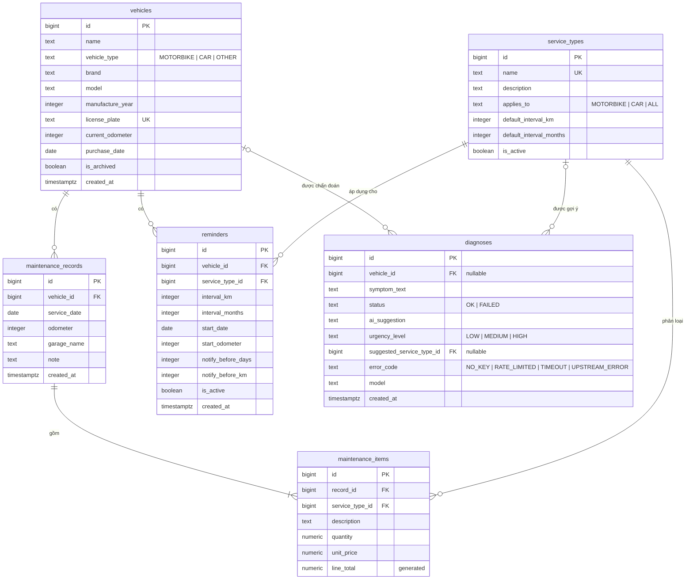

# 04 – ERD & Database Design

**Người phụ trách:** Kiều Bảo Giang · **Đầu vào:** [01 Requirements](../01-requirements/requirements.md)
**Hệ quản trị:** PostgreSQL 16: `postgres:16-alpine` trong Compose (Week 4) và **Supabase** trên cloud (Week 7)

File đi kèm (copy sang `db/` của repo `team01` khi code):

| File | Nội dung |
|---|---|
| [`schema.sql`](schema.sql) | Tạo bảng, ràng buộc, index, view, bật RLS. **Chạy lại nhiều lần không lỗi** |
| [`seed.sql`](seed.sql) | Dữ liệu mẫu, **chạy lại không nhân đôi** (dựa trên khóa tự nhiên, không ghi cứng id) |
| [`sample-queries.sql`](sample-queries.sql) | Các truy vấn chính, viết theo tham số psycopg `%(ten)s` |

## 1. Danh sách bảng

| Bảng | Ý nghĩa | FR |
|---|---|---|
| `service_types` | Danh mục loại dịch vụ, có chu kỳ mặc định | FR-11, FR-12 |
| `vehicles` | Xe | FR-01 → FR-05 |
| `maintenance_records` | Một lần bảo dưỡng | FR-06 → FR-09 |
| `maintenance_items` | Hạng mục trong một lần bảo dưỡng | FR-06, FR-08 |
| `reminders` | Quy tắc nhắc lịch của một loại dịch vụ cho một xe | FR-13 → FR-15 |
| `diagnoses` | Lịch sử chẩn đoán AI, gồm cả lần lỗi | FR-18 → FR-21 |

Bảng `notes` của starter không còn dùng nữa. Endpoint `/health/db` đổi sang `SELECT count(*) FROM vehicles` và trả về `{"db":"ok","vehicles":N}`. Đổi trong cùng PR với việc thay `schema.sql`.

## 2. Sơ đồ ERD



## 3. Mối quan hệ

| Quan hệ | Bản số | Khi xóa bản ghi cha | Lý do |
|---|---|---|---|
| vehicles → maintenance_records | 1 – n | **RESTRICT** | Xe đã có lịch sử không xóa hẳn được, chỉ lưu trữ (BR-09) |
| vehicles → reminders | 1 – n | CASCADE | Nhắc lịch không có ý nghĩa khi không còn xe |
| vehicles → diagnoses | 0..1 – n | SET NULL | Giữ lịch sử chẩn đoán |
| maintenance_records → maintenance_items | 1 – 1..n | CASCADE | Xóa lần bảo dưỡng thì xóa luôn hạng mục. "Ít nhất 1 hạng mục" kiểm tra ở app (BR-04) |
| service_types → maintenance_items, reminders | 1 – n | **RESTRICT** | Loại dịch vụ đã dùng chỉ được ngừng dùng (BR-09) |
| service_types → diagnoses | 0..1 – n | SET NULL | |

## 4. Từ điển dữ liệu

Quy ước theo starter của môn: khóa chính `id bigint GENERATED ALWAYS AS IDENTITY`, khóa ngoại `<bảng>_id`, thời gian `timestamptz` (Supabase lưu UTC), tiền VNĐ dạng `numeric` (không dùng `float` để tránh sai số). Giá trị liệt kê dùng `text` + `CHECK ... IN (...)` thay vì `CREATE TYPE`, vì `CREATE TYPE` không có `IF NOT EXISTS` nên script sẽ không chạy lại được.

### 4.1. `service_types`

| Cột | Kiểu | Ràng buộc | Mô tả |
|---|---|---|---|
| id | bigint | PK, identity | |
| name | text | NOT NULL, UNIQUE, 1–100 ký tự | Ví dụ "Thay nhớt máy (xe máy)" |
| description | text | | |
| applies_to | text | NOT NULL, mặc định 'ALL', ∈ {MOTORBIKE, CAR, ALL} | Loại xe áp dụng |
| default_interval_km | integer | > 0, có thể NULL | Chu kỳ khuyến nghị (km) |
| default_interval_months | integer | > 0, có thể NULL | Chu kỳ khuyến nghị (tháng) |
| is_active | boolean | NOT NULL, mặc định true | false = ngừng dùng |

### 4.2. `vehicles`

| Cột | Kiểu | Ràng buộc | Mô tả |
|---|---|---|---|
| id | bigint | PK | |
| name | text | NOT NULL, 1–100 ký tự | Tên gợi nhớ, ví dụ "Vision đi làm" |
| vehicle_type | text | NOT NULL, ∈ {MOTORBIKE, CAR, OTHER} | |
| brand, model | text | | Hãng, dòng xe |
| manufacture_year | integer | 1950–2100 | |
| license_plate | text | UNIQUE, có thể NULL | BR-01 |
| current_odometer | integer | NOT NULL, mặc định 0, ≥ 0 | ODO hiện tại (BR-02) |
| purchase_date | date | | |
| is_archived | boolean | NOT NULL, mặc định false | Xe đã bán / lưu trữ |
| created_at | timestamptz | NOT NULL, mặc định now() | |

### 4.3. `maintenance_records`

| Cột | Kiểu | Ràng buộc | Mô tả |
|---|---|---|---|
| id | bigint | PK | |
| vehicle_id | bigint | FK → vehicles, NOT NULL | |
| service_date | date | NOT NULL | Không ở tương lai (BR-03, kiểm tra ở app) |
| odometer | integer | NOT NULL, ≥ 0 | ODO lúc bảo dưỡng |
| garage_name | text | | Nơi làm (text tự do, không tách bảng cho gọn) |
| note | text | | |
| created_at | timestamptz | NOT NULL | |
| | | UNIQUE (vehicle_id, service_date, odometer) | Chống nhập trùng (BR-04) |

### 4.4. `maintenance_items`

| Cột | Kiểu | Ràng buộc | Mô tả |
|---|---|---|---|
| id | bigint | PK | |
| record_id | bigint | FK → maintenance_records, NOT NULL | |
| service_type_id | bigint | FK → service_types, NOT NULL | |
| description | text | | Ví dụ "Nhớt Castrol 0.8L" |
| quantity | numeric(8,2) | NOT NULL, mặc định 1, > 0 | |
| unit_price | numeric(12,0) | NOT NULL, mặc định 0, ≥ 0 | Đơn giá VNĐ |
| line_total | numeric(14,0) | `GENERATED ALWAYS AS (round(quantity * unit_price)) STORED` | Thành tiền, database tự tính (BR-05) |

### 4.5. `reminders`

| Cột | Kiểu | Ràng buộc | Mô tả |
|---|---|---|---|
| id | bigint | PK | |
| vehicle_id | bigint | FK → vehicles, NOT NULL | |
| service_type_id | bigint | FK → service_types, NOT NULL | |
| interval_km | integer | > 0, có thể NULL | |
| interval_months | integer | > 0, có thể NULL | Phải có ít nhất 1 trong 2 cột (BR-06) |
| start_date | date | NOT NULL, mặc định hôm nay | Mốc gốc khi chưa có lần làm nào (BR-07) |
| start_odometer | integer | NOT NULL, mặc định 0 | App điền bằng ODO hiện tại của xe |
| notify_before_days | integer | NOT NULL, mặc định 7 | Ngưỡng "sắp đến hạn" (BR-08) |
| notify_before_km | integer | NOT NULL, mặc định 300 | |
| is_active | boolean | NOT NULL, mặc định true | false = tạm dừng |
| created_at | timestamptz | NOT NULL | |
| | | UNIQUE (vehicle_id, service_type_id) | BR-06 |

**Không lưu mốc đến hạn.** View `v_reminder_status` tự tìm lần bảo dưỡng gần nhất cùng loại dịch vụ rồi tính mốc mỗi khi đọc. Nhờ vậy:
- ghi nhận, sửa hay xóa lần bảo dưỡng thì nhắc lịch luôn đúng mà app không phải cập nhật gì (FR-15);
- không cần tác vụ chạy ngầm hằng ngày. Render free sleep sau ~15 phút không dùng nên cron trong container không chạy được.

### 4.6. `diagnoses`

| Cột | Kiểu | Ràng buộc | Mô tả |
|---|---|---|---|
| id | bigint | PK | |
| vehicle_id | bigint | FK → vehicles, có thể NULL | Xe được hỏi (không bắt buộc) |
| symptom_text | text | NOT NULL, 10–1.000 ký tự | Triệu chứng người dùng nhập |
| status | text | NOT NULL, ∈ {OK, FAILED} | |
| ai_suggestion | text | Bắt buộc khi OK | Gợi ý từ Gemini |
| urgency_level | text | ∈ {LOW, MEDIUM, HIGH} | |
| suggested_service_type_id | bigint | FK → service_types, có thể NULL | Hạng mục nên kiểm tra (dùng cho FR-22) |
| error_code | text | Bắt buộc khi FAILED, ∈ {NO_KEY, RATE_LIMITED, TIMEOUT, UPSTREAM_ERROR} | Xem bảng BR-10 ở tài liệu 01 |
| model | text | | Tên model Gemini đã gọi |
| created_at | timestamptz | NOT NULL | |

Ràng buộc kiểm tra: `OK` thì phải có `ai_suggestion` và không có `error_code`; `FAILED` thì phải có `error_code`. Số lần `RATE_LIMITED` trong bảng này là số liệu thật để đưa vào mục "AI API integration" của report.

## 5. View

| View | Mục đích |
|---|---|
| `v_record_totals` | Mỗi lần bảo dưỡng kèm `item_count` và `total_cost`. Dùng cho lịch sử, Dashboard, thống kê |
| `v_reminder_status` | Mỗi nhắc lịch kèm mốc gốc, `next_due_date`, `next_due_odometer`, `days_left`, `km_left` và `status` ∈ {OK, DUE_SOON, OVERDUE} |

Cả hai view tạo với `WITH (security_invoker = true)`. Mặc định, view trong PostgreSQL chạy với quyền của chủ view, nên REST API tự động của Supabase có thể đọc dữ liệu qua view dù bảng đã bật RLS. Với `security_invoker`, người gọi qua REST API (role `anon`) không thấy dòng nào; app kết nối bằng chủ bảng nên vẫn đọc bình thường. Điều này đã được kiểm tra bằng một role không phải chủ bảng: đọc qua view được 0 dòng.

## 6. Index

Ngoài khóa chính và các ràng buộc UNIQUE (PostgreSQL tự tạo index):

| Index | Phục vụ |
|---|---|
| `maintenance_records (vehicle_id, service_date DESC)` | Lịch sử bảo dưỡng của xe; tìm lần làm gần nhất trong `v_reminder_status` |
| `maintenance_items (record_id)` | Lấy hạng mục của một lần bảo dưỡng, tính tổng chi phí |
| `maintenance_items (service_type_id)` | Thống kê theo loại dịch vụ; tìm lần làm gần nhất cùng loại |
| `diagnoses (created_at DESC)` | Lịch sử chẩn đoán mới nhất |

PostgreSQL không tự tạo index cho cột khóa ngoại (khác MySQL), nên hai index trên `maintenance_items` phải tạo tay.

## 7. Chuẩn hóa

Lược đồ đạt **3NF**:
- Cột nguyên tố; các hạng mục tách bảng riêng thay vì gộp trong một cột (1NF).
- Khóa chính là khóa đơn, không có phụ thuộc bộ phận (2NF).
- Không có phụ thuộc bắc cầu; tổng chi phí và mốc đến hạn không lưu mà tính qua view (3NF).

Chỗ phi chuẩn hóa có chủ đích duy nhất là `vehicles.current_odometer`. Cột này được lưu để hiển thị nhanh và được cập nhật trong cùng transaction khi ghi nhận bảo dưỡng có ODO lớn hơn (BR-02).

## 8. Kết nối từ ứng dụng (áp dụng Week 4 và Week 7)

| Môi trường | `DATABASE_URL` lấy từ đâu | Host |
|---|---|---|
| Local (Compose) | `compose.yml` ghép từ `DB_PASSWORD` trong `.env` | `db` (tên service, **không phải** `localhost`) |
| Production (Render) | Render → Environment, giá trị là **Transaction pooler** của Supabase (cổng `6543`) | `*.pooler.supabase.com` |
| CI (GitHub Actions) | Giá trị giả trong `tests/conftest.py`, test không mở kết nối | |

App dùng `psycopg_pool.ConnectionPool` (đã làm ở nhánh `week7-pool`): `max_size=5`, kiểm tra kết nối trước khi cho mượn (pre-ping), thay kết nối sau 5 phút, `prepare_threshold=None` vì pooler cổng 6543 không hỗ trợ prepared statement, `connect_timeout=5`. Khi Supabase pause hoặc mất mạng: `/health/db` trả 503 sau tối đa 5 giây, `/health` vẫn 200, và app tự phục hồi khi DB có lại mà không cần redeploy.

## 9. Cách chạy

**Local bằng Compose:** copy `schema.sql` và `seed.sql` vào `team01/db/`. `compose.yml` đã mount 2 file này vào `/docker-entrypoint-initdb.d/`. Sau đó chạy:

```bash
podman compose down -v
```
```bash
podman compose up --build
```

(`down -v` xóa volume cũ để Postgres chạy lại script khởi tạo.)

**Supabase:** vào SQL Editor, dán `schema.sql` rồi Run, dán `seed.sql` rồi Run. Kiểm tra bằng `SELECT count(*) FROM vehicles;` → 3. Chạy lại cả hai lần nữa thì vẫn ra 3. Trong Table Editor, không bảng nào có nhãn đỏ "RLS disabled".

**Đã kiểm tra** trên `postgres:16-alpine`:
- Chạy `schema.sql` + `seed.sql` hai lần liên tiếp không lỗi; số dòng giữ nguyên (12 / 3 / 6 / 14 / 5 / 2).
- Ghi nhận thay nhớt mới thì nhắc lịch tự chuyển từ OVERDUE sang OK với mốc mới.
- Các ràng buộc BR-01, BR-04, BR-06, BR-09 chặn đúng dữ liệu sai.
- Role không phải chủ bảng đọc qua view được 0 dòng.
