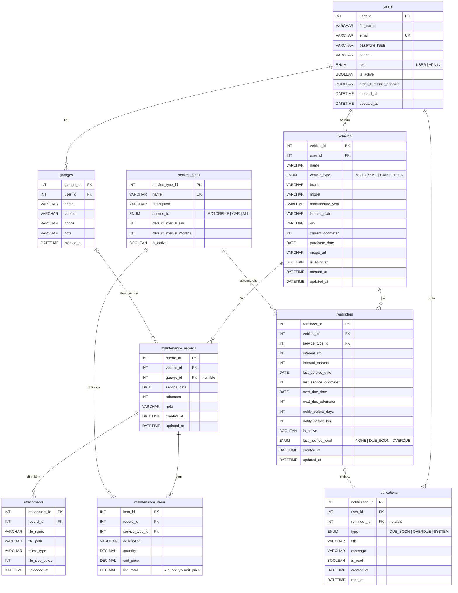

# 04 – ERD & Database Design

**Người phụ trách:** Giang · **Đầu vào:** [01 Requirements](../01-requirements/requirements.md) · **Hệ quản trị:** MySQL 8.0 (utf8mb4)

File đi kèm:
- [`schema.sql`](schema.sql): tạo database, bảng, ràng buộc, view.
- [`seed.sql`](seed.sql): dữ liệu mẫu để demo và kiểm thử.
- [`sample-queries.sql`](sample-queries.sql): các truy vấn chính mà ứng dụng sẽ dùng.

## 1. Danh sách thực thể

| Bảng | Ý nghĩa | FR liên quan |
|---|---|---|
| `users` | Tài khoản người dùng và quản trị viên | FR-01 → FR-04, FR-27 |
| `vehicles` | Xe của người dùng | FR-05 → FR-10 |
| `service_types` | Danh mục loại dịch vụ chuẩn, có chu kỳ mặc định | FR-26 |
| `garages` | Garage hay dùng của từng người dùng | FR-16 |
| `maintenance_records` | Một lần bảo dưỡng (phiếu) | FR-11 → FR-14 |
| `maintenance_items` | Các hạng mục trong một lần bảo dưỡng | FR-11, FR-13 |
| `attachments` | File hóa đơn đính kèm | FR-15 |
| `reminders` | Quy tắc nhắc lịch của một loại dịch vụ cho một xe | FR-18 → FR-20 |
| `notifications` | Thông báo gửi cho người dùng | FR-21 → FR-23 |

## 2. Sơ đồ ERD



## 3. Mối quan hệ

| Quan hệ | Bản số | Khi xóa bản ghi cha | Lý do |
|---|---|---|---|
| users → vehicles | 1 – n | CASCADE | Xe không tồn tại khi không có chủ. Thực tế tài khoản chỉ bị khóa, không xóa (BR-13) |
| users → garages | 1 – n | CASCADE | Garage là danh sách riêng của từng người |
| users → notifications | 1 – n | CASCADE | |
| vehicles → maintenance_records | 1 – n | **RESTRICT** | Xe đã có lịch sử không được xóa hẳn (BR-12) |
| vehicles → reminders | 1 – n | CASCADE | |
| garages → maintenance_records | 0..1 – n | SET NULL | Xóa garage không làm mất lịch sử |
| maintenance_records → maintenance_items | 1 – 1..n | CASCADE | Một lần bảo dưỡng có ít nhất 1 hạng mục (BR-05, kiểm tra ở tầng ứng dụng) |
| maintenance_records → attachments | 1 – n | CASCADE | Ứng dụng xóa luôn file vật lý |
| service_types → maintenance_items | 1 – n | **RESTRICT** | Loại dịch vụ đã dùng chỉ được ngừng dùng (BR-14) |
| service_types → reminders | 1 – n | **RESTRICT** | Như trên |
| reminders → notifications | 0..1 – n | SET NULL | Xóa nhắc lịch vẫn giữ thông báo cũ |

## 4. Từ điển dữ liệu

Quy ước chung: khóa chính `INT AUTO_INCREMENT`; tiền tính bằng VNĐ; `created_at`/`updated_at` do database tự điền.

### 4.1. `users`

| Cột | Kiểu | Ràng buộc | Mô tả |
|---|---|---|---|
| user_id | INT | PK | |
| full_name | VARCHAR(100) | NOT NULL | Họ tên |
| email | VARCHAR(255) | NOT NULL, UNIQUE | Email đăng nhập (BR-01) |
| password_hash | VARCHAR(255) | NOT NULL | Mật khẩu đã băm bcrypt (NFR-01) |
| phone | VARCHAR(20) | NULL | |
| role | ENUM('USER','ADMIN') | NOT NULL, mặc định 'USER' | Phân quyền |
| is_active | BOOLEAN | NOT NULL, mặc định TRUE | FALSE = bị khóa (BR-13) |
| email_reminder_enabled | BOOLEAN | NOT NULL, mặc định FALSE | Bật gửi email nhắc lịch (FR-23) |
| created_at, updated_at | DATETIME | NOT NULL | |

### 4.2. `vehicles`

| Cột | Kiểu | Ràng buộc | Mô tả |
|---|---|---|---|
| vehicle_id | INT | PK | |
| user_id | INT | FK → users, NOT NULL | Chủ xe |
| name | VARCHAR(100) | NOT NULL | Tên gợi nhớ, ví dụ "Vision đi làm" |
| vehicle_type | ENUM('MOTORBIKE','CAR','OTHER') | NOT NULL | |
| brand | VARCHAR(50) | NULL | Hãng: Honda, Toyota... |
| model | VARCHAR(50) | NULL | Dòng xe: Vision, Vios... |
| manufacture_year | SMALLINT | NULL, CHECK 1950–2100 | |
| license_plate | VARCHAR(20) | NULL, UNIQUE(user_id, license_plate) | Biển số (BR-02) |
| vin | VARCHAR(30) | NULL | Số khung |
| current_odometer | INT | NOT NULL, mặc định 0, CHECK ≥ 0 | ODO hiện tại (BR-03) |
| purchase_date | DATE | NULL | |
| image_url | VARCHAR(500) | NULL | Đường dẫn ảnh xe |
| is_archived | BOOLEAN | NOT NULL, mặc định FALSE | Xe đã bán/lưu trữ (FR-10) |
| created_at, updated_at | DATETIME | NOT NULL | |

### 4.3. `service_types`

| Cột | Kiểu | Ràng buộc | Mô tả |
|---|---|---|---|
| service_type_id | INT | PK | |
| name | VARCHAR(100) | NOT NULL, UNIQUE | Ví dụ "Thay nhớt máy (xe máy)" |
| description | VARCHAR(255) | NULL | |
| applies_to | ENUM('MOTORBIKE','CAR','ALL') | NOT NULL, mặc định 'ALL' | Loại xe áp dụng |
| default_interval_km | INT | NULL, CHECK > 0 | Chu kỳ khuyến nghị theo km |
| default_interval_months | INT | NULL, CHECK > 0 | Chu kỳ khuyến nghị theo tháng |
| is_active | BOOLEAN | NOT NULL, mặc định TRUE | FALSE = ngừng dùng (BR-14) |

### 4.4. `garages`

| Cột | Kiểu | Ràng buộc | Mô tả |
|---|---|---|---|
| garage_id | INT | PK | |
| user_id | INT | FK → users, NOT NULL | Người lưu |
| name | VARCHAR(100) | NOT NULL | |
| address | VARCHAR(255) | NULL | |
| phone | VARCHAR(20) | NULL | |
| note | VARCHAR(255) | NULL | |
| created_at | DATETIME | NOT NULL | |

### 4.5. `maintenance_records`

| Cột | Kiểu | Ràng buộc | Mô tả |
|---|---|---|---|
| record_id | INT | PK | |
| vehicle_id | INT | FK → vehicles, NOT NULL | |
| garage_id | INT | FK → garages, NULL | Nơi làm |
| service_date | DATE | NOT NULL | Không ở tương lai (BR-04, kiểm tra ở ứng dụng) |
| odometer | INT | NOT NULL, CHECK ≥ 0 | ODO lúc bảo dưỡng |
| note | VARCHAR(500) | NULL | |
| created_at, updated_at | DATETIME | NOT NULL | |

Tổng chi phí **không lưu** trong bảng này mà tính từ `maintenance_items` qua view `v_record_totals`, để không bao giờ lệch với các hạng mục (BR-06).

### 4.6. `maintenance_items`

| Cột | Kiểu | Ràng buộc | Mô tả |
|---|---|---|---|
| item_id | INT | PK | |
| record_id | INT | FK → maintenance_records, NOT NULL | |
| service_type_id | INT | FK → service_types, NOT NULL | |
| description | VARCHAR(255) | NULL | Ví dụ "Nhớt Castrol 0.8L" |
| quantity | DECIMAL(8,2) | NOT NULL, mặc định 1, CHECK > 0 | |
| unit_price | DECIMAL(12,0) | NOT NULL, mặc định 0, CHECK ≥ 0 | Đơn giá (VNĐ) |
| line_total | DECIMAL(14,0) | Cột sinh tự động = ROUND(quantity × unit_price) | Thành tiền (BR-06) |

### 4.7. `attachments`

| Cột | Kiểu | Ràng buộc | Mô tả |
|---|---|---|---|
| attachment_id | INT | PK | |
| record_id | INT | FK → maintenance_records, NOT NULL | |
| file_name | VARCHAR(255) | NOT NULL | Tên file gốc |
| file_path | VARCHAR(500) | NOT NULL | Đường dẫn lưu trên server |
| mime_type | VARCHAR(50) | NOT NULL | image/jpeg, image/png, application/pdf |
| file_size_bytes | INT | NOT NULL, CHECK 1 – 5.242.880 | Tối đa 5 MB (NFR-08) |
| uploaded_at | DATETIME | NOT NULL | |

### 4.8. `reminders`

| Cột | Kiểu | Ràng buộc | Mô tả |
|---|---|---|---|
| reminder_id | INT | PK | |
| vehicle_id | INT | FK → vehicles, NOT NULL | |
| service_type_id | INT | FK → service_types, NOT NULL, UNIQUE(vehicle_id, service_type_id) | BR-11 |
| interval_km | INT | NULL, CHECK > 0 | Chu kỳ km |
| interval_months | INT | NULL, CHECK > 0 | Chu kỳ tháng. Phải có ít nhất 1 trong 2 cột (BR-07) |
| last_service_date | DATE | NOT NULL | Mốc gốc để tính hạn (BR-08) |
| last_service_odometer | INT | NOT NULL | |
| next_due_date | DATE | NULL | = last_service_date + interval_months |
| next_due_odometer | INT | NULL | = last_service_odometer + interval_km |
| notify_before_days | INT | NOT NULL, mặc định 7 | Ngưỡng "sắp đến hạn" (BR-09) |
| notify_before_km | INT | NOT NULL, mặc định 300 | |
| is_active | BOOLEAN | NOT NULL, mặc định TRUE | FALSE = tạm dừng |
| last_notified_level | ENUM('NONE','DUE_SOON','OVERDUE') | NOT NULL, mặc định 'NONE' | Mức đã thông báo, chống lặp (BR-10). Đặt về NONE khi mốc được tính lại |
| created_at, updated_at | DATETIME | NOT NULL | |

`next_due_date` và `next_due_odometer` do tầng ứng dụng tính và lưu lại mỗi khi tạo/sửa nhắc lịch hoặc ghi nhận bảo dưỡng (FR-20), giúp truy vấn tìm nhắc lịch đến hạn chạy nhanh nhờ index.

### 4.9. `notifications`

| Cột | Kiểu | Ràng buộc | Mô tả |
|---|---|---|---|
| notification_id | INT | PK | |
| user_id | INT | FK → users, NOT NULL | |
| reminder_id | INT | FK → reminders, NULL | |
| type | ENUM('DUE_SOON','OVERDUE','SYSTEM') | NOT NULL | |
| title | VARCHAR(150) | NOT NULL | |
| message | VARCHAR(500) | NOT NULL | |
| is_read | BOOLEAN | NOT NULL, mặc định FALSE | |
| created_at | DATETIME | NOT NULL | |
| read_at | DATETIME | NULL | |

## 5. View

| View | Mục đích |
|---|---|
| `v_record_totals` | Mỗi lần bảo dưỡng kèm `total_cost` và `item_count`, dùng cho danh sách lịch sử, dashboard, thống kê |
| `v_reminder_status` | Mỗi nhắc lịch kèm ODO hiện tại của xe, số ngày/km còn lại và trạng thái `OK` / `DUE_SOON` / `OVERDUE` tính theo BR-09 |

## 6. Index

Ngoài khóa chính, khóa ngoại (MySQL tự tạo index) và các ràng buộc UNIQUE:

| Index | Phục vụ |
|---|---|
| `maintenance_records(vehicle_id, service_date)` | Lịch sử bảo dưỡng của xe, sắp xếp theo ngày (FR-12) |
| `reminders(is_active, next_due_date)` | Tiến trình nhắc lịch quét theo ngày (FR-21) |
| `notifications(user_id, is_read, created_at)` | Đếm/hiển thị thông báo chưa đọc (FR-22) |
| `vehicles(user_id, is_archived)` | Danh sách xe đang dùng (FR-06) |

## 7. Chuẩn hóa

Lược đồ đạt **dạng chuẩn 3 (3NF)**:
- Mọi cột đều nguyên tố (1NF); các hạng mục của một lần bảo dưỡng tách ra bảng `maintenance_items` thay vì lưu chung một cột.
- Khóa chính đều là khóa đơn nên không có phụ thuộc bộ phận (2NF).
- Không có phụ thuộc bắc cầu (3NF): chủ xe chỉ lưu ở `vehicles`, không lặp lại ở `maintenance_records`; tổng chi phí không lưu mà tính qua view.

Hai chỗ phi chuẩn hóa có chủ đích, đều do ứng dụng tự cập nhật:
- `vehicles.current_odometer`: lưu để hiển thị nhanh, cập nhật khi người dùng nhập ODO mới hoặc ghi nhận bảo dưỡng (BR-03).
- `reminders.next_due_date`, `next_due_odometer`: lưu để quét nhắc lịch nhanh (xem 4.8).

## 8. Cách chạy

```bash
mysql -u root -p < schema.sql
mysql -u root -p vehicle_maintenance < seed.sql
```

Hoặc mở hai file trong MySQL Workbench và chạy lần lượt `schema.sql` rồi `seed.sql`.
