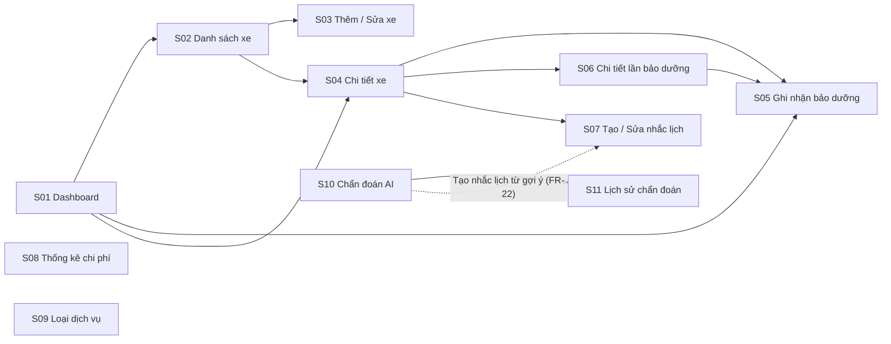

# 05 – Wireframe

**Người phụ trách:** Nguyễn Nam Khoa · **Đầu vào:** 01 (Requirements), 02 (Use Case) · **Trạng thái:** ✅ Xong (chờ review)

Wireframe độ trung thực thấp (low-fidelity), chỉ dùng xám đen, cho 11 màn hình **S01–S11** trong mục 7 của [`01-requirements/requirements.md`](../01-requirements/requirements.md). Mỗi ảnh có chú thích mã màn hình và mã `FR-xx` ở chân ảnh. Tên trường, tên bảng và quy tắc nghiệp vụ (`BR-xx`) dùng thống nhất với tài liệu 01 và 04.

- Desktop: 1280×800 px. Mobile: 360×760 px (đáp ứng NFR-08, dùng được từ 360px).
- Giao diện tiếng Việt, tiền tệ VNĐ, quãng đường km.
- Dữ liệu trong ảnh là dữ liệu mẫu minh họa.

## Sơ đồ điều hướng

Menu chính (luôn hiện): Dashboard · Xe của tôi · Loại dịch vụ · Thống kê · Chẩn đoán AI. Trên mobile là thanh điều hướng dưới cùng.

## Danh sách màn hình

| Mã | Màn hình | FR / BR liên quan | Ảnh |
|----|----------|-------------------|-----|
| S01 | Dashboard | FR-16 | [S01-dashboard.png](S01-dashboard.png) · [mobile](M-S01-dashboard.png) |
| S02 | Danh sách xe | FR-02, FR-05 | [S02-danh-sach-xe.png](S02-danh-sach-xe.png) |
| S02b | Hộp thoại xác nhận lưu trữ/xóa xe | FR-05, NFR-09, BR-09 | [S02b-xac-nhan-luu-tru.png](S02b-xac-nhan-luu-tru.png) |
| S02c | Trạng thái rỗng (chưa có xe) | FR-02 | [S02c-trang-thai-rong.png](S02c-trang-thai-rong.png) |
| S03 | Thêm / Sửa xe | FR-01, FR-04, BR-01, BR-02 | [S03-them-sua-xe.png](S03-them-sua-xe.png) |
| S04 | Chi tiết xe, tab Lịch sử | FR-03, FR-07 | [S04-chi-tiet-xe-lich-su.png](S04-chi-tiet-xe-lich-su.png) · [mobile](M-S04-chi-tiet-xe.png) |
| S04b | Chi tiết xe, tab Nhắc lịch | FR-14, BR-08 | [S04b-chi-tiet-xe-nhac-lich.png](S04b-chi-tiet-xe-nhac-lich.png) |
| S05 | Ghi nhận / Sửa lần bảo dưỡng | FR-06, FR-09, BR-02..BR-05 | [S05-ghi-nhan-bao-duong.png](S05-ghi-nhan-bao-duong.png) · [mobile](M-S05-ghi-nhan-bao-duong.png) |
| S06 | Chi tiết lần bảo dưỡng | FR-08, FR-09 | [S06-chi-tiet-lan-bao-duong.png](S06-chi-tiet-lan-bao-duong.png) |
| S07 | Tạo / Sửa nhắc lịch | FR-13, FR-14, BR-06..BR-08 | [S07-tao-nhac-lich.png](S07-tao-nhac-lich.png) |
| S08 | Thống kê chi phí | FR-17 | [S08-thong-ke-chi-phi.png](S08-thong-ke-chi-phi.png) |
| S09 | Loại dịch vụ | FR-11, FR-12, BR-09 | [S09-loai-dich-vu.png](S09-loai-dich-vu.png) |
| S10 | Chẩn đoán AI (8 trạng thái, xem bảng bên dưới) | FR-18..FR-20, FR-22, BR-10 | [mobile](M-S10-chan-doan-ai.png) |
| S11 | Lịch sử chẩn đoán | FR-21 | [S11-lich-su-chan-doan.png](S11-lich-su-chan-doan.png) |

## S10 – các trạng thái (theo bảng BR-10)

Ở mọi trạng thái lỗi, nội dung người dùng đã nhập vẫn được giữ nguyên trong ô nhập.

| Trạng thái | Mã server | Thông báo hiển thị | `diagnoses.error_code` | Ảnh |
|------------|-----------|--------------------|------------------------|-----|
| Ban đầu | – | Khung kết quả trống | – | [S10a](S10a-chan-doan-ban-dau.png) |
| Đang chờ | – | Nút "Đang phân tích…" bị khóa, khung kết quả hiện skeleton | – | [S10b](S10b-dang-cho.png) |
| Thành công | 200 | Mức khẩn cấp LOW/MEDIUM/HIGH, nguyên nhân, hạng mục nên kiểm tra, câu "chỉ mang tính tham khảo", nút "Tạo nhắc lịch từ gợi ý" | – | [S10c](S10c-thanh-cong.png) |
| Chưa cấu hình key | 503 | "Tính năng chẩn đoán AI tạm thời không khả dụng." | `NO_KEY` | [S10d](S10d-loi-503-no-key.png) |
| Hết lượt | 429 | "Đã hết lượt chẩn đoán miễn phí, vui lòng thử lại sau ít phút." | `RATE_LIMITED` | [S10e](S10e-loi-429-rate-limited.png) |
| Quá thời gian | 504 | "AI phản hồi quá lâu, vui lòng thử lại." | `TIMEOUT` | [S10f](S10f-loi-504-timeout.png) |
| Lỗi từ Gemini | 502 | "Không nhận được kết quả từ AI, vui lòng thử lại." | `UPSTREAM_ERROR` | [S10g](S10g-loi-502-upstream.png) |
| Triệu chứng quá ngắn/dài | 422 | Báo lỗi ngay dưới ô nhập, không gọi AI, không lưu | (không lưu) | [S10h](S10h-loi-422-qua-ngan.png) |

## Ghi chú thiết kế

- Không có đăng nhập, không có phân quyền (ngoài phạm vi, mục 1.4 của tài liệu 01), nên thanh trên cùng không có khu vực tài khoản.
- Trạng thái nhắc lịch luôn kèm chữ (Còn hạn / Sắp đến hạn / Quá hạn), không chỉ dựa vào màu.
- Xóa xe và xóa lần bảo dưỡng luôn qua hộp thoại xác nhận (NFR-09).
- Tổng chi phí của lần bảo dưỡng là ô chỉ đọc, tự tính từ các hạng mục (BR-05).
