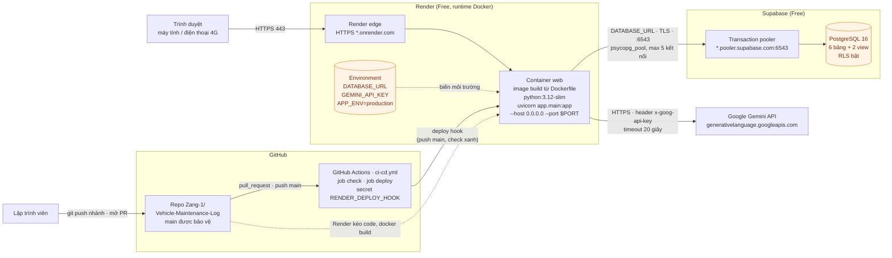
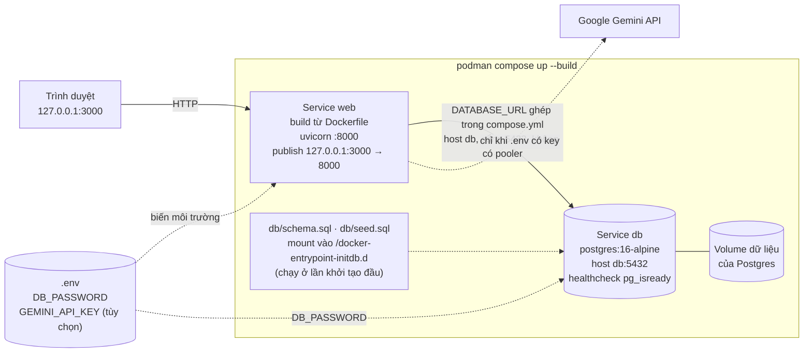
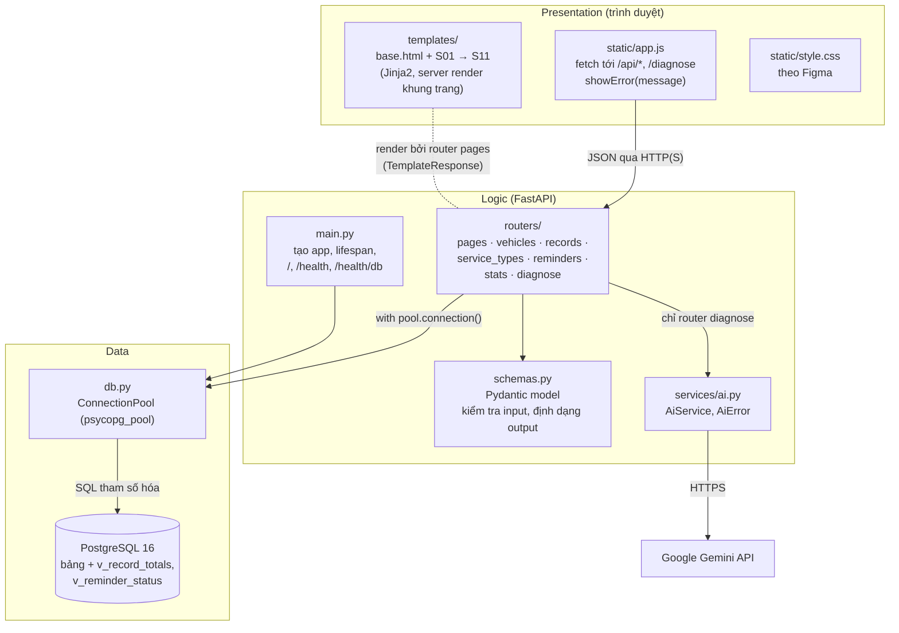
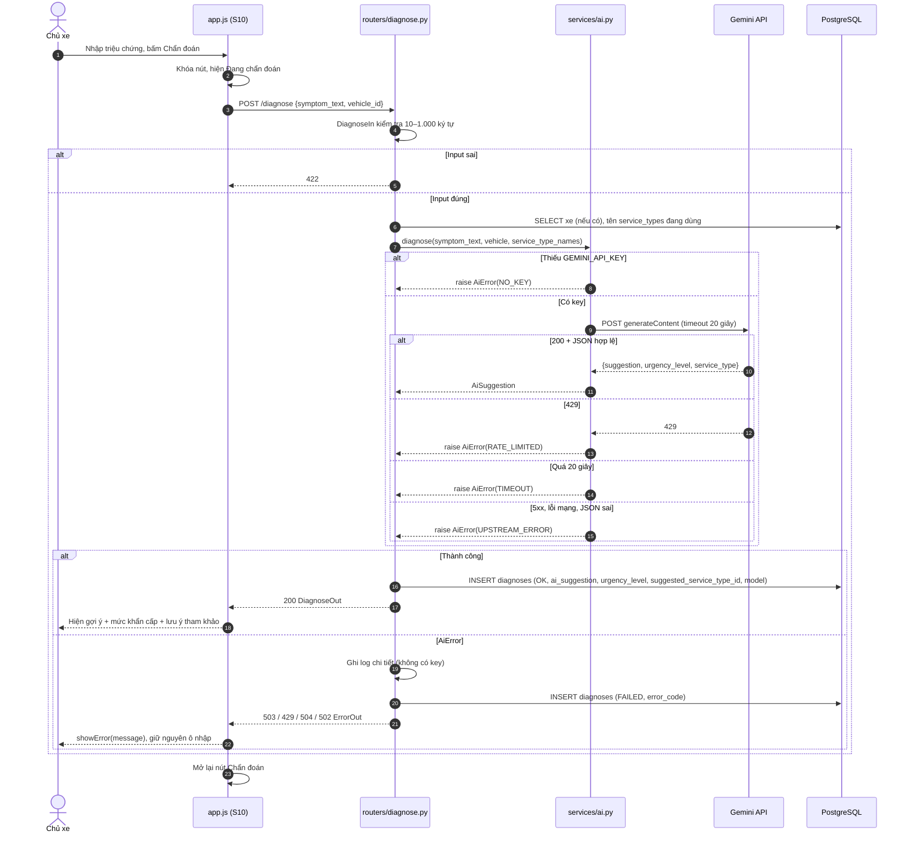
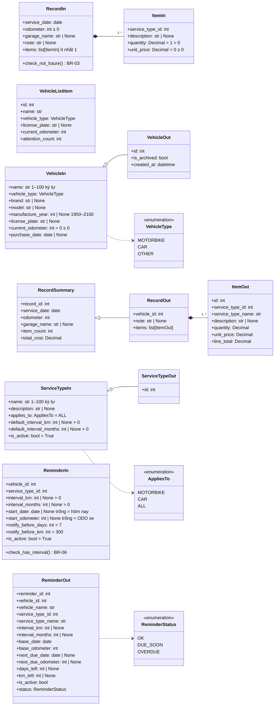
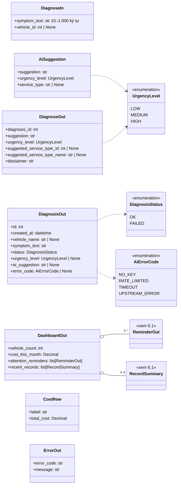
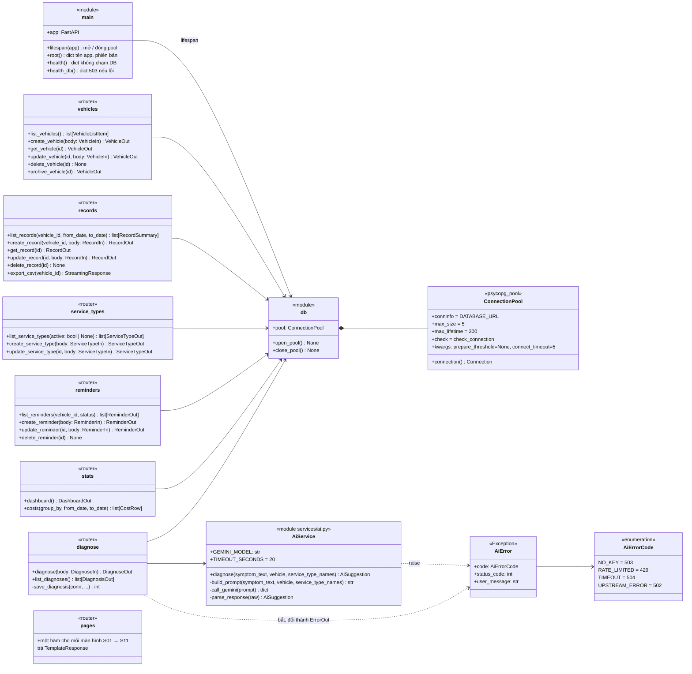

# 07 – Architecture & Class Diagram

**Người phụ trách:** Tăng Thoại Lâm · **Phiên bản:** 2.0 · **Đầu vào:** [02 Use Case](../02-use-case/), [04 Database](../04-database/erd.md), [08 Implementation Plan](../08-implementation-plan/implementation-plan.md) (mục 1–5)

Tài liệu chốt công nghệ, vẽ sơ đồ triển khai **khớp với những gì thật sự được deploy**, kiến trúc 3 tầng và class diagram của ứng dụng. Tên file, tên lớp, tên hàm ở đây là tên sẽ dùng trong code (cấu trúc repo ở mục 3 tài liệu 08). Sơ đồ ở mục 2 và 3 là bản dùng cho mục 2 "System architecture" của report; nếu cách deploy thay đổi thì phải sửa sơ đồ trong cùng PR.

## 1. Công nghệ chốt

Giữ nguyên lựa chọn ở mục 1 tài liệu 08 và chốt các điểm còn để mở:

| Thành phần | Chốt | Phiên bản / gói | Ghi chú |
|---|---|---|---|
| Ngôn ngữ | Python | 3.12 (cùng phiên bản ở Dockerfile và CI) | |
| Backend | FastAPI + Pydantic v2, chạy bằng uvicorn | `fastapi`, `uvicorn[standard]`, `pydantic` | Có sẵn trang `/docs` để thử API |
| Giao diện | Jinja2 templates + CSS + JavaScript `fetch` | `jinja2`; FastAPI phục vụ cả `templates/` và `static/` | Một service duy nhất, không có bước build frontend |
| Truy cập DB | psycopg 3 + connection pool | `psycopg[binary]`, `psycopg_pool` | SQL viết tay, tham số hóa `%(ten)s` (NFR-02) |
| Gọi AI | **`httpx`** gọi REST API của Gemini | `httpx` | **Chốt `httpx` thay cho `google-genai`**: đặt timeout 20 giây trực tiếp, đọc được mã HTTP gốc (429, 5xx) để ánh xạ đúng bảng BR-10, dễ mock trong test, ít phụ thuộc |
| Model AI | Gemini Flash của free tier | Tên model là hằng `GEMINI_MODEL` trong `app/services/ai.py`, lưu vào `diagnoses.model` | Kiểm tra lại tên model và rate limit trên Google AI Studio khi code M7 |
| Database | PostgreSQL 16 | `postgres:16-alpine` (local) · Supabase (cloud) | |
| Container | Podman + Dockerfile + Compose | Base image `python:3.12-slim` | |
| Cloud | Render Web Service, runtime Docker, gói Free | Auto-Deploy **tắt**, health check path `/health` | |
| CI/CD | GitHub Actions + Render Deploy Hook | Workflow `.github/workflows/ci-cd.yml`: job `check`, job `deploy` | |
| Kiểm thử | pytest + FastAPI `TestClient`, ruff | `pytest`, `ruff`, `httpx` (TestClient cần) | Không gọi Gemini thật, không cần DB thật (NFR-11) |

## 2. Sơ đồ triển khai – production



| Kết nối | Giao thức / cổng | Xác thực | Ghi chú |
|---|---|---|---|
| Trình duyệt → Render | HTTPS 443 | Không (không có đăng nhập) | Render cấp chứng chỉ TLS và chuyển request vào cổng `$PORT` của container (PR-01) |
| Container → Supabase | PostgreSQL qua TLS, **cổng 6543** (transaction pooler) | User/mật khẩu trong `DATABASE_URL` | Pooler không hỗ trợ prepared statement nên pool đặt `prepare_threshold=None` (tài liệu 04, mục 8) |
| Container → Gemini | HTTPS 443, REST `generateContent` | Key gửi trong **header** `x-goog-api-key`, không đặt trên URL để key không lọt vào log | Chỉ server gọi; trình duyệt không bao giờ thấy key (PR-06) |
| GitHub → Actions | Nội bộ GitHub | – | Sự kiện `pull_request` và `push` vào `main` |
| Actions → Render | HTTPS POST tới deploy hook | URL hook chính là bí mật (GitHub secret) | Chỉ job `deploy` chạy khi `check` xanh trên `main` (PR-04) |
| Render → GitHub | HTTPS | Render GitHub App | Render kéo code của commit mới nhất trên `main` rồi build `Dockerfile` |
| Render → container | HTTP `/health` | – | Health check không chạm DB, nên DB pause không làm Render coi service là chết (NFR-04) |

## 3. Sơ đồ triển khai – local (Compose)



`web` khai báo `depends_on: db` với điều kiện `service_healthy`, nên app chỉ khởi động khi Postgres đã sẵn sàng.

**Local khác cloud ở đâu**

| Khía cạnh | Local (Compose) | Production (Render + Supabase) |
|---|---|---|
| Database | Container `db` trong cùng mạng Compose | Supabase managed PostgreSQL |
| Host trong `DATABASE_URL` | `db` (tên service, không phải `localhost`) | `*.pooler.supabase.com` |
| Cổng DB | 5432, kết nối thẳng, không pooler | 6543, transaction pooler |
| Tạo bảng, dữ liệu mẫu | Tự chạy `schema.sql` + `seed.sql` khi volume còn trống | Dán vào Supabase SQL Editor một lần (script chạy lại được) |
| Biến môi trường lấy từ | `.env` (đã gitignore) | Render → Environment |
| Địa chỉ app | `http://127.0.0.1:3000`, HTTP | `https://<tên-service>.onrender.com`, HTTPS |
| Cách chạy bản mới | `podman compose up --build` | Merge vào `main` → Actions → deploy hook |
| `$PORT` | Không đặt, uvicorn dùng mặc định 8000 | Render tự đặt, không ghi đè |
| Ngủ khi không dùng | Không | Render sleep sau ~15 phút; Supabase pause sau 7 ngày không hoạt động |
| Gemini | Chỉ chạy khi `.env` có key; không có key thì `/diagnose` trả 503 `NO_KEY` | Key ở Render Environment |

## 4. Kiến trúc 3 tầng



**Quy tắc giữa các tầng**
- Trình duyệt chỉ nói chuyện với FastAPI. Không bao giờ gọi thẳng Supabase hay Gemini (NFR-01, PR-06).
- Mỗi router làm đúng 3 việc (tài liệu 08, mục 3): nhận input đã được Pydantic kiểm tra → chạy SQL tham số hóa → trả JSON hoặc trang HTML. Router không ghép chuỗi SQL.
- Quy tắc tính toán nằm ở tầng Data khi có thể: thành tiền là cột sinh tự động, tổng chi phí và trạng thái nhắc lịch là view. Router chỉ đọc, nên không có chỗ nào tính lệch nhau.
- Phần gọi Gemini tách riêng trong `services/ai.py`, để router `diagnose` không phụ thuộc chi tiết HTTP của Gemini và để test thay hàm này bằng mock (NFR-11).
- `/health` nằm ở `main.py` và không chạm DB; `/health/db` mượn một kết nối từ pool và trả 503 khi lỗi (NFR-04, NFR-05).

## 5. Luồng xử lý một request: `POST /diagnose`

Request phức tạp nhất của hệ thống, đi qua đủ 3 tầng và gọi ra hệ thống ngoài. Luồng nghiệp vụ đầy đủ ở activity diagram 3 của [tài liệu 03](../03-activity/README.md#3-chẩn-đoán-ai).



## 6. Class diagram

Ứng dụng viết theo kiểu FastAPI: router là module Python chứa các hàm xử lý, không phải lớp. Trong class diagram, mỗi module được vẽ như một lớp có nhãn `«router»` hoặc `«module»`, các hàm là phương thức. Kiểu dữ liệu ghi theo Python: `X | None` là có thể trống, `list[X]` là danh sách, `Decimal` cho tiền (khớp `numeric` của PostgreSQL).

Pydantic model đặt trong `app/schemas.py`. Quy ước tên: `...In` là dữ liệu trình duyệt gửi lên (đã kiểm tra ràng buộc), `...Out` là dữ liệu server trả về. Các kiểu liệt kê dùng `StrEnum`, giá trị trùng với `CHECK ... IN (...)` ở `schema.sql`.

### 6.1. Pydantic model – xe, bảo dưỡng, loại dịch vụ, nhắc lịch



| Model | Bảng / view ở tài liệu 04 | Dùng ở API |
|---|---|---|
| `VehicleIn`, `VehicleOut` | `vehicles` | `POST`, `PUT`, `GET /api/vehicles/{id}` |
| `VehicleListItem` | `vehicles` + `v_reminder_status` (đếm nhắc lịch cần chú ý) | `GET /api/vehicles` |
| `RecordIn`, `ItemIn` | `maintenance_records`, `maintenance_items` | `POST /api/vehicles/{id}/records`, `PUT /api/records/{id}` |
| `RecordSummary` | `v_record_totals` | `GET /api/vehicles/{id}/records`, Dashboard |
| `RecordOut`, `ItemOut` | `v_record_totals` + `maintenance_items` + `service_types` | `GET /api/records/{id}` |
| `ServiceTypeIn`, `ServiceTypeOut` | `service_types` | `/api/service-types` |
| `ReminderIn` | `reminders` | `POST /api/reminders`, `PUT /api/reminders/{id}` |
| `ReminderOut` | `v_reminder_status` | `GET /api/reminders`, Dashboard |

### 6.2. Pydantic model – chẩn đoán AI, thống kê, lỗi



| Model | Bảng ở tài liệu 04 | Vai trò |
|---|---|---|
| `DiagnoseIn` | `diagnoses.symptom_text`, `vehicle_id` | Body của `POST /diagnose`; sai độ dài thì 422, không gọi AI |
| `AiSuggestion` | `diagnoses.ai_suggestion`, `urgency_level` | Kiểm tra JSON Gemini trả về. Sai định dạng thì `AiService` coi là `UPSTREAM_ERROR` |
| `DiagnoseOut` | 1 dòng `diagnoses` có `status = OK` | Kết quả trả cho S10, luôn có `disclaimer` (FR-19) |
| `DiagnosisOut` | `diagnoses` + `vehicles.name` | Một dòng lịch sử ở S11 (FR-21) |
| `DashboardOut`, `CostRow` | `v_record_totals`, `v_reminder_status` | `GET /api/stats/dashboard`, `GET /api/stats/costs` |
| `ErrorOut` | – | Body của mọi lỗi nghiệp vụ (404, 409, lỗi AI). Lỗi 422 giữ định dạng mặc định của FastAPI để `app.js` biết trường nào sai |

### 6.3. Router, AiService, AiError, ConnectionPool



**`AiService` ánh xạ lỗi sang `AiError`** (bảng BR-10 tài liệu 01):

| Điều kiện trong `services/ai.py` | `AiErrorCode` | HTTP trả trình duyệt | `user_message` |
|---|---|---|---|
| `os.getenv("GEMINI_API_KEY")` rỗng | `NO_KEY` | 503 | Tính năng chẩn đoán AI tạm thời không khả dụng. |
| Gemini trả `429` | `RATE_LIMITED` | 429 | Đã hết lượt chẩn đoán miễn phí, vui lòng thử lại sau ít phút. |
| `httpx.TimeoutException` (quá 20 giây) | `TIMEOUT` | 504 | AI phản hồi quá lâu, vui lòng thử lại. |
| Gemini trả `5xx` hoặc 4xx khác (ví dụ key sai), `httpx.TransportError` (lỗi mạng), JSON không qua được `AiSuggestion` | `UPSTREAM_ERROR` | 502 | Không nhận được kết quả từ AI, vui lòng thử lại. |

Request gửi Gemini đặt `generationConfig.responseMimeType = "application/json"` để model trả JSON, nhưng server vẫn luôn kiểm tra lại bằng `AiSuggestion` vì model có thể trả sai.

## 7. Trách nhiệm từng thành phần

| Thành phần | File | Trách nhiệm | FR / yêu cầu | Module (08) |
|---|---|---|---|---|
| `main` | `app/main.py` | Tạo app, gắn router, mount `static/`; lifespan mở pool khi khởi động, đóng khi tắt; `/` trả tên + phiên bản (dùng kiểm tra deploy PT-04); `/health` không chạm DB; `/health/db` đếm `vehicles`, lỗi thì 503; đăng ký exception handler đổi `AiError` và lỗi nghiệp vụ thành `ErrorOut` | NFR-04, NFR-05 | M0 |
| `db` + `ConnectionPool` | `app/db.py` | Một pool dùng chung cho cả app; đọc `DATABASE_URL` (bắt buộc, thiếu thì app dừng ngay khi khởi động); kiểm tra kết nối trước khi cho mượn, thay kết nối sau 5 phút, `prepare_threshold=None` cho pooler 6543, `connect_timeout=5` | PR-05, NFR-05 | M1 |
| `schemas` | `app/schemas.py` | Tất cả Pydantic model ở mục 6.1–6.2: ràng buộc độ dài, khoảng giá trị, kiểu liệt kê; validator `check_not_future` (BR-03), `check_has_interval` (BR-06) | NFR-02 | Người làm module tương ứng |
| `vehicles` | `app/routers/vehicles.py` | CRUD xe; kiểm tra ODO mới không nhỏ hơn ODO hiện tại (BR-02); bắt vi phạm UNIQUE biển số → 409 (BR-01); xóa xe có lịch sử → 409 (BR-09); trả 404 cho M3, M5, M7 | FR-01 → FR-05 | M2 |
| `records` | `app/routers/records.py` | Lịch sử, chi tiết; ghi nhận và sửa trong **một transaction** (record + items + nâng ODO); bắt vi phạm UNIQUE (xe, ngày, ODO) → 409 (BR-04); xuất CSV | FR-06 → FR-10 | M3 |
| `service_types` | `app/routers/service_types.py` | Danh mục, lọc `active`; thêm/sửa/ngừng dùng, không có xóa (BR-09) | FR-11, FR-12 | M4 |
| `reminders` | `app/routers/reminders.py` | CRUD nhắc lịch; điền mặc định `start_date`, `start_odometer`; trùng → 409 (BR-06); đọc trạng thái từ `v_reminder_status` | FR-13 → FR-15 | M5 |
| `stats` | `app/routers/stats.py` | Số liệu Dashboard và thống kê chi phí từ hai view; nhóm theo loại dịch vụ cộng theo hạng mục | FR-16, FR-17 | M6 |
| `diagnose` | `app/routers/diagnose.py` | Kiểm tra `DiagnoseIn`; lấy thông tin xe và tên loại dịch vụ; gọi `AiService`; lưu **mọi** lần gọi vào `diagnoses` (OK hoặc FAILED); trả `DiagnoseOut` hoặc `ErrorOut`; lịch sử chẩn đoán | FR-18 → FR-22, BR-10 | M7 |
| `pages` | `app/routers/pages.py` | Trả trang HTML S01 → S11 bằng Jinja2; dữ liệu do `app.js` tải qua API | Tài liệu 01, mục 7 | M6 (khung), mỗi người trang của module mình |
| `AiService` | `app/services/ai.py` | Đọc key bằng `os.getenv`; tạo prompt; gọi Gemini bằng `httpx` với timeout 20 giây, key ở header; **không tự gọi lại** khi gặp 429; kiểm tra JSON bằng `AiSuggestion`; ánh xạ lỗi thành `AiError`; ghi log chi tiết nhưng không ghi key | PR-06, NFR-01, NFR-06 | M7 |
| `AiError`, `AiErrorCode` | `app/services/ai.py` | Mang mã lỗi, HTTP status và câu thông báo thân thiện theo BR-10 | FR-20 | M7 |
| `app.js` | `app/static/app.js` | Gọi API bằng `fetch`, khóa nút khi chờ, `showError(message)` cho `ErrorOut`, hiện lỗi 422 dưới đúng ô nhập | NFR-08 | M6 |

## 8. Cấu trúc thư mục `app/` theo class diagram

```
app/
├── main.py              # main
├── db.py                # db, ConnectionPool
├── schemas.py           # Pydantic model mục 6.1, 6.2
├── routers/
│   ├── vehicles.py      # «router» vehicles      – M2 (Lâm)
│   ├── records.py       # «router» records       – M3 (Lâm)
│   ├── service_types.py # «router» service_types – M4 (Khoa)
│   ├── reminders.py     # «router» reminders     – M5 (Giang)
│   ├── stats.py         # «router» stats         – M6 (Khoa)
│   ├── diagnose.py      # «router» diagnose      – M7 (Giang)
│   └── pages.py         # «router» pages
├── services/
│   └── ai.py            # AiService, AiError, AiErrorCode
├── templates/           # base.html + S01 → S11
└── static/              # style.css, app.js
```

So với mục 3 tài liệu 08: thêm `app/schemas.py` cho các Pydantic model. Phần còn lại giữ nguyên.

## 9. Ghi chú cho tài liệu 08

Đề xuất Giang cập nhật tài liệu 08 sau khi nhóm duyệt tài liệu này:

1. **Mục 1:** thư viện gọi AI chốt là `httpx` (lý do ở mục 1 tài liệu này).
2. **Mục 3:** thêm `app/schemas.py`.
3. **Hợp đồng với M6 (`showError`):** lỗi nghiệp vụ và lỗi AI trả body `ErrorOut` `{error_code, message}`; lỗi 422 giữ định dạng mặc định của FastAPI. `app.js` chỉ cần xử lý hai dạng này.
4. **Mục 5 (Bảo mật key):** gửi key Gemini qua header `x-goog-api-key`, không đặt trong query string `?key=`, để key không xuất hiện trong log request.
5. **Mục 9:** health check path của Render đặt là `/health`.
