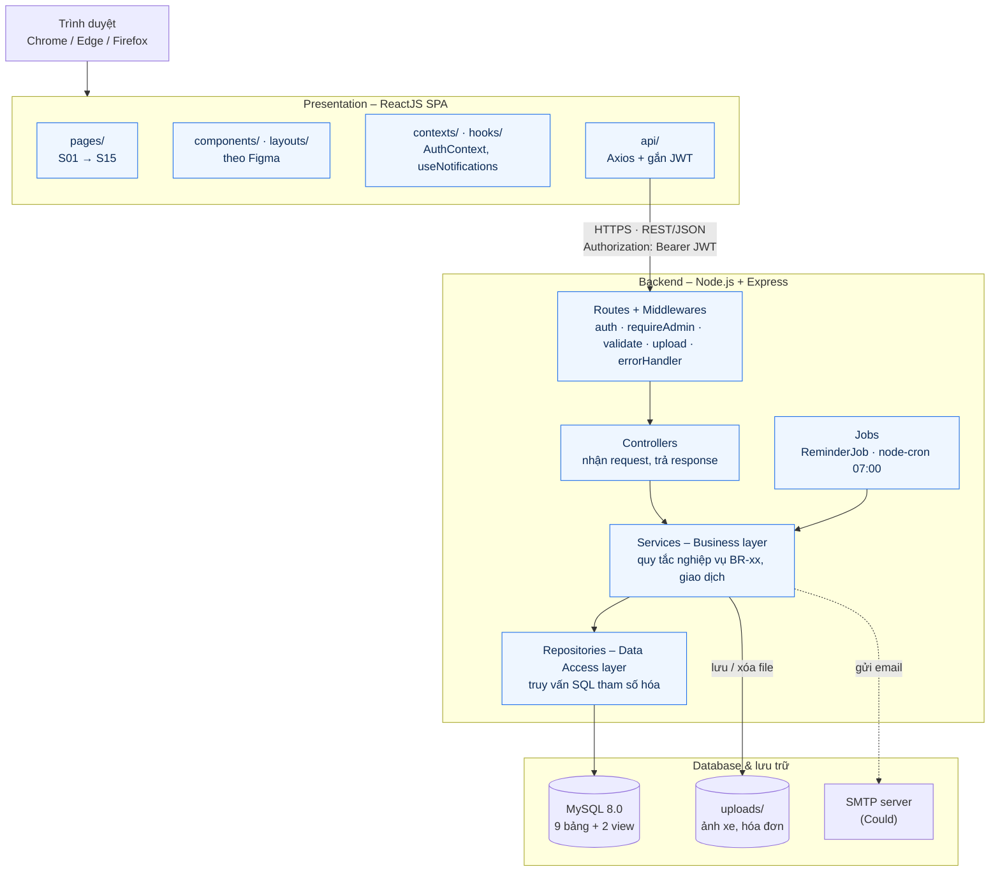
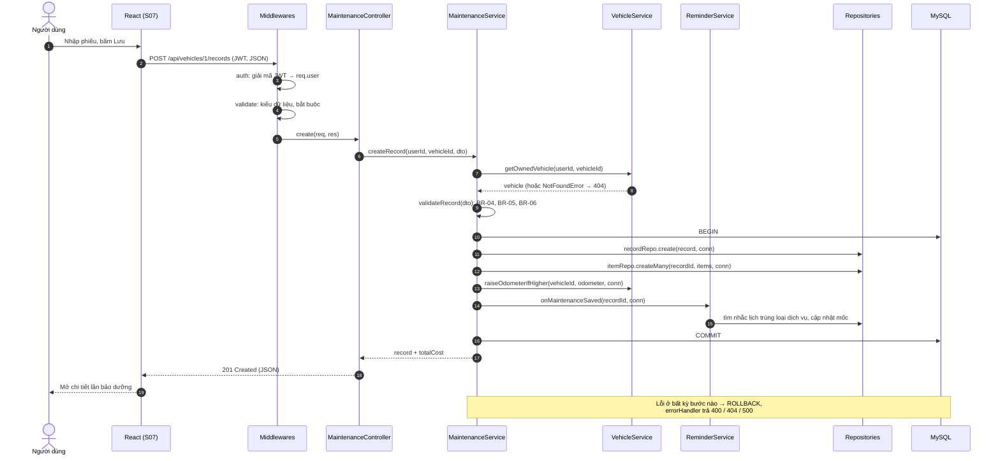
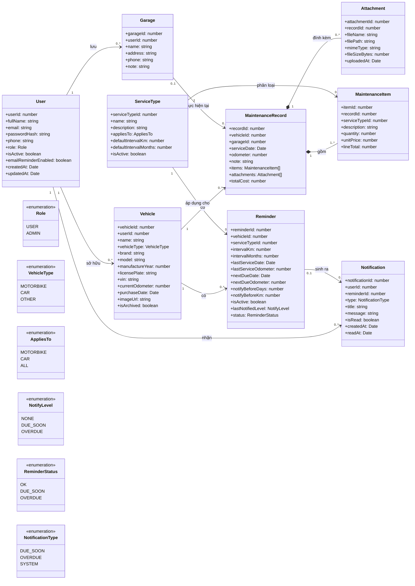
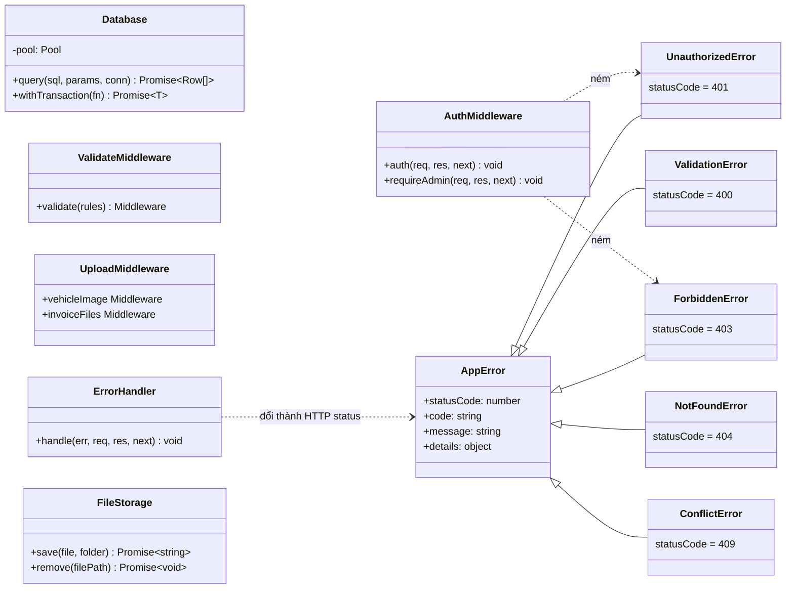
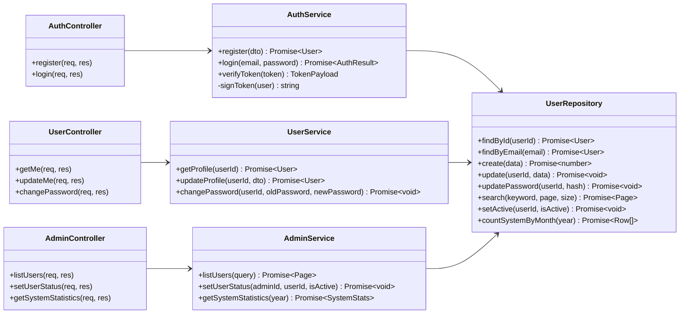
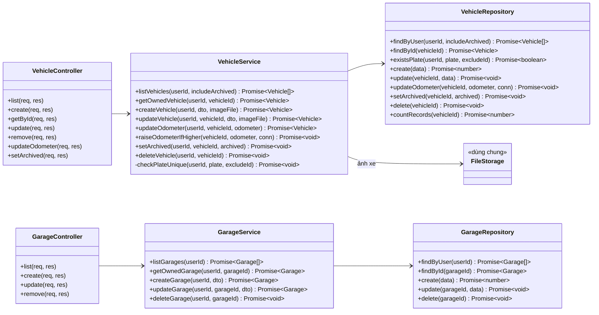
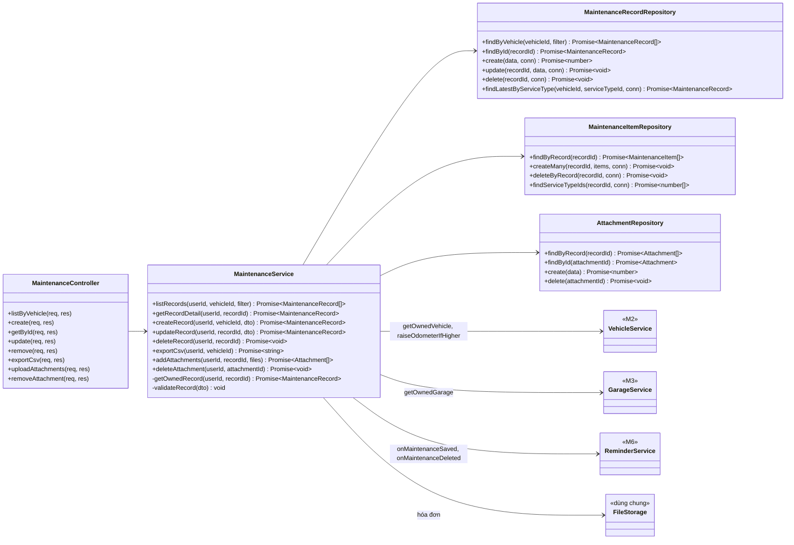
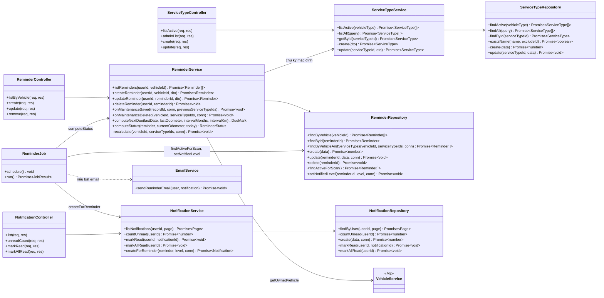
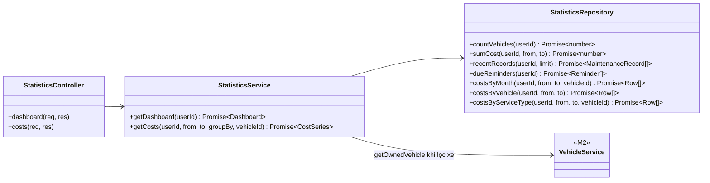

# 07 – Architecture & Class Diagram

**Người phụ trách:** Lâm · **Phiên bản:** 1.0 · **Đầu vào:** [02 Use Case](../02-use-case/), [04 Database](../04-database/erd.md), [08 Implementation Plan](../08-implementation-plan/implementation-plan.md) (mục 1–3)

Tài liệu chốt công nghệ, mô tả kiến trúc phân tầng và các lớp chính của hệ thống. Tên lớp, tên hàm ở đây là tên sẽ dùng trong code (tài liệu 08, mục 2).

## 1. Công nghệ chốt

Giữ nguyên bản đề xuất ở mục 1 tài liệu 08, bổ sung thư viện cụ thể cho từng việc:

| Tầng | Công nghệ | Thư viện chính | Ghi chú |
|---|---|---|---|
| Presentation | ReactJS 18 + Vite | `react-router-dom`, `axios`, `chart.js` + `react-chartjs-2` | SPA, gọi REST API, lưu JWT trong `localStorage` |
| Business + Data Access | Node.js 20 LTS + Express 4 | `jsonwebtoken`, `bcrypt`, `express-validator`, `multer`, `mysql2/promise`, `node-cron`, `dotenv`, `cors` | REST API trả JSON |
| Database | MySQL 8.0 | – | Script ở [tài liệu 04](../04-database/schema.sql) |
| Lưu file | Ổ đĩa server, thư mục `uploads/` | `multer` | Ảnh xe, hóa đơn; không commit lên Git |
| Email (Could) | SMTP | `nodemailer` | Chỉ làm nếu kịp FR-23 |
| Kiểm thử | Jest + Supertest (BE), Vitest + React Testing Library (FE) | – | Như mục 5 tài liệu 08 |

Lý do không dùng ORM (Sequelize, Prisma): schema đã viết sẵn bằng SQL ở tài liệu 04, có view và cột sinh tự động; viết truy vấn tham số hóa bằng `mysql2` vừa đủ chống SQL Injection (NFR-03), vừa ít thứ phải học.

## 2. Sơ đồ kiến trúc phân tầng



**Quy tắc phụ thuộc giữa các tầng**
- Mỗi tầng chỉ gọi tầng ngay dưới nó: Controller → Service → Repository. Controller **không** gọi thẳng Repository; Repository **không** chứa quy tắc nghiệp vụ.
- Service của module này muốn dùng dữ liệu module khác thì gọi **Service** của module đó (ví dụ `MaintenanceService` gọi `VehicleService.getOwnedVehicle`), không gọi Repository của module khác. Đây là các "hợp đồng giữa các module" ở mục 3 tài liệu 08.
- Kiểm tra quyền sở hữu dữ liệu (NFR-02) nằm ở **Service**, vì Service nào cũng nhận `userId` từ `req.user`.
- Giao dịch database do Service mở (`Database.withTransaction`), Repository chỉ nhận `conn` và chạy câu lệnh.

## 3. Luồng xử lý một request

Ví dụ ghi nhận lần bảo dưỡng (UC-12, `POST /api/vehicles/:id/records`) đi qua đủ các tầng và gọi chéo sang module M2, M6:



## 4. Class diagram

Class diagram chia làm 7 phần cho dễ đọc. Mỗi module backend có bộ ba **Controller – Service – Repository**, đặt trong `backend/src/modules/<module>/` với tên file `*.controller.js`, `*.service.js`, `*.repository.js`. Mỗi file export **một đối tượng duy nhất** của lớp (ví dụ `module.exports = new VehicleService()`), nên trong code gọi là `vehicleService.getOwnedVehicle(...)` như ở tài liệu 08.

Quy ước kiểu: `number`, `string`, `boolean`, `Date` là kiểu JavaScript; `Promise~T~` là hàm bất đồng bộ trả về `T`; `conn` là kết nối đang trong giao dịch (có thể bỏ trống khi không cần giao dịch).

### 4.1. Entity (mô hình dữ liệu)

Mỗi entity tương ứng một bảng ở tài liệu 04; thuộc tính viết `camelCase` trong JavaScript, Repository đổi sang tên cột `snake_case`. Entity chỉ là đối tượng dữ liệu, không truy cập database.



- `MaintenanceRecord.totalCost` lấy từ view `v_record_totals`, không lưu trong bảng (BR-06). `items`, `attachments` chỉ có khi đọc chi tiết.
- `Reminder.status` lấy từ view `v_reminder_status` khi đọc danh sách, hoặc tính bằng `ReminderService.computeStatus` (BR-09). Không lưu trong bảng.
- Quan hệ **hợp thành** (hình thoi đặc) giữa `MaintenanceRecord` với `MaintenanceItem`, `Attachment`: xóa lần bảo dưỡng thì xóa luôn hạng mục và hóa đơn (CASCADE ở tài liệu 04).

### 4.2. Thành phần dùng chung



### 4.3. Tài khoản và quản trị người dùng (M1, M8)



### 4.4. Xe và garage (M2, M3)



### 4.5. Lịch sử bảo dưỡng (M4)

Các lớp có nhãn `«M2»`, `«M3»`, `«M6»` thuộc module khác, chỉ vẽ để thể hiện M4 gọi sang (chi tiết ở 4.4 và 4.6).



### 4.6. Loại dịch vụ, nhắc lịch, thông báo (M5, M6)



### 4.7. Dashboard và thống kê (M7)



## 5. Trách nhiệm từng lớp

### 5.1. Theo tầng

| Tầng | Thành phần | Được làm | Không được làm |
|---|---|---|---|
| Presentation | `pages`, `components`, `layouts` | Hiển thị, kiểm tra dữ liệu sơ bộ trên form (NFR-03), gọi `api/` | Gọi thẳng `axios` trong component; tự tính quy tắc nghiệp vụ thay server |
| Presentation | `api/*` | Gọi REST API, tự gắn header `Authorization`, chuyển lỗi 401 về trang đăng nhập | |
| Presentation | `AuthContext` | Giữ JWT và thông tin người dùng, cung cấp `login`, `logout` cho toàn app | |
| Route | `*.routes.js` | Khai báo URL, gắn middleware (`auth`, `requireAdmin`, `validate`, `upload`) | Chứa logic |
| Controller | `*Controller` | Lấy `req.user.userId`, `req.params`, `req.body`; gọi một hàm Service; trả HTTP status + JSON | Truy vấn database; kiểm tra quy tắc nghiệp vụ |
| Business | `*Service` | Quy tắc nghiệp vụ BR-xx, kiểm tra quyền sở hữu, mở giao dịch, gọi Service module khác; ném `AppError` | Đọc `req`/`res`; viết SQL |
| Data Access | `*Repository` | Một hàm = một (hoặc vài) câu SQL tham số hóa; đổi cột `snake_case` ↔ thuộc tính `camelCase` | Quy tắc nghiệp vụ; gọi Repository khác |
| Job | `ReminderJob` | Lên lịch bằng `node-cron`, chạy quét nhắc lịch | Viết SQL trực tiếp |

### 5.2. Theo lớp

| Lớp | Module | Trách nhiệm chính | FR / BR |
|---|---|---|---|
| `Database` | dùng chung | Tạo pool kết nối `mysql2`, `query` với tham số, `withTransaction` (BEGIN/COMMIT/ROLLBACK) | NFR-03 |
| `AuthMiddleware` | dùng chung (M1) | `auth`: đọc Bearer token, gắn `req.user = { userId, role }`, kiểm tra tài khoản chưa bị khóa. `requireAdmin`: chặn nếu `role ≠ ADMIN` | NFR-02, BR-13 |
| `ValidateMiddleware` | dùng chung | Kiểm tra kiểu, bắt buộc, độ dài theo luật `express-validator`; lỗi → 400 kèm tên trường | NFR-03, NFR-06 |
| `UploadMiddleware` | dùng chung | Cấu hình `multer`: chỉ JPG/PNG/PDF, tối đa 5 MB/file | NFR-08 |
| `ErrorHandler` | dùng chung | Đổi `AppError` thành HTTP status + JSON `{ code, message, details }`; lỗi lạ → 500, ghi log | NFR-06 |
| `AppError` và lớp con | dùng chung | Phân loại lỗi: 400 dữ liệu sai, 401 chưa đăng nhập, 403 không có quyền, 404 không tìm thấy hoặc không phải của mình, 409 trùng | NFR-02 |
| `FileStorage` | dùng chung | Đặt tên file duy nhất, lưu vào `uploads/`, xóa file vật lý | FR-05, FR-15 |
| `AuthService` | M1 | Đăng ký (kiểm tra email trùng, băm bcrypt), đăng nhập, ký/giải mã JWT | FR-01, FR-02, BR-01, BR-13, NFR-01 |
| `UserService` | M1 | Xem/sửa hồ sơ, đổi mật khẩu (kiểm tra mật khẩu cũ) | FR-04 |
| `AdminService` | M8 | Tìm kiếm, khóa/mở khóa người dùng (không tự khóa mình), thống kê hệ thống | FR-27, FR-28, BR-13 |
| `VehicleService` | M2 | CRUD xe, `getOwnedVehicle` cho module khác, cập nhật ODO không giảm, `raiseOdometerIfHigher` khi ghi nhận bảo dưỡng, lưu trữ, chỉ xóa hẳn xe chưa có lịch sử | FR-05 → FR-10, BR-02, BR-03, BR-12 |
| `GarageService` | M3 | CRUD garage của người dùng, `getOwnedGarage` | FR-16 |
| `MaintenanceService` | M4 | Ghi nhận/sửa/xóa lần bảo dưỡng trong một giao dịch, kiểm tra ngày, hạng mục, chi phí; gọi M2 nâng ODO, gọi M6 tính lại mốc; lịch sử có lọc; hóa đơn; xuất CSV | FR-11 → FR-15, FR-17, BR-03 → BR-06 |
| `ServiceTypeService` | M5 | Danh mục loại dịch vụ, chỉ ngừng dùng chứ không xóa | FR-26, BR-14 |
| `ReminderService` | M6 | CRUD nhắc lịch, tính mốc đến hạn, tính trạng thái, tính lại mốc khi lịch sử bảo dưỡng thay đổi | FR-18 → FR-20, BR-07 → BR-09, BR-11 |
| `ReminderJob` | M6 | 07:00 hằng ngày quét nhắc lịch, sinh thông báo không trùng, gửi email nếu bật | FR-21, FR-23, BR-10 |
| `NotificationService` | M6 | Danh sách, đếm chưa đọc, đánh dấu đã đọc, tạo thông báo cho nhắc lịch | FR-21, FR-22 |
| `EmailService` | M6 | Gửi email qua SMTP | FR-23 (Could) |
| `StatisticsService` | M7 | Số liệu Dashboard, chi phí theo tháng / xe / loại dịch vụ | FR-24, FR-25 |
| `*Repository` | từng module | Truy vấn bảng tương ứng ở tài liệu 04; `StatisticsRepository` đọc từ view `v_record_totals`, `v_reminder_status` | – |

Các hàm thuần (không chạm database) chứa quy tắc nghiệp vụ, ưu tiên viết unit test trước (mục 5.1 tài liệu 08): `ReminderService.computeNextDue`, `ReminderService.computeStatus`, `MaintenanceService.validateRecord`.

## 6. Cấu trúc thư mục backend theo class diagram

```
backend/src/
├── config/database.js              # Database
├── middlewares/
│   ├── auth.js                     # AuthMiddleware (auth, requireAdmin)
│   ├── validate.js                 # ValidateMiddleware
│   ├── upload.js                   # UploadMiddleware
│   └── errorHandler.js             # ErrorHandler
├── utils/
│   ├── errors.js                   # AppError và các lớp con
│   └── fileStorage.js              # FileStorage
├── modules/
│   ├── auth/                       # AuthController, AuthService
│   ├── users/                      # UserController, UserService, UserRepository
│   ├── admin/                      # AdminController, AdminService
│   ├── vehicles/                   # VehicleController, VehicleService, VehicleRepository
│   ├── garages/                    # GarageController, GarageService, GarageRepository
│   ├── maintenance/                # MaintenanceController, MaintenanceService,
│   │                               # MaintenanceRecordRepository, MaintenanceItemRepository, AttachmentRepository
│   ├── service-types/              # ServiceTypeController, ServiceTypeService, ServiceTypeRepository
│   ├── reminders/                  # ReminderController, ReminderService, ReminderRepository
│   ├── notifications/              # NotificationController, NotificationService, NotificationRepository, EmailService
│   └── statistics/                 # StatisticsController, StatisticsService, StatisticsRepository
├── jobs/reminder.job.js            # ReminderJob
└── app.js
```

So với mục 2 tài liệu 08: thêm thư mục `modules/admin/` cho M8 và `utils/` cho lỗi, lưu file. Phần còn lại giữ nguyên.

## 7. Ghi chú cho tài liệu 08

Đề xuất Giang cập nhật tài liệu 08 sau khi nhóm duyệt tài liệu này:

1. **Mục 1:** công nghệ giữ nguyên, có thể dẫn sang mục 1 tài liệu này cho danh sách thư viện.
2. **Mục 2:** thêm `modules/admin/` và `utils/` như mục 6 ở trên.
3. **Hợp đồng M6 → M4 (mục 3):** đổi thành
   - `reminderService.onMaintenanceSaved(recordId, conn, previousServiceTypeIds = [])`: gọi trong cùng giao dịch của M4 (`conn`). Khi **sửa** lần bảo dưỡng, M4 truyền thêm danh sách loại dịch vụ cũ để M6 tính lại cả nhắc lịch của loại bị bỏ khỏi phiếu.
   - Thêm `reminderService.onMaintenanceDeleted(vehicleId, serviceTypeIds, conn)`: khi **xóa** lần bảo dưỡng, mốc phải quay về lần làm gần nhất còn lại (UC-21 ở tài liệu 02).
   - Cả hai hàm đều tính lại theo lần làm **gần nhất** của loại dịch vụ đó (ngày lớn nhất), không mặc định lần vừa lưu là mới nhất, vì người dùng có thể ghi bù lần bảo dưỡng cũ.
4. **Hợp đồng M2 → M4:** thêm `vehicleService.raiseOdometerIfHigher(vehicleId, odometer, conn)` để M4 nâng ODO xe trong cùng giao dịch (BR-03).
5. **Tiến trình nhắc lịch:** bỏ qua xe đã lưu trữ và tài khoản bị khóa (`ReminderRepository.findActiveForScan`).
