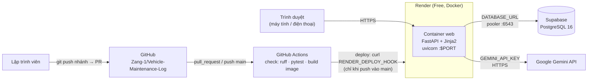

# 08 – Implementation Plan (Kế hoạch triển khai)

**Người phụ trách:** Kiều Bảo Giang · **Phiên bản:** 2.3 (lộ trình mới: chạy local trước 26/10, lên Render + Supabase trước 29/10)
**Đầu vào:** [01 Requirements](../01-requirements/requirements.md) · [04 Database](../04-database/erd.md) · [07 Architecture](../07-architecture/)

## 1. Công nghệ

Lâm chốt chính thức ở tài liệu 07.

| Thành phần | Công nghệ | Chọn thay cho (ghi vào report, mục Platform selection) |
|---|---|---|
| Backend | **FastAPI** (Python 3.12), Pydantic | Flask/Django: nặng hơn, không có sẵn trang `/docs` |
| Giao diện | **Jinja2 templates** + CSS + một ít JavaScript (`fetch`) do chính FastAPI phục vụ | React/Vue: phải build và deploy thêm một service, vượt phạm vi Brief |
| Database | **PostgreSQL 16**: Compose (local) / **Supabase** (cloud), thư viện `psycopg` + `psycopg_pool` | Neon (cũng free); MySQL (Brief yêu cầu PostgreSQL) |
| Container | **Podman** + Dockerfile, **Compose** | Docker Desktop (cần license với tổ chức lớn; Podman miễn phí, không cần daemon) |
| Cloud | **Render** Web Service (Docker, Free) | Railway, Fly.io (gói miễn phí bị giới hạn hoặc phải thêm phương thức thanh toán; kiểm tra lại điều khoản hiện tại khi viết report) |
| CI/CD | **GitHub Actions** + Render Deploy Hook | Render Auto-Deploy (không có cổng chặn khi test đỏ) |
| AI | **Google Gemini API** (Google AI Studio, free tier, không cần billing), gọi từ server bằng **`httpx`** (chốt ở tài liệu 07: đặt được timeout, đọc được mã HTTP gốc để ánh xạ lỗi, dễ mock) | `google-genai` SDK; gọi AI từ trình duyệt (lộ key) |
| Kiểm thử | pytest + FastAPI `TestClient`, ruff | |

**Cái giá của lựa chọn** (report yêu cầu nêu): Render free sleep sau ~15 phút nên lần mở đầu chậm và không chạy được tác vụ hẹn giờ; Supabase free pause sau 7 ngày không hoạt động; Gemini free tier có rate limit nên lúc demo có thể gặp 429.

## 2. Kiến trúc triển khai

Sơ đồ này phải **khớp với những gì thật sự được deploy** (Brief trừ điểm nếu không khớp). Lâm vẽ bản chính thức ở tài liệu 07.



Local (Compose) khác cloud ở chỗ: database là container `db` trong cùng mạng Compose (host `db`, không có pooler), web publish ở `127.0.0.1:3000`, biến môi trường đọc từ `.env`.

## 3. Cấu trúc repo

```
Vehicle-Maintenance-Log/
├── docs/                         # tài liệu thiết kế 01 → 08
├── .github/workflows/ci-cd.yml   # job check (compileall, ruff, pytest, build image) + job deploy
├── Dockerfile · .dockerignore
├── compose.yml                   # web + db (postgres:16-alpine), healthcheck, volume
├── .env.example                  # mọi biến môi trường, không có giá trị bí mật
├── requirements.txt · requirements-dev.txt
├── db/
│   ├── schema.sql                # chuyển từ docs/04-database khi bắt đầu code
│   └── seed.sql
├── app/
│   ├── main.py                   # tạo app, lifespan mở/đóng pool, /, /health, /health/db, gắn router
│   ├── db.py                     # ConnectionPool
│   ├── schemas.py                # Pydantic model (VehicleIn/Out, RecordIn, ..., ErrorOut) theo class diagram tài liệu 07
│   ├── routers/
│   │   ├── vehicles.py           # /api/vehicles
│   │   ├── records.py            # /api/records, /api/vehicles/{id}/records
│   │   ├── service_types.py      # /api/service-types
│   │   ├── reminders.py          # /api/reminders
│   │   ├── stats.py              # /api/stats/...
│   │   ├── diagnose.py           # /diagnose, /api/diagnoses
│   │   └── pages.py              # các trang HTML (Jinja2)
│   ├── services/
│   │   └── ai.py                 # gọi Gemini, ánh xạ lỗi → NO_KEY / RATE_LIMITED / TIMEOUT / UPSTREAM_ERROR
│   ├── templates/                # base.html + từng màn hình S01 → S11
│   └── static/                   # style.css (theo Figma), app.js
└── tests/                        # pytest, chạy trong CI; mock Gemini, không cần DB thật
```

Mỗi router chỉ làm 3 việc: kiểm tra input (Pydantic) → chạy SQL tham số hóa (mẫu ở `sample-queries.sql`) → trả JSON. Trang HTML gọi các API này bằng `fetch`. Nhờ vậy cùng một API vừa được test bằng `TestClient`, vừa xem được ở `/docs`.

## 4. Chia module và phân công lập trình

Mỗi người làm trọn module của mình từ API, template đến test, để tự trả lời được câu hỏi bảo vệ cá nhân về commit của mình.

| Module | FR | Màn hình | Người làm | Việc chính |
|---|---|---|---|---|
| **M0. Khung dự án** | – | – | **Giang** + **Khoa** | FastAPI app, `/`, `/health` (không chạm DB), `/health/db`; `requirements*.txt`; `.gitignore`, `.env.example`; test đầu tiên |
| **M1. Database** | – | – | **Giang** | `db/schema.sql`, `db/seed.sql`; `app/db.py` (pool); tạo Supabase, chạy SQL, đặt `DATABASE_URL` trên Render |
| **M2. Xe** | FR-01 → FR-05 | S02, S03, S04 (tab Thông tin) | **Lâm** | |
| **M3. Lần bảo dưỡng** | FR-06 → FR-10 | S04 (tab Lịch sử), S05, S06 | **Lâm** | Ghi nhận trong 1 transaction (record + items + nâng ODO) |
| **M4. Loại dịch vụ** | FR-11, FR-12 | S09 | **Khoa** | |
| **M5. Nhắc lịch** | FR-13 → FR-15 | S04 (tab Nhắc lịch), S07 | **Giang** | Đọc trạng thái từ `v_reminder_status` |
| **M6. Giao diện chung, Dashboard, Thống kê** | FR-16, FR-17 | S01, S08 + `base.html` | **Khoa** | Layout, CSS theo Figma, điều hướng, biểu đồ |
| **M7. Chẩn đoán AI** | FR-18 → FR-22 | S10, S11 | **Giang** | `services/ai.py`, xử lý lỗi theo BR-10, lưu `diagnoses`, mock trong test |
| **P1. CI/CD + Render** | PR-01, PR-04 | – | **Lâm** | Workflow `check` + `deploy`; branch protection; tạo Render service (health check path `/health`), tắt Auto-Deploy, lưu deploy hook vào GitHub Secrets |
| **P2. Dockerfile + Compose** | PR-02, PR-03 | – | **Khoa** | `python:3.12-slim` (cùng phiên bản với CI), copy `requirements.txt` và cài trước rồi mới copy code, `exec uvicorn ... --port ${PORT:-8000}`; Compose `web` + `db`; thử clean clone trên máy khác |

### Hợp đồng giữa các module

| Bên cung cấp | Bên dùng | Nội dung |
|---|---|---|
| M1 (Giang) | Tất cả | `app/db.py` có `pool`; dùng `with pool.connection() as conn:` |
| M2 (Lâm) | M3, M5, M7 | `GET /api/vehicles/{id}` trả 404 nếu không có xe |
| M4 (Khoa) | M3, M5, M7 | `GET /api/service-types?active=true` |
| M6 (Khoa) | Tất cả | `templates/base.html` (thanh điều hướng, vùng thông báo lỗi), `static/style.css`, hàm `showError(message)` trong `app.js` |
| Tất cả router | M6 (`app.js`) | Lỗi nghiệp vụ và lỗi AI trả body `ErrorOut` `{error_code, message}`; lỗi 422 giữ định dạng mặc định của FastAPI. `app.js` chỉ cần xử lý hai dạng này |

### Danh sách API

| Phương thức & URL | Mô tả | Module |
|---|---|---|
| `GET /` · `GET /health` · `GET /health/db` | Thông tin app · sống (không chạm DB) · DB ok/503 | M0, M1 |
| `GET/POST /api/vehicles` · `GET/PUT/DELETE /api/vehicles/{id}` | CRUD xe (DELETE trả 409 nếu xe đã có lịch sử) | M2 |
| `PATCH /api/vehicles/{id}/archive` | Lưu trữ xe | M2 |
| `GET/POST /api/vehicles/{id}/records` · `GET/PUT/DELETE /api/records/{id}` | Lịch sử, ghi nhận, chi tiết, sửa, xóa | M3 |
| `GET /api/vehicles/{id}/records.csv` | Xuất CSV | M3 |
| `GET/POST /api/service-types` · `PUT /api/service-types/{id}` | Danh mục | M4 |
| `GET /api/reminders?vehicle_id=&status=` · `POST /api/reminders` · `PUT/DELETE /api/reminders/{id}` | Nhắc lịch kèm trạng thái | M5 |
| `GET /api/stats/dashboard` · `GET /api/stats/costs?group_by=month\|vehicle\|service_type&from=&to=` | Dashboard, thống kê | M6 |
| `POST /diagnose` · `GET /api/diagnoses` | Chẩn đoán AI, lịch sử | M7 |

## 5. Tính năng AI – thiết kế chi tiết

| Câu hỏi của Brief | Thiết kế |
|---|---|
| **Gọi ở đâu?** | Chỉ ở server, trong `app/services/ai.py`, được `POST /diagnose` gọi. Trình duyệt không bao giờ thấy key hay gọi thẳng Gemini |
| **Bảo mật key?** | `GEMINI_API_KEY` đọc bằng `os.getenv`. Local: `.env` (đã gitignore). Production: Render → Environment. CI: không cần key, vì test mock hàm gọi AI. Key gửi qua header `x-goog-api-key`, **không** đặt trong query string `?key=`, để key không xuất hiện trong log request |
| **Thiếu key thì sao?** | App **vẫn khởi động** (khác `DATABASE_URL`, biến bắt buộc). `/diagnose` trả 503 `NO_KEY`; các trang khác không bị ảnh hưởng |
| **Rate limit?** | Free tier giới hạn số request mỗi phút và mỗi ngày (xem trang *Rate limits* của Google AI Studio cho model đang dùng). Gặp 429 thì **không tự gọi lại**: trả ngay 429 kèm thông báo. Nút "Chẩn đoán" bị khóa trong lúc chờ để tránh bấm liên tục |
| **Timeout?** | 20 giây; quá thời gian thì trả 504 |
| **Người dùng thấy gì khi lỗi?** | Thông báo theo bảng BR-10 (tài liệu 01) hiện ngay trên trang; ô triệu chứng giữ nguyên nội dung; các phần khác của trang vẫn dùng được |
| **Prompt** | Gửi kèm loại xe, hãng, dòng xe, ODO (nếu chọn xe) và danh sách tên loại dịch vụ đang dùng; yêu cầu trả về JSON `{suggestion, urgency_level, service_type}`. Server kiểm tra JSON bằng Pydantic; sai định dạng thì xử lý như `UPSTREAM_ERROR` |
| **Bằng chứng cho report** | Bảng `diagnoses` lưu mọi lần gọi kèm `error_code`; log server ghi chi tiết lỗi (không ghi key) |

## 6. Lộ trình theo phase

Hai mốc nhóm đã chốt: **chạy được local trước hết thứ Hai 26/10**, và **lên Render dùng Supabase trước hết thứ Năm 29/10**.

| Phase | Thời gian | Mục tiêu |
|---|---|---|
| **1. Thiết kế** ✅ | đến 25/10 | 8 tài liệu thiết kế |
| **2. Chạy local** | **T6 23/10 → T2 26/10** | Clone về, chạy 1 lệnh, các trang chính hiện dữ liệu mẫu trên `localhost:3000` |
| **3. Lên Render + Supabase** | **T3 27/10 → T5 29/10** | URL HTTPS công khai nối Supabase; merge vào `main` là tự deploy |
| **4. Hoàn thiện** | T6 30/10 → CN 8/11 | AI chạy trên URL live, đủ chức năng, kiểm thử, audit secret, bản nháp report |
| **5. Tập demo và nộp** | T2 9/11 → Session 20 | Không thêm chức năng; tập demo trên máy khác; nộp report PDF |

**Nguyên tắc:** pipeline đi trước chức năng. Khi URL đã chạy (Phase 3), mọi chức năng làm sau đều được merge và tự deploy lên Render, nên lúc nào URL cũng có bản mới nhất. 21/25 điểm demo nằm ở pipeline.

### Phase 1 – Thiết kế (đến 25/10) ✅

| Việc | Người | Trạng thái |
|---|---|---|
| 01 Requirements · 04 Database · 08 Implementation Plan | Giang | ✅ |
| 02 Use Case · 03 Activity · 07 Architecture & Class | Lâm | ✅ (PR #4) |
| 05 Wireframe | Khoa | Đưa lên repo trước **T7 24/10** (cần cho `base.html`) |
| 06 UI Figma | Khoa | Hoàn thiện trong Phase 3 (trước 29/10); giao diện local dựng theo wireframe trước, chỉnh theo Figma sau |

### Phase 2 – Chạy local (T6 23/10 → T2 26/10)

**Mục tiêu:** trên máy bất kỳ: `git clone` → `cp .env.example .env` → đặt `DB_PASSWORD` → `podman compose up --build` → mở `http://localhost:3000`, thấy Dashboard, danh sách xe, lịch sử bảo dưỡng, nhắc lịch với dữ liệu mẫu, và thêm được xe mới.

Vì chỉ có 4 ngày, Phase 2 chỉ làm phần **đọc dữ liệu + thêm xe**. Sửa, xóa và các form còn lại làm tiếp ở Phase 3–4.

| Ngày | Giang | Lâm | Khoa |
|---|---|---|---|
| **T6 23/10** (khung, merge trong ngày để mọi người dùng chung) | **M0** khung FastAPI: `/`, `/health`, `/health/db`, `app/db.py` (pool), `app/schemas.py`, `requirements*.txt`, `tests/` đầu tiên; **M1** đưa `schema.sql`, `seed.sql` vào `db/` | **P1** workflow `check` (compileall, ruff, pytest, build image); bật branch protection cho `main` | **P2** `Dockerfile`, `.dockerignore`, `compose.yml` (`web` + `db`), `.env.example` |
| **T7 24/10** | **M5** API nhắc lịch (đọc từ `v_reminder_status`) | **M2** API xe: danh sách, chi tiết, thêm | **05** Wireframe lên repo; **M6** `base.html`, `style.css`, `app.js` (`showError`) |
| **CN 25/10** | **M5** tab Nhắc lịch trên S04; review và merge PR của bạn | **M2** trang S02 danh sách xe, S03 thêm xe | **M6** Dashboard S01 (`/api/stats/dashboard`) |
| **T2 26/10** | Thử **clean clone** trên máy mình; ghi lỗi thành Issues | **M3** API + tab Lịch sử (chỉ xem) trên S04; thử clean clone | **M4** API danh sách loại dịch vụ (cho các form dùng) |

**Xong phase khi** (cả nhóm kiểm tra tối **T2 26/10**):
- [ ] Clean clone trên **ít nhất 2 máy** chạy được bằng `podman compose up --build`.
- [ ] `/health` → 200; `/health/db` → `{"db":"ok","vehicles":3}`.
- [ ] Trên giao diện: Dashboard hiện số xe, nhắc lịch quá hạn, chi phí; danh sách xe; lịch sử bảo dưỡng của một xe; thêm được xe mới.
- [ ] Mọi thay đổi vào `main` qua PR; check `check` xanh; branch protection đã bật.

### Phase 3 – Lên Render + Supabase (T3 27/10 → T5 29/10)

**Mục tiêu:** `https://<tên-service>.onrender.com` mở được trên điện thoại dùng 4G, đọc dữ liệu từ Supabase, và merge một PR là tự lên URL.

| Ngày | Giang (Supabase) | Lâm (Render + CI/CD) | Khoa |
|---|---|---|---|
| **T3 27/10** | Tạo project Supabase, region **Southeast Asia (Singapore)**, lưu mật khẩu DB ở chỗ riêng tư. SQL Editor: chạy `db/schema.sql` rồi `db/seed.sql`, chạy lại lần 2 để chắc không nhân đôi; kiểm tra không bảng nào có nhãn "RLS disabled" | Tạo Render Web Service: runtime **Docker**, branch `main`, gói **Free**, region **Singapore** (cùng Supabase), health check path `/health`, **tắt Auto-Deploy**. Environment: `APP_ENV=production`, **không** đặt `PORT` | **06** Figma; **M4** trang S09 |
| **T4 28/10** | Lấy **Transaction pooler URI** (cổng `6543`) của Supabase, gửi riêng cho Lâm (không gửi vào group chat, không chụp màn hình). Thử local: `podman run --env-file .env.cloud ...` → `/health/db` ok | Đặt `DATABASE_URL` trên Render → deploy. Tạo **Deploy Hook**, lưu vào GitHub secret `RENDER_DEPLOY_HOOK`; thêm job `deploy` (`needs: check`, chỉ chạy khi push vào `main`) | Kiểm tra giao diện trên điện thoại (360px); sửa Issues giao diện từ Phase 2 |
| **T5 29/10** | Thử pause/restore Supabase: `/health/db` 503 rồi tự ok lại, `/health` luôn 200 (PT-06) | Thử **commit đến production**: PR tăng `APP_VERSION` → `check` xanh → merge → `deploy` xanh → Render Events có commit hash mới → `/` hiện version mới (PT-04) | Cập nhật URL live vào `README.md` |

**Xong phase khi** (kiểm tra tối **T5 29/10**):
- [ ] URL Render mở được trên điện thoại dùng 4G, có HTTPS (PT-01).
- [ ] `/health/db` trên URL live → `{"db":"ok","vehicles":3}` (dữ liệu từ Supabase).
- [ ] Merge một PR thì tự lên URL live, commit hash khớp Render Events (PT-04).
- [ ] `git grep -n -i -E "pooler.supabase|api.render.com/deploy"` không ra kết quả (PT-05).

### Phase 4 – Hoàn thiện (T6 30/10 → CN 8/11)

| Thời gian | Giang | Lâm | Khoa |
|---|---|---|---|
| **30/10 – 1/11** | **M7** chẩn đoán AI: chạy local, đặt `GEMINI_API_KEY` trên Render, chạy trên URL live (mốc W8 của Brief) | **M3** ghi nhận/sửa/xóa lần bảo dưỡng (S05, S06); **M2** sửa xe, cập nhật ODO | **M6** thống kê chi phí S08; chỉnh giao diện theo Figma |
| **2 – 5/11** | **M5** tạo/sửa nhắc lịch (S07); FR-21 lịch sử chẩn đoán | FR-05 lưu trữ/xóa xe; FR-10 xuất CSV | FR-12 thêm/sửa loại dịch vụ; trang S10, S11 cho AI (cùng Giang) |
| **6/11** | Kiểm thử chéo M2, M3 | Kiểm thử chéo M4, M6 | Kiểm thử chéo M5, M7 |
| **7 – 8/11** | **Audit secret** (cả lịch sử Git); report mục 5, 6, 7; tổng hợp bảng đóng góp từ `git shortlog -sne` | Report mục 1, 2, 4 | Report mục 3, 7 |

**Xong phase khi:**
- [ ] AI chạy trên URL live; gặp 429, timeout hay thiếu key thì hiện thông báo thân thiện (TC-12 → TC-15).
- [ ] Test case TC-01 → TC-16 đạt; Issues mức `bug` đã đóng.
- [ ] Không có key hay connection string trong file và lịch sử Git (PT-05).
- [ ] Bản nháp report đủ 8 mục; góp ý peer review đã thành Issues.

### Phase 5 – Tập demo và nộp (T2 9/11 → Session 20)

**Đóng băng chức năng:** từ 9/11 chỉ sửa lỗi.

| Ngày | Giang | Lâm | Khoa |
|---|---|---|---|
| **9–10/11** | Hoàn thiện report, xuất **PDF ≤ 12 trang**; cả nhóm ký bảng đóng góp | Chuẩn bị nhánh "cố tình đỏ" cho phần demo cổng chặn (PT-03) | **Clean clone trên máy chưa từng có project** (PT-02); slide 10 phút |
| **11/11** | Tập toàn bộ kịch bản demo (mục 11), có bấm giờ | | |
| **Session 19** | **Nộp report**; mỗi người ôn lại các commit của mình và câu hỏi bảo vệ cá nhân trong Brief | | |
| **Ngày demo** | Trước 5 phút: mở URL cho Render thức dậy, kiểm tra Supabase không bị pause, chạy một truy vấn | | |

**Xong phase khi:** đánh dấu đủ các ô trong *Submission checklist* (mục 8) của Final Project Brief.

## 7. Kế hoạch kiểm thử

### 7.1. Các mức kiểm thử

| Mức | Phạm vi | Công cụ | Chạy ở đâu |
|---|---|---|---|
| Lint + compile | Toàn bộ code Python | `ruff check .`, `python -m compileall` | CI, mỗi PR |
| Unit / API test | Route trả đúng mã khi input sai (422), khi không tìm thấy (404); `/health` không chạm DB; `services/ai.py` ánh xạ đúng 429/timeout/thiếu key (mock) | pytest + `TestClient` + `monkeypatch` | CI, mỗi PR |
| Build image | Dockerfile build được | `docker build .` trong job `check` | CI, mỗi PR |
| Kiểm thử database | `schema.sql` + `seed.sql` chạy 2 lần không lỗi; ràng buộc chặn dữ liệu sai; `v_reminder_status` tính đúng | `psql` trên `postgres:16-alpine` (Compose) | Local trước khi mở PR sửa `db/` |
| Kiểm thử hệ thống | Kịch bản đầu-cuối trên URL live, theo bảng 7.2 | Thủ công, ghi kết quả vào GitHub Issues | W9–W10, kiểm thử chéo (người này test module của người kia) |
| Kiểm thử nền tảng | 5 tiêu chí demo + các tình huống lỗi | Theo bảng 7.3 | W10, trên máy chưa từng có project |

Test trong CI **không cần database thật và không gọi Gemini thật**: `tests/conftest.py` đặt `DATABASE_URL` giả, còn hàm gọi AI được thay bằng mock. Nhờ vậy pipeline xanh mà không cần secret.

### 7.2. Test case chức năng

| Mã | FR / BR | Kịch bản | Kết quả mong đợi |
|---|---|---|---|
| TC-01 | FR-01, BR-01 | Thêm xe trùng biển số `51H-678.90` | 409, báo trùng biển số |
| TC-02 | FR-04, BR-02 | Cập nhật ODO 12.000 cho xe đang 12.850 | 422, ODO giữ nguyên |
| TC-03 | FR-05, BR-09 | Xóa xe đã có lịch sử | 409, gợi ý "Lưu trữ" |
| TC-04 | FR-06, BR-04 | Ghi nhận bảo dưỡng không có hạng mục | 422 |
| TC-05 | FR-06, BR-03 | Ngày bảo dưỡng là ngày mai | 422 |
| TC-06 | FR-06, BR-05 | Hạng mục 4 × 210.000 và 1 × 150.000 | Tổng chi phí 990.000 |
| TC-07 | FR-06, BR-02 | Ghi nhận ODO 13.000 cho xe đang 12.850 | ODO xe thành 13.000 |
| TC-08 | FR-15, BR-07 | Ghi nhận thay nhớt (nhắc lịch 1.500 km / 2 tháng) ngày 22/10/2026, ODO 13.000 | Nhắc lịch chuyển sang "Còn hạn", mốc 22/12/2026 hoặc 14.500 km |
| TC-09 | FR-14, BR-08 | Còn 200 km, còn 30 ngày, ngưỡng 300 km / 7 ngày | "Sắp đến hạn" |
| TC-10 | FR-13, BR-06 | Tạo nhắc lịch trùng loại dịch vụ trên cùng xe | 409 |
| TC-11 | FR-17 | Chi phí theo tháng năm 2026 với dữ liệu `seed.sql` | 02: 1.960.000 · 03: 255.000 · 06: 135.000 · 07: 225.000 · 08: 1.305.000 |
| TC-12 | FR-19 | Chẩn đoán "phanh kêu rít khi bóp mạnh" (AI chạy được) | 200, có gợi ý + mức khẩn cấp; 1 dòng `diagnoses` status OK |
| TC-13 | FR-20 | Mock Gemini trả 429 | 429, thông báo "hết lượt…"; dòng `diagnoses` với `RATE_LIMITED`; ô nhập giữ nguyên |
| TC-14 | FR-20 | Không đặt `GEMINI_API_KEY` | App vẫn khởi động; `/diagnose` → 503 `NO_KEY`; `/api/vehicles` vẫn 200 |
| TC-15 | FR-20 | Mock Gemini treo quá 20 giây | 504 |
| TC-16 | FR-18 | Triệu chứng 5 ký tự | 422, không gọi AI |

### 7.3. Test case nền tảng (khớp tiêu chí demo của Brief)

| Mã | Tiêu chí | Cách kiểm tra | Kết quả mong đợi |
|---|---|---|---|
| PT-01 | HTTPS công khai (6đ) | Mở URL Render trên điện thoại dùng 4G | Trang tải được, có ổ khóa HTTPS |
| PT-02 | Compose 1 lệnh (5đ) | Máy chưa từng có project: `git clone` → `cp .env.example .env` → đặt `DB_PASSWORD` → `podman compose up --build` | `http://localhost:3000/health/db` → ok, có dữ liệu mẫu |
| PT-03 | CI chặn PR hỏng (5đ) | PR cố tình làm test đỏ | Check `check` đỏ, nút merge bị khóa |
| PT-04 | Merge là tự deploy (5đ) | Sửa test, tăng `APP_VERSION`, merge | Actions: `check` → `deploy` xanh; Render Events có commit hash mới; `/` hiện version mới |
| PT-05 | Không có secret trong repo (4đ) | `git grep -n -i -E "pooler.supabase\|AIza\|api.render.com/deploy"` và `git log -p` cho các từ đó | Không ra kết quả |
| PT-06 | Supabase pause | Pause project → gọi `/health/db` và `/health` → Restore | 503 rồi tự ok lại, `/health` luôn 200, không redeploy |
| PT-07 | Render ngủ | Không truy cập 15 phút rồi mở lại | Lần đầu chậm (~1 phút) nhưng tải được. Lúc demo: mở URL trước 5 phút |

### 7.4. Quy trình xử lý lỗi

1. Người phát hiện tạo GitHub Issue, gắn nhãn `bug`, ghi bước tái hiện, kết quả mong đợi/thực tế, mã test case. **Ảnh chụp không được có key hay connection string.**
2. Giao cho người phụ trách module ở mục 4.
3. Sửa trên nhánh riêng; trong PR ghi `Fixes #<số>`; người phát hiện kiểm tra lại. Brief tính điểm "closed issues" vào phần làm việc nhóm.

## 8. Quy trình Git

- `main` được bảo vệ: **Require a pull request** (1 approving review) và **Require status checks** (`check`). Không ai commit thẳng vào `main`.
- Tên nhánh: `feature/<module>-<mô-tả>` (ví dụ `feature/m2-vehicles`), `fix/<mô-tả>`, `docs/<bước>`.
- Commit message: câu mệnh lệnh tiếng Anh, < 60 ký tự. Ví dụ: `Add vehicles table and CRUD endpoints`.
- Review phải có nhận xét thật, không chỉ bấm Approve. Merge xong thì **Delete branch**.
- **Mỗi người dùng đúng một danh tính Git** (tên + email) trên mọi máy, để bảng đóng góp khớp với lịch sử commit:

| Thành viên | `user.name` | `user.email` | GitHub |
|---|---|---|---|
| Kiều Bảo Giang | `Kieu Bao Giang` | giangbao041@gmail.com | @Zang-1 |
| Tăng Thoại Lâm | (Lâm chốt) | lam.2474802010210@vanlanguni.vn | @noway165 |
| Nguyễn Nam Khoa | (Khoa chốt) | chọn **một** email và dùng thống nhất | @namkhoa306 |

## 9. Quản lý cấu hình và secret

| Biến | Bí mật? | Local | Render | GitHub Actions |
|---|---|---|---|---|
| `APP_NAME`, `APP_ENV` | Không | `.env` | Environment (`APP_ENV=production`) | Không cần |
| `PORT` | Không | Mặc định 8000 | **Render tự đặt, không ghi đè** | Không cần |
| `DB_PASSWORD` | Có | `.env` (chỉ chữ + số) | Không dùng | Không cần |
| `DATABASE_URL` | **Có** | `compose.yml` ghép (host `db`) | Environment = Supabase transaction pooler `:6543` | Giá trị giả trong `conftest.py` |
| `GEMINI_API_KEY` | **Có** | `.env` | Environment | Không cần (test dùng mock) |
| `RENDER_DEPLOY_HOOK` | **Có** | Không có | Không có | Repository secret |

`.env` và `.env.*` nằm trong `.gitignore` và `.dockerignore`. `.env.example` liệt kê đủ tên biến, không có giá trị.

**Nếu lộ key** (trả lời câu hỏi của report):
1. Thu hồi ngay: tạo key Gemini mới / đổi mật khẩu DB Supabase / tạo lại deploy hook trên Render.
2. Cập nhật giá trị mới ở Render Environment hoặc GitHub Secrets, rồi redeploy.
3. Xóa key khỏi lịch sử Git nếu đã commit (`git filter-repo`), vì xóa ở commit sau thì key vẫn còn trong lịch sử. Báo nhóm và giảng viên.

## 10. Phân công report và thuyết trình

**Report** (PDF, tối đa 12 trang, 8 mục bắt buộc):

| Mục | Người viết |
|---|---|
| 1. Platform selection rationale | Lâm |
| 2. System architecture (sơ đồ khớp deployment) | Lâm |
| 3. Dockerfile and Compose explained | Khoa |
| 4. CI/CD pipeline walkthrough | Lâm |
| 5. Database schema and integration | Giang |
| 6. AI API integration | Giang |
| 7. Secret and configuration management | Giang + Khoa |
| 8. Individual contribution table (khớp lịch sử commit, cả nhóm ký) | Cả nhóm (Giang tổng hợp) |

**Thuyết trình 10 phút** (mỗi người giữ ít nhất một khối, theo gợi ý của Brief):

| Thời lượng | Nội dung | Người trình bày |
|---|---|---|
| 1 phút | Ứng dụng làm gì, cho ai | Khoa |
| 2 phút | Kiến trúc: các thành phần, giao tiếp ra sao | Lâm |
| 4 phút | Demo trực tiếp theo thứ tự đã tập (mục 11) | Giang dẫn; Lâm làm phần CI/deploy; Khoa làm phần clean clone |
| 2 phút | Một lỗi đã gặp và cách sửa | Lâm |
| 1 phút | Nếu làm lại sẽ làm khác gì | Khoa |

## 11. Kịch bản demo (theo Brief)

1. **Đánh thức service:** mở URL live trước 5 phút.
2. **Kiểm tra DB:** nếu Supabase đang pause thì Restore và chạy một truy vấn.
3. **Clean clone:** trên máy chưa từng có project, clone, một lệnh, stack chạy.
4. **Cổng chặn:** mở PR cố tình hỏng, check đỏ chặn merge.
5. **Deploy:** sửa, merge, thay đổi lên URL live.
6. **Repo sạch:** chạy `git grep` tìm key trước lớp, không ra gì.
7. **AI:** chẩn đoán một triệu chứng trên URL live. Nếu gặp 429 thì đó chính là cơ hội cho thấy thông báo lỗi thân thiện.

## 12. Rủi ro

| Rủi ro | Cách xử lý |
|---|---|
| Để pipeline (Render, CI, Compose) đến cuối kỳ mới làm | Làm M0, P1, P2 ngay T6 23/10; Render + Supabase xong trước T5 29/10 |
| Deploy hook trỏ nhầm service, job `deploy` xanh nhưng URL không đổi | Chỉ giữ **một** Render service chính thức; sau mỗi lần merge đối chiếu commit hash trên Render Events |
| Phiên bản Python trong Dockerfile khác CI: CI xanh nhưng image lỗi | Dùng 3.12 ở cả hai; job `check` có bước build image |
| Clean clone chỉ chạy trên một máy | Tập trên máy khác từ W10; README ghi đủ bước |
| Supabase pause khi demo | Restore trước giờ demo; app tự phục hồi (PT-06) |
| Gemini 429 lúc demo | Thông báo thân thiện là một phần của demo; đã có dòng `RATE_LIMITED` mẫu trong `seed.sql` |
| Lịch sử commit lệch nhau giữa các thành viên | Mỗi người làm module riêng (mục 4); kiểm tra `git shortlog -sne` mỗi tuần |
| Lộ secret qua ảnh chụp, group chat | Không dán connection string ở đâu ngoài Render/GitHub Secrets; audit ở W9 |
