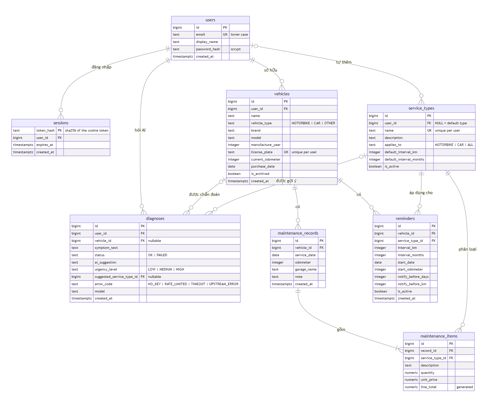
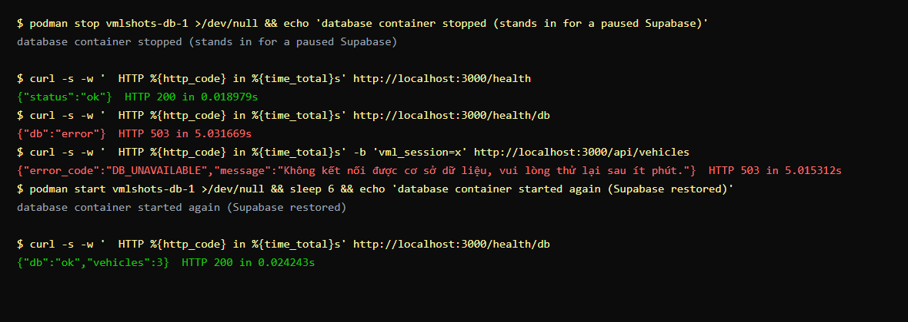
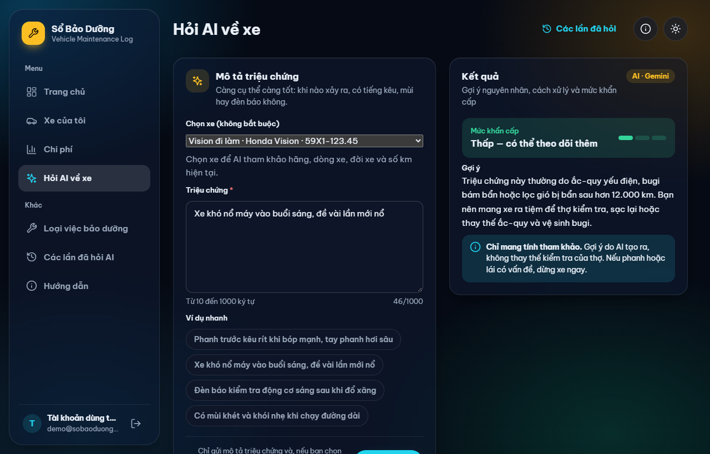
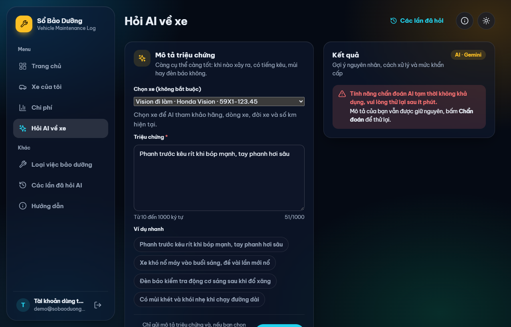
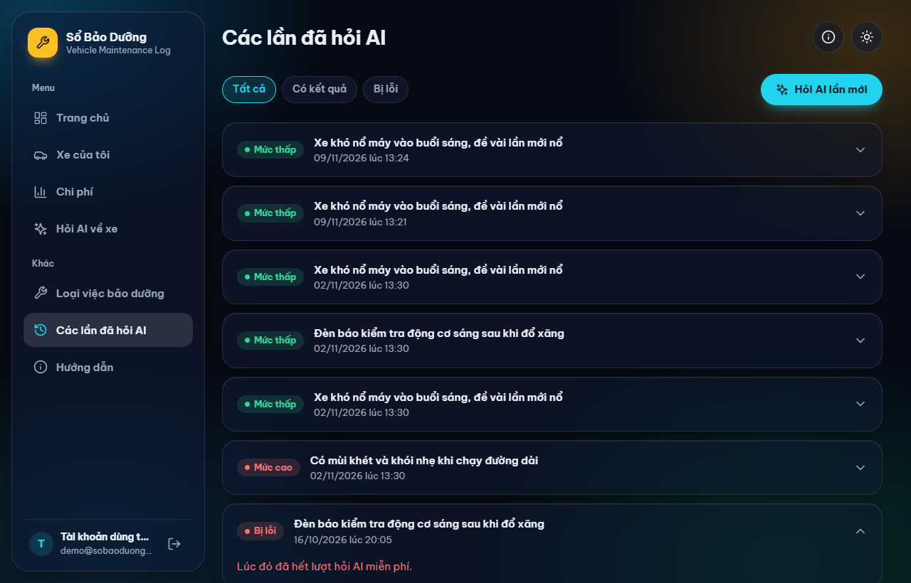

# Report — phần của Kiều Bảo Giang (mục 5, 6, cuối mục 7, mục 8)

Bản nháp để dán vào `72ITDS30103_SDPs_Final_Report_Template.docx`. Viết bằng tiếng Anh như file mẫu. Mỗi mục khoảng 1,5 trang.

**Trước khi dán:**
- Thay mọi chỗ `(chèn ảnh …)` bằng ảnh chụp thật. Che mọi key, connection string, URL Deploy Hook trước khi chèn.
- Điền các chỗ `[…]` (mã số sinh viên, số liệu cần chạy SQL).
- Mục 7: Khoa viết phần đầu (giá trị nào nằm ở đâu, audit secret); phần dưới đây là phần cuối (khi key bị lộ).
- Mục 8: cả 3 người đọc lại bảng rồi ký.

---

## 5. Database schema and integration approach

### 5.1 Tables

The database is PostgreSQL: version 16 in the local Compose stack, version 17 on Supabase. One script, `db/schema.sql`, creates both. It holds eight tables and two views.

| Table | Purpose |
|---|---|
| `users`, `sessions` | Accounts. Passwords are stored only as scrypt hashes. A session stores only the sha256 of the token that sits in the browser cookie |
| `vehicles` | A user's vehicles (`user_id`) |
| `maintenance_records`, `maintenance_items` | One service visit and its line items |
| `service_types` | The catalogue. `user_id` NULL means a default type: shared and read-only. Otherwise it is a user's own type |
| `reminders` | A service interval (km and/or months) for one vehicle and one service type |
| `diagnoses` | Every AI call, the failed ones included (Section 6) |

The database enforces the business rules that must never break, so a bug in a router cannot store bad data:
- `CHECK` constraints on every enumerated or positive value.
- `UNIQUE (vehicle_id, service_date, odometer)` stops the same service visit being saved twice.
- `line_total` is a generated column (`quantity × unit_price`).
- `ON DELETE RESTRICT` stops a vehicle or service type that has history from being deleted.
- Plates and service type names are unique per user: `UNIQUE (user_id, license_plate)` and `UNIQUE (user_id, name) NULLS NOT DISTINCT`.

Two views compute values at read time, never in a background job:
- `v_record_totals`: the total cost of each visit.
- `v_reminder_status`: the next due date and odometer, days and km left, and OK / DUE_SOON / OVERDUE.

We chose this because Render's free instance sleeps, so a scheduled job would not run reliably. A view is always correct when it is read.

*Figure 5.1: The ERD of `docs/04-database/erd.md`, matching `db/schema.sql`: eight tables, with `user_id` on the user-owned data.*

### 5.2 How the application connects

`app/db.py` creates one psycopg 3 `ConnectionPool` from a single environment variable, `DATABASE_URL`:
- **Locally:** `compose.yml` builds the URL (host `db`).
- **On Render:** it is the Supabase transaction pooler on port 6543.

The pool settings are chosen for the free tiers:

| Setting | Value | Why |
|---|---|---|
| `max_size` | 5 | The Supabase free tier has few connections, and more than one copy of the app may run |
| `prepare_threshold` | `None` | The transaction pooler on port 6543 cannot keep prepared statements between transactions |
| `check` | `check_connection` | A connection is tested before it is lent, so a connection that dropped while the database was paused is replaced instead of failing a request |
| `max_lifetime` | 300 s | Connections are recycled every 5 minutes |
| `connect_timeout` | 5 s | Fail fast instead of hanging |
| `open=False` | the pool opens at start-up without waiting | The app starts even when the database is paused |

Every query is parameterised (psycopg), and every query filters on the signed-in user's `user_id`. Another user's vehicle answers 404, exactly like a vehicle that does not exist.

Row Level Security is switched on for every table with no policies. This closes Supabase's automatic REST API, which we do not use. The views are created `WITH (security_invoker = true)`, so they cannot be used to bypass RLS either.

### 5.3 Surviving a restart or a pause

| Event | What happens |
|---|---|
| Render restarts or redeploys the container | Nothing is lost. The container holds no state, and sessions are in the `sessions` table, so users stay signed in |
| Supabase pauses (free tier, after a week idle) | `/health` does not touch the database, so Render's health check still passes and Render does not restart the app in a loop. `/health/db` answers 503 `{"db":"error"}` within 5 s. Any API call answers 503 `DB_UNAVAILABLE` with "Không kết nối được cơ sở dữ liệu, vui lòng thử lại sau ít phút.", and the details go to the log only |
| Supabase is restored | The pool reconnects by itself. No redeploy is needed |

*Figure 5.3: Local stack, with the database container stopped to stand in for a paused Supabase. `/health` stays 200, `/health/db` and the API answer 503 within 5 s, and `/health/db` is ok again as soon as the database is back, with no restart of the app.*

### 5.4 Changing the schema on a live database

`schema.sql` is safe to run more than once: it uses `IF NOT EXISTS` and `ADD COLUMN IF NOT EXISTS`. When we added accounts, the same script upgraded the live database:
- It added `user_id` to the existing tables.
- It gave every old row to a demo account.
- It swapped the global unique constraints for per-user ones.

We tested it on a fresh database and on a copy of the old schema; both gave the same row counts.

**What went wrong:** we merged the code before running the script on Supabase. The live site answered 500 on sign-up, because the `users` table did not exist yet. We ran `schema.sql` in the Supabase SQL Editor and the site worked again, with no data lost. The lesson: the schema change has to reach the database **before** the merge that needs it.

---

## 6. AI API integration

### 6.1 Where the call happens

The browser never talks to the AI provider:
- The browser sends `POST /diagnose {"symptom_text": "..."}` to our own server.
- `app/routers/diagnose.py` validates the input (10–1,000 characters; anything else gets 422 before any AI call).
- It then calls `app/ai.py`, the only file that knows the provider.

`app/ai.py` calls Google Gemini (`gemini-3.5-flash-lite`) through its OpenAI-compatible chat-completions endpoint. Changing provider means changing three environment values (`AI_BASE_URL`, `AI_MODEL`, the key); no code changes.

The user may pick one of their vehicles. The server first loads that vehicle with the signed-in user's id. Another user's vehicle answers 404, exactly like a vehicle that does not exist, before any AI call is spent. The server then adds one line to the prompt: type, brand, model, year and odometer. Only these fields reach the provider, never the plate or the owner.

The prompt asks for at most three short sentences and a last line `Mức khẩn cấp: LOW|MEDIUM|HIGH`, which we parse to store the urgency.

*Figure 6.1: The live site. The user picked a vehicle; the answer uses its odometer, and the page shows the urgency and the "for reference only" note.*

### 6.2 Key security

- The key exists in one place only: the `GEMINI_API_KEY` environment variable (Render Environment in production, `.env` locally; both are outside Git).
- It travels only in the `Authorization` header of the server's request. It is never in a URL, the page, the logs or an error message.
- The test suite mocks the AI call, so CI needs no key at all.

### 6.3 Rate limits and cost

The free tier has per-minute and per-day quotas. We keep well inside them:
- One click is one request: the button is disabled while waiting.
- The input is capped (1,000 characters from the form, 8,000 on the server).
- `max_tokens` is 1024, `temperature` is 0.2 and `reasoning_effort` is low.

`summarize_safe()` applies the failure policy:

| Provider answer | What the server does |
|---|---|
| 429, or 5xx | Waits 1 s, then 2 s, and tries again: 3 attempts in total |
| 400, 401, 403, 404 | Gives up at once: a bad request or a bad key never becomes good |
| No answer within 15 s | Gives up (`TIMEOUT`) |
| Network error, empty or malformed answer | Gives up (`UPSTREAM_ERROR`) |

### 6.4 What the user sees when the call fails

Every failure becomes one `AIUnavailable(reason)`:
- The reason goes to the server log only (`ai failed: HTTP 429 after 3 attempts`).
- The row is saved in `diagnoses` with `status = FAILED` and an error code: `NO_KEY`, `RATE_LIMITED`, `TIMEOUT` or `UPSTREAM_ERROR`.
- The browser receives 503 `{"error_code": "AI_UNAVAILABLE", "message": "Tính năng chẩn đoán AI tạm thời không khả dụng, vui lòng thử lại sau ít phút."}`.

**What a 429 does to the page:**
- The page shows that sentence in a red box.
- The symptom the user typed stays in the box, and the button is ready again.
- Nothing else on the page breaks.
- The browser also stops waiting after 60 s, so the user never sees an endless spinner.

On "Các lần đã hỏi AI", a failed attempt reads, for example, "Lúc đó đã hết lượt hỏi AI miễn phí." The table counts every call, so it shows how often the free tier failed. On 9 November, `SELECT error_code, count(*) FROM diagnoses GROUP BY 1;` on Supabase returned:

| `error_code` | Calls |
|---|---|
| `NULL` (answered) | 9 |
| `RATE_LIMITED` | 1 |

The one `RATE_LIMITED` row is sample data from `seed.sql`, kept so the history page shows a failure. The live site itself has not hit the free-tier limit yet: all 9 real calls were answered.

If the AI answers but the database is down, the user still gets the answer. Saving the history row is attempted, and a failure is only logged.

These failures are covered by `tests/test_ai.py` and `tests/test_diagnose.py`: every error code, the missing key, the database down, too-short and too-long input, and a vehicle that belongs to someone else. The whole suite (152 tests) runs on every pull request without a key or a database.

*Figure 6.4a: The page when the AI call fails (taken locally without a key; a 429 shows exactly the same box). The message is friendly, the symptom stays in the box, and the button works again.*

*Figure 6.4b: "Các lần đã hỏi AI" on the live site: successful answers with their urgency, and a failed attempt that reads "Lúc đó đã hết lượt hỏi AI miễn phí" (`RATE_LIMITED`, the sample row from `seed.sql`).*

---

## 7. Secret and configuration management — what we do if a key leaks

*(Phần đầu mục 7 do Khoa viết: bảng giá trị nào nằm ở đâu, `.gitignore`, `.dockerignore`, kết quả audit secret.)*

### 7.x A real leak, and what we did

On 1 November, after the deploy job was added, the Render **Deploy Hook URL leaked**. Render's Events page showed about nine "Triggered via Deploy Hook" deploys in thirteen minutes, but GitHub's API showed our pipeline had called the hook only once. Anyone holding that URL could redeploy our service at will.

We responded in this order:
1. **Revoked it:** "Regenerate hook" on Render. The old URL stopped working at once.
2. **Replaced it:** updated the `RENDER_DEPLOY_HOOK` repository secret on GitHub with the new URL. The new URL was not pasted anywhere else.
3. **Verified:** Render's Events showed no hook deploy after the regeneration, and the next merge produced exactly one deploy from the pipeline.

The same order applies to every secret: **revoke and replace first, then clean up.**

| If this leaks | Revoke and replace | Then |
|---|---|---|
| `GEMINI_API_KEY` | Delete the key in Google AI Studio and create a new one; save it in Render Environment and redeploy | Check AI Studio usage for calls we did not make |
| `DATABASE_URL` (Supabase password) | Reset the database password in Supabase; update `DATABASE_URL` on Render | Check the tables for rows we did not write |
| `RENDER_DEPLOY_HOOK` | Regenerate the hook on Render; update the GitHub secret | Check Render Events for deploys we did not trigger |

If a secret was ever committed, deleting it in a later commit is not enough, because it stays in the history:
- Rotate it first. Only rotation protects us.
- Then rewrite the history with `git filter-repo`, agree a force-push with the team, and tell the lecturer.

---

## 8. Individual contribution table and AI-use declaration

How the numbers were produced (anyone can re-run them):
- `git shortlog -sne --no-merges origin/main`, where `.mailmap` joins the different names each member committed under.
- `git log --numstat` for lines changed.
- The merged pull requests and reviews on GitHub.

The numbers are as of 8 November and must be re-run just before submission.

| Member | Student ID | GitHub | Main contributions (as in the commits) | Commits | PRs authored | Reviews given | Lines + / − | Agreed |
|---|---|---|---|---|---|---|---|---|
| Kiều Bảo Giang (lead) | 2474802010095 | @Zang-1 | Requirements, database design (01, 04, 08); FastAPI skeleton, health checks, pool; first Dockerfile; Supabase and Render setup; AI diagnosis and history; accounts and per-user data; glass UI shell, home page, UI fixes; report sections 5–8 | 22 | 17 | 17 | +8,802 / −1,931 | ☐ |
| Tăng Thoại Lâm | 2474802010210 | @noway165 | Use case, activity, architecture (02, 03, 07); CI/CD workflow and deploy job; vehicles (M2); maintenance records (M3); reminder API and the vehicle's reminder tab (M5); report sections 1, 2, 4; the demo pull request with a red check | 14 | 7 | 7 | +7,089 / −69 | ☐ |
| Nguyễn Nam Khoa | 2474802010194 | @namkhoa306 | Wireframes and UI design (05, 06); service types (M4); cost statistics; reminder form S07 (M5); the "Thêm" page for phones; choosing a vehicle when asking the AI (FR-18) | 16 | 10 | 8 | +1,821 / −160 | ☐ |

Notes:
- Only one commit reached `main` without a pull request: `6128dea` on 22 October, before branch protection was switched on. Every later change went through a pull request reviewed by another member, and the `check` job is required.
- Line counts favour code and generated files over design work, so they are not a measure of effort. The table lists what each member can explain.

Each member ticks **Agreed** on their own row to confirm it. No handwritten or scanned signature is needed.

The use of AI tools is declared in **Appendix E**, which every member confirms.

---

## Appendix E — AI-use declaration (Giang's rows, draft)

> **Ghi chú cho Giang (xóa khi ghép report):**
> - Bản nháp này chỉ liệt kê những việc làm cùng Claude Code mà mình thấy được trong phiên làm việc. Các PR trước đó (#1–#12) bạn tự xem lại có dùng AI không, rồi thêm dòng.
> - Lâm và Khoa tự khai phần của mình. Phần D (tỉ lệ %) cả nhóm ước tính chung.
> - Giới hạn của thầy: **AI-generated ≤ 30%**, **AI-assisted ≤ 50%** trên toàn bài.
> - Theo template, **phải do nhóm tự làm**: kiến trúc triển khai, lựa chọn nền tảng và lý do, phân tích và thiết kế. Phần nào AI viết gần như nguyên văn thì hoặc viết lại bằng lời của mình (thành "assisted"), hoặc khai đúng là "generated".
> - Mục F có câu xác nhận "No AI tool was given an API key, token, connection string or .env content". Trong phiên làm việc: **connection string Supabase kèm mật khẩu đã xuất hiện trong cuộc trò chuyện**; Claude Code đã **chép file `.env`** sang thư mục worktree (không mở, không in nội dung), và được **kết nối vào project Supabase** qua connector (chỉ chạy liệt kê bảng). Không tick được ý này nếu không khai rõ. **Đã đổi mật khẩu database ngày 09/11/2026** (Supabase, `DATABASE_URL` trên Render và `.env.cloud`). Khi ghép report, ghi vào mục F: "The Supabase connection string was once pasted into the AI conversation; the database password was rotated on 9 November 2026."

**B. Các công cụ AI đã sử dụng**

| # | Công cụ và mô hình / phiên bản | Gói sử dụng | Người sử dụng | Thời gian sử dụng |
|---|---|---|---|---|
| 1 | Claude Code (Anthropic), mô hình Claude Opus 5.5 | Trả phí | Kiều Bảo Giang | Tháng 10 – Tháng 11 năm 2026 |

**C. Nhật ký sử dụng AI (Giang)**

| # | Sản phẩm / Thành phần thực hiện | Thành viên | Công cụ | AI đã tạo ra hoặc giải thích những gì | Tạo mới / Hỗ trợ | Cách bạn kiểm tra và chỉnh sửa | Minh chứng |
|---|---|---|---|---|---|---|---|
| 1 | Chức năng tài khoản: `app/auth.py`, `app/routers/auth.py`, các trang đăng nhập, bộ lọc theo người dùng ở mọi router, `tests/test_auth.py` (PR #27) | Giang | Claude Code | Đề xuất thiết kế (scrypt, session cookie, lọc theo `user_id`) và viết mã nguồn cùng các bài kiểm thử | Được tạo bởi AI | Chạy 130 bài kiểm thử; kiểm tra toàn bộ quy trình với hai tài khoản trên máy cục bộ; chạy nâng cấp cấu trúc cơ sở dữ liệu trên bản sao của cơ sở dữ liệu cũ; xem xét câu lệnh SQL của từng router | E-1; E-2 (PR #27) |
| 2 | Giao diện Glass UI, trang chủ, trang lịch sử AI (PR #18); sửa lỗi giao diện (PR #28) | Giang | Claude Code | Viết các template, CSS và JavaScript dựa trên file `ui-design.html` | Được hỗ trợ | Phát triển ý tưởng, sau đó đưa cho Claude định hình và thực tế hoá ý tưởng | E-1; E-2 (PR #18, #28) |
| 3 | `ui-design.html` (file thiết kế và demo) | Giang | Claude Code | Xây dựng trang hệ thống thiết kế và bản demo có thể tương tác | Được tạo bởi AI | Thay đổi bố cục sau khi nhận được phản hồi từ giảng viên | E-1; E-2 (`ui-design.html` trong repo) |
| 4 | Đồng bộ tài liệu (01, 04, 08, PHAN-CONG, README), file `.mailmap` (PR #30) | Giang | Claude Code | Chỉnh sửa tài liệu để nội dung thống nhất với mã nguồn | Được hỗ trợ | Bám sát cấu trúc và template tài liệu có sẵn, sử dụng AI hỗ trợ cập nhật nội dung, sau đó đối chiếu từng phần với mã nguồn thực tế để đảm bảo tính chính xác và thống nhất | E-1; E-2 (PR #30) |
| 5 | Báo cáo mục §5, §6, phần cuối §7, §8 (`docs/report/giang.md`) | Giang | Claude Code | Soạn thảo nội dung dựa trên mã nguồn và lịch sử phát triển dự án | Được hỗ trợ | Dựa trên template báo cáo được cung cấp, sử dụng AI hỗ trợ soạn thảo nội dung dựa trên mã nguồn và lịch sử dự án. Sau đó, rà soát từng phần, đối chiếu với kết quả triển khai thực tế và viết lại một số đoạn bằng lời của mình cho dễ hiểu, rút gọn để vừa giới hạn số trang | E-1; E-2 (PR #30, #42) |
| 6 | Hình minh họa báo cáo 5.1, 5.3, 6.1, 6.4a, 6.4b; các cột thông tin người dùng trong ERD | Giang | Claude Code | Chụp ảnh màn hình bằng trình duyệt chạy ở chế độ headless; bổ sung các cột còn thiếu vào sơ đồ ERD | Được hỗ trợ | Kiểm tra từng hình minh họa dựa trên ứng dụng đang chạy; đảm bảo không có khóa (key) nào bị hiển thị | E-1; E-2 (PR #42); E-3 |
| 7 | Chức năng chẩn đoán AI (PR #16): `app/routers/diagnose.py`, `diagnose.html`, `diagnose.js`, `tests/test_diagnose.py`. `app/ai.py` và `tests/test_ai.py` lấy từ app mẫu Lab 5, chỉ sửa `PROMPT` | Giang | Claude Code | Viết endpoint, phần ánh xạ mã lỗi, trang giao diện và bài kiểm thử quanh module của Lab 5; viết câu prompt tiếng Việt | Được tạo bởi AI | Chạy kiểm thử cho từng trường hợp lỗi; thử endpoint khi không có key và với key thật trên URL live | E-1; E-2 (PR #16) |
| 8 | Thiết kế lại trang chẩn đoán AI và chống cache file tĩnh (PR #17) | Giang | Claude Code | Thiết kế lại `diagnose.html`, `diagnose.js` và CSS; thêm `?v=<version>` cho file tĩnh | Được tạo bởi AI | Kiểm tra các trạng thái của trang (đang chờ, có kết quả, từng loại lỗi) trên máy tính và điện thoại | E-1; E-2 (PR #17) |

**E. Minh chứng**

| Mục | Link, tên file hoặc ảnh chụp | Nội dung thể hiện |
|---|---|---|
| E-1 | File `E-1_Claude-Code-transcript-Giang_redacted.md`, nộp kèm report: toàn bộ tin nhắn giữa Giang và Claude Code, đã che mật khẩu và connection string; bản xuất gốc gửi khi giảng viên yêu cầu | Các câu lệnh (prompt) và phản hồi của Claude Code cho các dòng 1–8 ở phần C |
| E-2 | Các pull request trên GitHub: https://github.com/Zang-1/Vehicle-Maintenance-Log/pulls?q=is%3Apr+author%3AZang-1 (PR #16, #17, #18, #27, #28, #30, #42) và file `ui-design.html` | Mã nguồn và tài liệu đã được giữ lại trong bài nộp, kèm lịch sử commit và review của từng dòng |
| E-3 | Thư mục `docs/report/img/` (`fig-5-1-erd.png`, `fig-5-3-db-pause.png`, `fig-6-1-ai-ok.png`, `fig-6-4a-ai-error.png`, `fig-6-4b-ai-history.png`) | Các hình minh họa ở dòng 6 |
