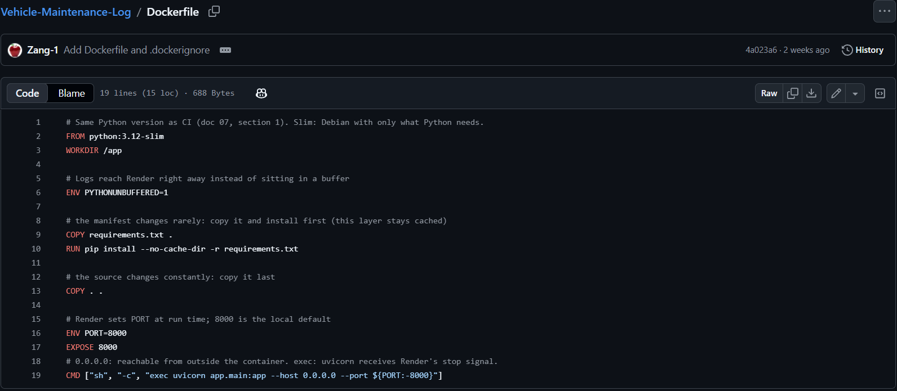
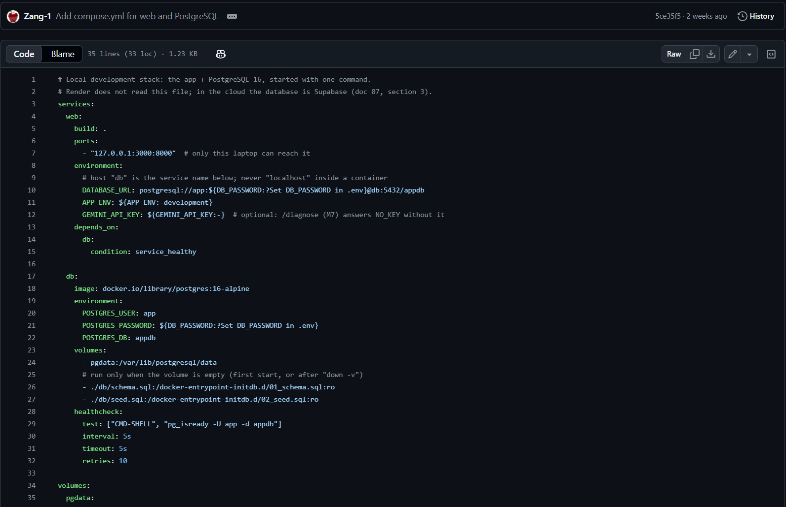
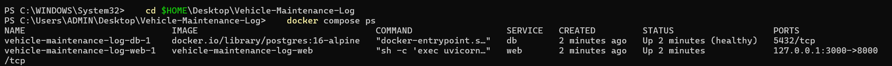
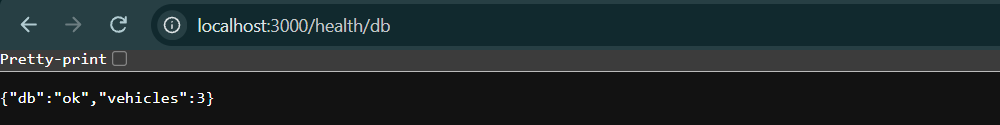
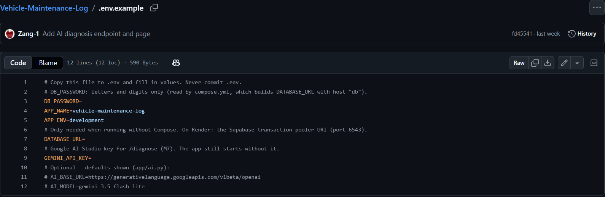
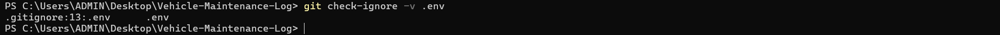

# Report — Nguyễn Nam Khoa (Sections 3 and 7)

Sections 3 and 7 (first part) of the final report for course 72ITDS30103 – Software Development Platforms.

---

## 3. Dockerfile and Compose explained

### 3.1 Goal

The application has to run the same way in three places: on a developer laptop, in the GitHub Actions `check` job, and in the container on Render. We therefore package it as one Docker image built from a single `Dockerfile`, and use `compose.yml` to start the web application and a local database with one command:

```bash
git clone https://github.com/Zang-1/Vehicle-Maintenance-Log.git
cd Vehicle-Maintenance-Log
cp .env.example .env          # set DB_PASSWORD
docker compose up --build     # or: podman compose up --build
                              # then open http://localhost:3000
```

The team plan uses Podman because it is free and needs no background daemon. The `Dockerfile` and `compose.yml` use the standard formats, so they run unchanged with either Podman or Docker. The screenshots in this section were taken with Docker Desktop on Windows.

### 3.2 The Dockerfile

The file has 19 lines. Each instruction is there for a reason:

| Instruction | What it does | Why we chose it |
|---|---|---|
| `FROM python:3.12-slim` | Starts from the official Python 3.12 image, slim variant | Same Python version as the CI job, so "green in CI, broken in the image" cannot happen because of a version mismatch. Slim is Debian with only what Python needs, so builds and deploys are faster |
| `WORKDIR /app` | Sets the working directory inside the container | All later commands run in `/app` |
| `ENV PYTHONUNBUFFERED=1` | Turns off Python's output buffering | Logs reach Render immediately instead of sitting in a buffer, which matters when we read logs during a failed deploy |
| `COPY requirements.txt .` then `RUN pip install --no-cache-dir -r requirements.txt` | Installs the libraries before any application code is copied | The manifest changes rarely, so Docker reuses this cached layer on most rebuilds. `--no-cache-dir` keeps pip's download cache out of the image |
| `COPY . .` | Copies the source code last | The source changes constantly, so it comes after the install layer. `.dockerignore` keeps secret files out of this step |
| `ENV PORT=8000` and `EXPOSE 8000` | Sets the default port and documents it | Render sets `PORT` at run time and overrides this value. 8000 is the local default |
| `CMD ["sh", "-c", "exec uvicorn app.main:app --host 0.0.0.0 --port ${PORT:-8000}"]` | Starts the FastAPI application with Uvicorn | `0.0.0.0` makes the server reachable from outside the container. The `sh -c` wrapper lets the shell expand `${PORT:-8000}`. `exec` makes Uvicorn the main process, so it receives Render's stop signal and shuts down cleanly |

**`.dockerignore`** excludes `.env` and `.env.*`, together with files the application does not need at run time. It has two purposes: a smaller image, and, more important, making sure that a file holding secrets can never be copied into an image.



*Figure 3.2: The `Dockerfile` in the repository (19 lines).*

### 3.3 Compose

`compose.yml` defines two services and one named volume, `pgdata`.

| Service | Image | Role | Key settings |
|---|---|---|---|
| `db` | `postgres:16-alpine` | Local PostgreSQL, standing in for Supabase during development | User `app`, database `appdb`, password from `DB_PASSWORD`. The data directory is the volume `pgdata`, so data survives a restart. `db/schema.sql` and `db/seed.sql` are mounted read-only into `/docker-entrypoint-initdb.d/`, so PostgreSQL runs them automatically on the first start. A `healthcheck` runs `pg_isready` every 5 seconds, up to 10 retries |
| `web` | Built from our `Dockerfile` (`build: .`) | The FastAPI application | Published as `127.0.0.1:3000:8000`, so only the laptop itself can reach it. `DATABASE_URL` is assembled as `postgresql://app:<DB_PASSWORD>@db:5432/appdb`. `depends_on` with `condition: service_healthy` makes it wait for the database |

Four details matter in practice:
- **Host name `db`.** Inside a container, `localhost` means the container itself. The web service reaches the database through the service name `db` on the Compose network.
- **Health check before start.** If the web container started before PostgreSQL was ready, its first connection would fail. Waiting for a healthy database makes the first `up` work reliably.
- **Fail fast on a missing password.** `${DB_PASSWORD:?Set DB_PASSWORD in .env}` stops Compose with a clear message when `.env` is missing, instead of starting a database with an empty password.
- **Initial data loads once.** PostgreSQL runs the scripts in `docker-entrypoint-initdb.d` only when the volume is empty, which is the first start or after `podman compose down -v`. The data stays between normal restarts.

The Gemini key is optional: `GEMINI_API_KEY` defaults to empty, so the application still starts and `/diagnose` answers `NO_KEY`.



*Figure 3.3: `compose.yml` with the `web` and `db` services (35 lines).*

### 3.4 Local versus cloud

| | Local (Compose) | Cloud (Render) |
|---|---|---|
| Database | Container `db` (PostgreSQL 16), host `db`, port 5432, no pooler | Supabase through the transaction pooler on port 6543 |
| Network | App on `127.0.0.1:3000` (container port 8000) | Render assigns `$PORT` and puts HTTPS in front |
| Configuration | Read from `.env` | Set in the Render Environment |
| Image | Built from our `Dockerfile` | Built from the same `Dockerfile` at the merged commit |

Render does not read `compose.yml`. Only the configuration changes: the image and the code are identical, which is why a problem reproduced locally is usually the same problem on Render.

### 3.5 Proof: a clean clone

The Brief asks for the stack to start with one command on a machine that has never seen the project. We tested this by cloning the repository into a new folder and following only the steps in the README, then checked:

- `http://localhost:3000/health` returns 200;
- `http://localhost:3000/health/db` returns `{"db":"ok","vehicles":3}`, which shows the sample data was loaded;
- the Dashboard page shows the sample vehicles and maintenance data.



*Figure 3.5a: `docker compose ps` after a clean clone: `db` is healthy and `web` is published on `127.0.0.1:3000`.*


*Figure 3.5b: `/health/db` returns `{"db":"ok","vehicles":3}`, so the sample data was loaded.*

**A rule we adopted.** `DB_PASSWORD` may contain only letters and digits. Compose places it inside the `DATABASE_URL` connection string, and characters such as `@`, `:` or `/` would be read as part of the URL and break the connection. `.env.example` states this rule next to the variable, because a strict rule is cheaper than debugging an unreadable error on someone else's machine.

---

## 7. Secret and configuration management (first part)

*Giang continues with the secrets on Render and GitHub Actions, the Git history audit, and the steps taken after a leak.*

### 7.1 Principle

Configuration and secrets never live in the code. The code reads values from environment variables, and the real values are kept outside the repository, different for each environment. The same image therefore runs locally and in production without any change to the code.

### 7.2 Configuration variables

| Variable | Secret? | Local | Render | GitHub Actions |
|---|---|---|---|---|
| `APP_ENV` | No | `.env`, default `development` | Environment (`APP_ENV=production`) | Not needed |
| `PORT` | No | Default 8000 | Set by Render, never overridden | Not needed |
| `DB_PASSWORD` | Yes | `.env` (letters and digits only) | Not used | Not needed |
| `DATABASE_URL` | **Yes** | Assembled by Compose (host `db`) | Environment: Supabase transaction pooler, port 6543 | Dummy value in `tests/conftest.py` |
| `GEMINI_API_KEY` | **Yes** | `.env` (optional) | Environment | Not needed (tests mock the AI call) |
| `AI_BASE_URL`, `AI_MODEL` | No | Optional, defaults in `app/ai.py` | Optional | Not needed |
| `RENDER_DEPLOY_HOOK` | **Yes** | Not present | Not present | Repository secret |

### 7.3 How it works locally

1. **`.env.example`** is committed. It lists the name of every variable but no secret value, and its first line reads "Never commit .env". A new team member knows exactly what to fill in.
2. The developer runs `cp .env.example .env` and enters the real values in `.env`.
3. **`.env` and `.env.*` are listed in `.gitignore`**, so `git add` cannot stage them.
4. **They are also listed in `.dockerignore`**, so they are never copied into the image. Without this line, the secrets would sit inside the image and leak with it.
5. `compose.yml` reads `.env` and passes the values to the containers at **run time**, through `${...}` substitution. Nothing is written into the image at **build time**.



*Figure 7.3a: `.env.example` lists variable names only, with no secret values.*


*Figure 7.3b: `git check-ignore -v .env` shows that line 13 of `.gitignore` blocks `.env`.*

### 7.4 Why we did it this way

- **Configuration is separate from code.** Changing the database or rotating a key does not need a code change or a new build.
- **Two barriers for two leak routes.** `.gitignore` stops secrets entering the repository, and `.dockerignore` stops them entering the image. Each file protects a different route, so we need both.
- **Tests need no secrets.** CI uses a dummy `DATABASE_URL` and mocks the Gemini call, so the pipeline passes without holding any real secret.

### 7.5 Team rules

- Never commit `.env`, a key or a connection string anywhere, **including screenshots and group chat messages**.
- Before attaching an image to an Issue or pull request, check it for connection strings and keys.
- Every new variable must have its name added to `.env.example` in the same pull request.

---

## Appendix E - AI-use declaration (Khoa's part, draft)

> **Ghi chú cho Khoa (xóa khi ghép report):**
> - Chỗ nào còn trong ngoặc vuông `[...]` là chỗ chỉ Khoa biết, phải tự điền đúng thực tế: tên model, cột **Gen. / Assist.** và file minh chứng.
> - **Generated** = giữ nguyên hoặc gần nguyên kết quả AI. **Assisted** = Khoa tự viết hoặc viết lại đáng kể, AI chỉ gợi ý, giải thích, sửa lỗi.
> - Giới hạn của thầy tính trên **toàn bài của cả nhóm**: AI-generated ≤ 30%, AI-assisted ≤ 50%. Phần D cả nhóm ước tính chung, số của Khoa ở dưới chỉ là phần đóng góp vào con số chung.
> - Các PR #10, #11 (wireframe, UI design), #23, #25, #26 (loại dịch vụ, trang chi phí): nếu có dùng AI thì thêm dòng vào bảng C; nếu không thì giữ nguyên.
> - Thầy hỏi vấn đáp từ cột "How you checked and changed it", nên chỉ giữ những gì Khoa thật sự đã làm và giải thích được.

**B. AI tools used**

| # | Tool and model / version | Plan | Used by | Period of use |
|---|---|---|---|---|
| 3 | Claude (Anthropic, claude.ai), model [model name shown in the app] | [free / paid] | Nguyễn Nam Khoa | November 2026 |

**C. Use log (Khoa)**

| # | Artefact | Member | Tool | What the AI produced or explained | Gen. / Assist. | How you checked and changed it | Evidence |
|---|---|---|---|---|---|---|---|
| 1 | Choosing a vehicle when asking the AI (FR-18): `app/ai.py`, `app/routers/diagnose.py`, `app/schemas.py`, `app/static/diagnose.js`, `app/templates/diagnose.html`, `tests/test_diagnose.py` (PR #33) | Khoa | Claude | Explained the existing diagnosis code and guided the change step by step: the `vehicle_id` field in `DiagnoseIn`, putting the vehicle's details into the prompt, the vehicle select box, and the tests for a vehicle that belongs to another user | [Generated / Assisted] | Ran the test suite (`tests/test_diagnose.py`); tried the page with and without a vehicle selected; the `check` job passed and another member reviewed the PR | E-7; E-8 (PR #33) |
| 2 | The "Thêm" menu page for phones: `app/templates/them.html`, route in `app/routers/pages.py`, CSS (PR #34) | Khoa | Claude | Guided the template, the route and the styles, following the existing pages | [Generated / Assisted] | Opened the page at phone width and followed every link; `tests/test_dashboard.py` passed; reviewed by another member | E-7; E-8 (PR #34) |
| 3 | Reminder form S07 (create and edit): `app/templates/reminder_form.html`, `app/static/reminder_form.js`, `app/routers/pages.py` (PR #35, #36) | Khoa | Claude | Guided the form and the JavaScript that calls Lâm's reminders API; helped find why the page returned to the wrong tab after saving | [Generated / Assisted] | Created, edited and saved reminders in the browser; fixed the tab name in a follow-up PR (#36); reviewed by another member | E-7; E-8 (PR #35, #36) |
| 4 | Date range filter on the Costs page (FR-17): `app/routers/stats.py`, `app/static/costs.js`, `app/templates/costs.html`, `tests/test_costs.py` (PR #37) | Khoa | Claude | Guided the `from` / `to` query parameters, the two date inputs and the tests; explained the ruff import error that failed CI | [Generated / Assisted] | Ran `tests/test_costs.py`; fixed the import order after the `check` job went red; tried several date ranges on the page | E-7; E-8 (PR #37) |
| 5 | Report §3 and the first part of §7, and this declaration (`docs/report/khoa.md`, PR #39) | Khoa | Claude | Helped outline, translate into English and format the text; drafted this declaration from the commit history | [Generated / Assisted] | Checked every statement against `Dockerfile`, `compose.yml`, `.env.example`, `.gitignore` and `.dockerignore`; took the screenshots on my own machine after a clean clone | E-7; E-8 (PR #39); E-9 |

**D. Estimated share (Khoa's contribution to the team figures)**

Counted with `git log --no-merges --numstat` per author on 10 November (lines added; `.mailmap` joins the names):

| Part of the submission | Khoa's lines added | Team total | Khoa's share |
|---|---|---|---|
| Application code (`app/`, `tests/`) | 1,867 | 9,286 | 20% |
| Written report (`docs/report/khoa.md`) | 139 | [team total after merging] | [..%] |

Khoa's rows therefore add at most 20 percentage points to the application-code figure, and only the rows marked *Generated* count towards the 30% limit. The whole-submission figures are estimated by the team together in Part D of the merged report.

**E. Evidence** (numbered after Lâm's E-4 to E-6)

| Item | Link, file name or screenshot | What it shows |
|---|---|---|
| E-7 | [Shared-chat links or exported transcript of Khoa's Claude conversations, keys and connection strings removed] | Prompts and responses for rows 1-5 |
| E-8 | Pull requests on GitHub: https://github.com/Zang-1/Vehicle-Maintenance-Log/pulls?q=is%3Apr+author%3Anamkhoa306 (PR #33, #34, #35, #36, #37, #39) | Code, commit history and reviews |
| E-9 | Folder `docs/report/img/` (`fig-3-*`, `fig-7-*`) | The screenshots in row 5, taken by Khoa |
