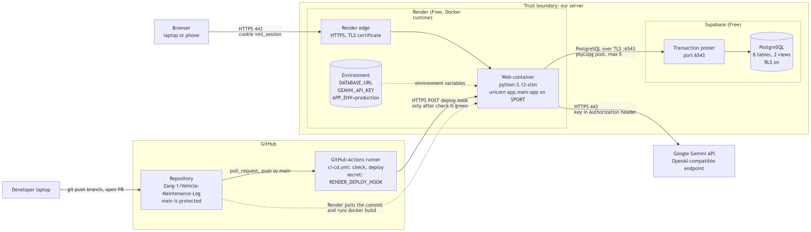
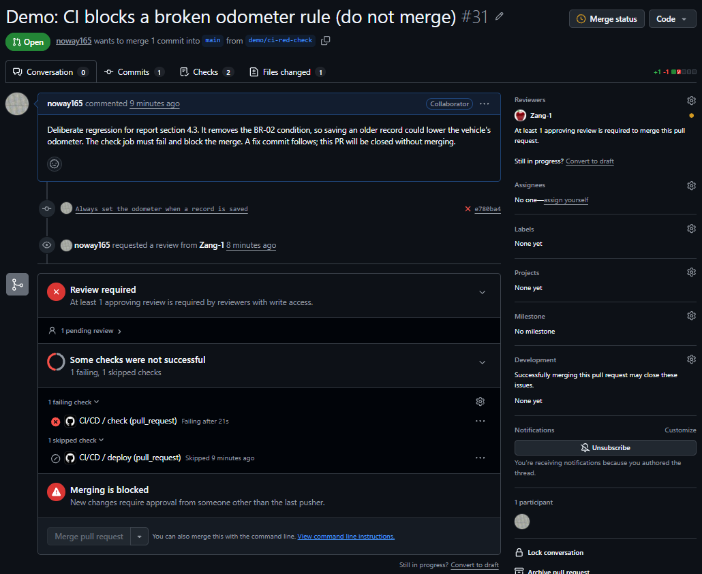
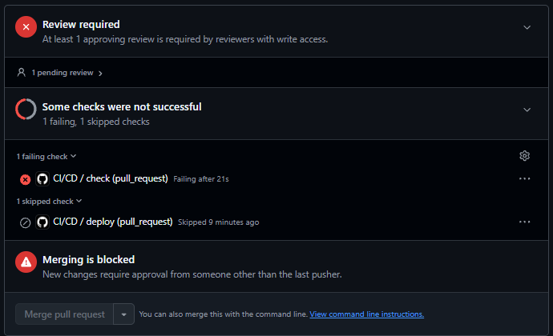
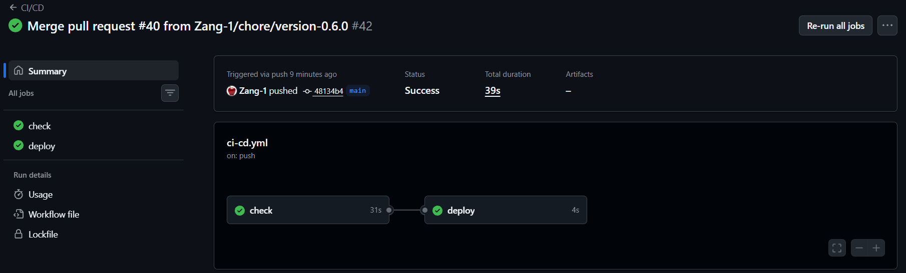
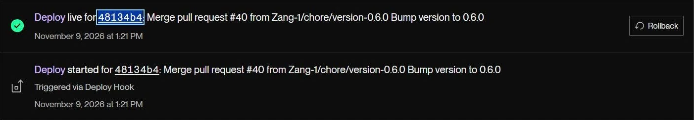
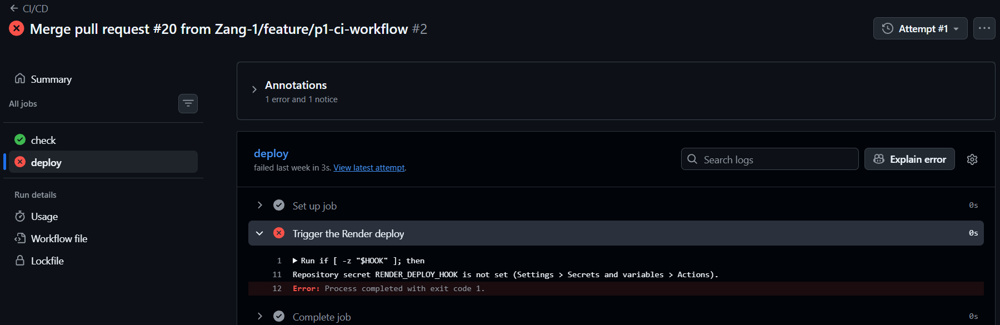
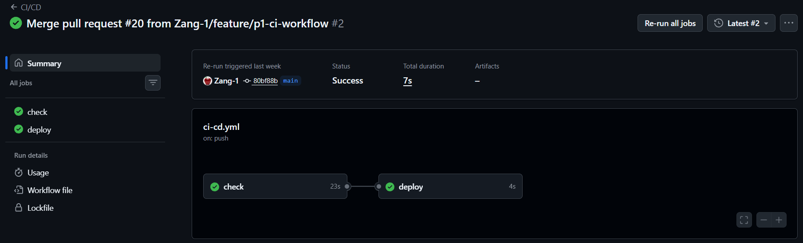
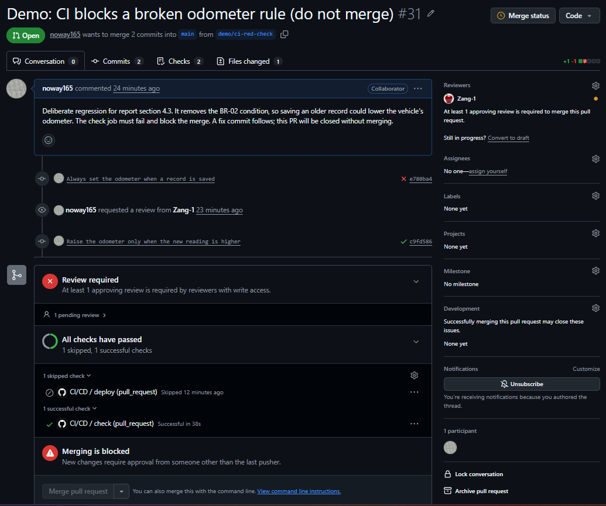

# Report — phần của Tăng Thoại Lâm (mục 1, 2, 4)

Bản nháp để dán vào `72ITDS30103_SDPs_Final_Report_Template.docx`. Viết bằng tiếng Anh như file mẫu.

**Trước khi dán:**
- Che mọi key, connection string, URL Deploy Hook.
- Nhờ Giang xác nhận Auto-Deploy đang **tắt** (Render Events chỉ có deploy qua hook, khớp với tắt).
- Phụ lục B: dán nguyên file `.github/workflows/ci-cd.yml`.

---

## 1. Platform selection rationale

We picked platforms that are easy to deploy and easy for a three-person student team to use. Render is also covered in this course, so we could apply directly what we learned.

| Component | Chosen | Chosen over | Why | What it costs us |
|---|---|---|---|---|
| Cloud PaaS | Render Web Service, Free, Docker runtime | Railway, Fly.io | Easy to deploy and use, and taught in this course. We had not had the chance to try or study the alternatives, so Render was the safer decision | The service goes to sleep when unused (after 15 minutes), so the first request is slow and scheduled jobs cannot run |
| Database | Supabase PostgreSQL, Free | Neon | We had already had several chances to work with Supabase, so it was easier to get started | The project pauses after a week without use. 500 MB limit |
| AI API | Google Gemini API, free tier | ChatGPT (OpenAI API) and other providers | The API key is easy to get and the service is reliable. Our earlier projects used a Gemini API key, and we had not tried switching to ChatGPT or another provider | Rate limits, so a demo can hit a 429 |
| CI / deploy | GitHub Actions + Render Deploy Hook | Render Auto-Deploy | A change is deployed only after it passes the checks, instead of everything that is pushed going live | One more secret to manage (the hook URL). There is no registry: Render builds the image itself |

**Cost.** Free for our team. If a company used this stack, we would move to paid plans instead of the free tiers, so the services do not sleep or pause.

**Portability and lock-in.** If we left Render, we would need another host that can run our Dockerfile. If we left Supabase, we would move to Neon, because it also uses SQL. Firebase uses NoSQL, which would be harder for the team and take much more time to rebuild.

**Licensing.** Our main dependencies are open source: Python (PSF), FastAPI (MIT), Uvicorn and Jinja2 (BSD-3-Clause), PostgreSQL (PostgreSQL Licence), psycopg (LGPL-3.0).

**What the free tiers cost us in practice.** Render and Supabase go to sleep when they are not used for too long. Our workaround is to start them early, before the demo.

---

## 2. System architecture

### 2.1 Deployed components



**Trust boundary.** A change goes from a laptop to a pull request on GitHub, GitHub Actions checks it, and after the merge it reaches the web container on Render. When the site is used, the container reads and writes Supabase and calls the Gemini API. The Gemini API key is stored in Render's environment variables. Locally it stays in `.env`, which `.gitignore` keeps out of Git. The browser never sees the key, because only our server calls Gemini: the browser only talks to our own URL.

| Component | Where it runs | Reached by | Notes |
|---|---|---|---|
| Web / API application | Render Free, one container from our `Dockerfile` (`python:3.12-slim`, uvicorn) | HTTPS 443 to `vehicle-maintenance-log.onrender.com`; Render's edge forwards to `$PORT` | Serves HTML pages and the JSON API. Holds no state |
| Database | Supabase PostgreSQL, Free | Container only: PostgreSQL over TLS, pooler port 6543, credentials in `DATABASE_URL` | Eight tables, two views. Sessions live here, so users stay signed in across redeploys |
| AI API | Google Gemini | Container only: HTTPS 443, 15 s timeout | Called only from `app/ai.py` |
| CI/CD | GitHub Actions, `ubuntu-latest` | Started by pull requests and pushes to `main` | `check`, then `deploy` calls the Deploy Hook |
| Image build | Render's builder | Started by the Deploy Hook | No registry: built from the `Dockerfile` at the latest commit of `main` |

Inside the container: Jinja2 templates and `fetch` scripts (presentation), one FastAPI router per module with Pydantic validation (logic), and `app/db.py`, the only connection pool (data). Section 3 explains how the local stack differs.

### 2.2 One request, end to end: saving a maintenance visit

1. The user fills in the form and presses Lưu. `record_form.js` sends the data to our server with `POST /api/vehicles/1/records`, over HTTPS, with the sign-in cookie.
2. The server checks that the user is signed in (401 if not) and that the input is valid (422 if not).
3. The server checks that the vehicle exists and belongs to this user (404 if not), and that it is not archived (409 `VEHICLE_ARCHIVED` if it is).
4. It checks for other errors: every service type must exist and be active (422 if not).
5. If there is no error, it adds the record and its items to the database, raises the vehicle odometer if the new reading is higher, and saves everything in one transaction. If a step fails, nothing is saved. The same date and odometer twice is refused (409).
6. The server reads the saved record back and answers 201. The page opens the new record and shows that it was saved.

---

## 4. CI/CD pipeline walkthrough

### 4.1 The workflow

`.github/workflows/ci-cd.yml` has two jobs (full file in Appendix B).

```yaml
on:
  pull_request:
  push:
    branches: [main]
jobs:
  check:
    steps:                                      # after checkout, Python 3.12 and install
      - run: python -m compileall -q app tests  # 1. syntax
      - run: ruff check .                       # 2. lint
      - run: pytest -q                          # 3. tests, no database, no AI key
      - run: docker build -t vehicle-maintenance-log:ci .  # 4. image builds
  deploy:
    needs: check                                # never runs if check is red
    if: github.event_name == 'push' && github.ref == 'refs/heads/main'
    steps:
      - run: curl -fsS -X POST "$HOOK" > /dev/null  # fails first if the secret is missing
```

The `check` job sets up Python, installs the dependencies, compiles the Python files, runs the `ruff` lint, runs the tests, and builds the image to make sure the Dockerfile still works. The `deploy` job runs only after `check` has passed: it checks that the hook secret is set on GitHub, then tells Render to build.

| Job (step) | Runs on | What it checks | What it blocks |
|---|---|---|---|
| lint (`compileall`, `ruff`) | Every pull request and push to `main` | Syntax, unused imports, undefined names | Code that does not compile or hides such a bug |
| test (`pytest`) | Same | 155 tests: API routes, validation, isolation between users, AI failures | A broken business rule, or one user reaching another's data |
| build (`docker build`) | Same | The `Dockerfile` still builds | A broken image reaching Render |
| deploy | Push to `main`, after a green `check` | The secret exists, then calls the hook | A red commit reaching production; Auto-Deploy is off, so the hook is the only way in |

The tests replace the database with `tests/fakedb.py` and mock the AI call, so CI never holds the database password or the Gemini key.

`main` accepts changes only through a pull request with one approval from someone other than the last pusher, and a green `check`, set as a required status check.

### 4.2 What happens on a merge to main

Measured on PR #40 (9 November, run `42572466362`), which changed `APP_VERSION` to 0.6.0, so `/api/info` shows when the new code is live:

| Step | Time (UTC) | Duration |
|---|---|---|
| Merge | 06:20:44 | |
| `check` | 06:20:49 to 06:21:20 | 31 s |
| `deploy` calls the hook | 06:21:22 to 06:21:26 | 4 s |
| Render builds and switches | `/api/info` said 0.5.0 at 06:21:42, 0.6.0 at 06:21:54 | under 30 s |

The image that goes live is built on Render. A change is live about one minute after the merge. This deploy changed only source code, so Docker reused the dependency layer; a change to `requirements.txt` takes longer. Figures 4.2a and 4.2b (Appendix B) show the run and the Render deploy.

### 4.3 Evidence that the pipeline blocks

**A staged red check.** No real pull request had failed by 4 November, so we staged one. PR #31 removes `AND current_odometer < %(odometer)s` from the odometer update, which breaks BR-02: saving an older visit would lower the odometer.

```
FAILED tests/test_records.py::test_create_record_saves_record_items_and_raises_the_odometer
1 failed, 148 passed
```

The `check` job (run `41853983479`) failed at the `Test` step after 21 s. Lint had passed: the code was valid, only the rule was wrong. Merging was blocked. Commit `c9fd586` restored the condition and `check` turned green (Figure 4.3d, Appendix B). The pull request was closed without merging.



**The deploy gate failed closed.** The first run on `main` (PR #20, 1 November, run `41320852255`) had a green `check` and a red `deploy`, with `Repository secret RENDER_DEPLOY_HOOK is not set`. The job stopped instead of skipping silently, so a merge could not look deployed when it was not. After the secret was added, attempt 2 was green (Figures 4.3a and 4.3b, Appendix B).

### 4.4 Secrets the pipeline needs

| Secret | Used by | Stored in |
|---|---|---|
| `RENDER_DEPLOY_HOOK` | Job `deploy` only | GitHub Actions repository secrets |
| `DATABASE_URL`, `GEMINI_API_KEY` | Not used by CI | Render Environment only |

The hook URL is a secret because anyone holding it can trigger a deploy. Section 7 describes the time it leaked. Forks get no secrets, and `deploy` never runs for a pull request.

---

<!-- appendices: not counted in the 12 pages -->

## Appendix B — CI/CD evidence (sau file workflow)













---

## Appendix E — AI-use declaration (phần của Lâm, bản nháp)

**B. Các công cụ AI đã sử dụng**

| # | Công cụ và mô hình / phiên bản | Gói sử dụng | Người sử dụng | Thời gian sử dụng |
|---|---|---|---|---|
| 1 | Claude Code (Anthropic), mô hình Claude Opus 5.5 | Trả phí | Tăng Thoại Lâm | Tháng 10 – Tháng 11 năm 2026 |

**C. Nhật ký sử dụng AI (Lâm)**

| # | Sản phẩm / Thành phần thực hiện | Thành viên | Công cụ | AI đã tạo ra hoặc giải thích những gì | Tạo mới / Hỗ trợ | Cách bạn kiểm tra và chỉnh sửa | Minh chứng |
|---|---|---|---|---|---|---|---|
| 1 | API và tab nhắc lịch: `app/routers/reminders.py`, `ReminderIn`, `ReminderDetailOut`, `app/static/vehicle_reminders.js`, `tests/test_reminders.py` (PR #29) | Lâm | Claude Code | Viết mã nguồn và 19 bài kiểm thử theo yêu cầu phân công của nhóm | Được tạo bởi AI | Chạy 48 kiểm tra trên PostgreSQL thật (gồm tách dữ liệu hai người dùng), 149 bài kiểm thử, thử tab trên trình duyệt; thành viên khác review PR. Lâm tự thử thêm, sửa, tạm dừng, xóa nhắc lịch và lỗi đã có loại bảo dưỡng này, đều đạt | E-4; E-5 (PR #29) |
| 2 | Workflow `.github/workflows/ci-cd.yml` (PR #20) | Lâm | Claude Code | Viết job `check` và `deploy` | Được tạo bởi AI | Lần chạy đầu `deploy` đỏ vì thiếu secret, thêm secret rồi chạy lại xanh. Lâm xem và thử CI trên GitHub, cả trường hợp đỏ và xanh | E-5 (PR #20) |
| 3 | Module xe và bảo dưỡng: `app/routers/vehicles.py`, `app/routers/records.py`, các trang và test (PR #21, #22) | Lâm | Claude Code | Viết mã nguồn và kiểm thử | Được tạo bởi AI | Lâm tự thử các chức năng và lỗi xe đã lưu trữ, đều đạt | E-5 (PR #21, #22) |
| 4 | Tài liệu 02, 03, 07 (PR #4) | Lâm | Claude Code | Viết nội dung tài liệu | Được tạo bởi AI | Lâm tự kiểm tra lại nội dung. | E-5 (PR #4) |
| 5 | PR minh họa check đỏ (#31) | Lâm | Claude Code | Đề xuất cách minh họa, viết commit gây lỗi BR-02 và commit sửa | Được tạo bởi AI | Xem check đỏ và merge bị khóa trên GitHub, sau đó đóng PR không merge | E-4; E-5 (PR #31) |
| 6a | Báo cáo §1, §2.2, đoạn Trust boundary của §2.1 và đoạn mô tả hai job ở §4.1 (`docs/report/lam.md`) | Lâm | Claude Code | Đặt câu hỏi gợi ý; chuyển câu trả lời của Lâm sang tiếng Anh, định dạng, chỉ ra và sửa chỗ sai kỹ thuật, bổ sung bước đăng nhập và kiểm tra dữ liệu; bổ sung danh sách license | Được hỗ trợ | Lâm tự trả lời lý do chọn nền tảng, hướng chuyển đổi và tự kể lại các bước của `create_record` và của hai job CI; đối chiếu với tài liệu 08 và mã nguồn | E-4; E-5 |
| 6b | Báo cáo §2.1 (sơ đồ, bảng thành phần), phần còn lại của §4 (`docs/report/lam.md`, PR #32, #41, #43, #44) | Lâm | Claude Code | Soạn nội dung từ mã nguồn, lịch sử CI; đo thời gian deploy | Được tạo bởi AI | Claude đối chiếu với `ci-cd.yml`, GitHub API và `/api/info`; thành viên khác rà soát và yêu cầu rút gọn. Lâm tự kiểm tra lại nội dung. | E-4; E-5 |
| 7 | Hình 2.1, 4.1, 4.2a, 4.2b, 4.3a–d | Lâm | Claude Code | Tạo trang xuất sơ đồ 2.1 từ Mermaid; cắt ảnh chụp màn hình | Được hỗ trợ | Ảnh do thành viên chụp từ GitHub và Render; kiểm tra không lộ key hay URL hook | E-6 |

**E. Minh chứng** (đánh số tiếp sau E-1 đến E-3 của Giang)

| Mục | Link, tên file hoặc ảnh chụp | Nội dung thể hiện |
|---|---|---|
| E-4 | Transcript phiên Claude Code của đồ án [tên file sau khi xuất] | Câu lệnh và phản hồi cho các dòng 1, 5, 6, 7 |
| E-5 | Các pull request trên GitHub: https://github.com/Zang-1/Vehicle-Maintenance-Log/pulls?q=is%3Apr+author%3Anoway165 | Mã nguồn, lịch sử commit và review |
| E-6 | Thư mục `docs/report/img/` (`fig-2-1-*`, `fig-4-*`) | Các hình ở dòng 7 |
